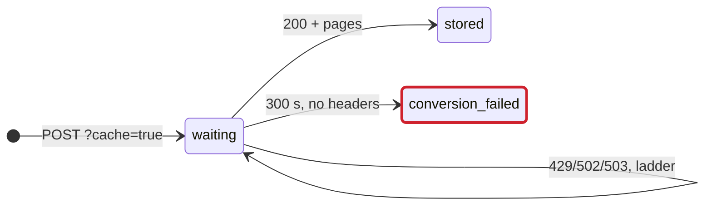
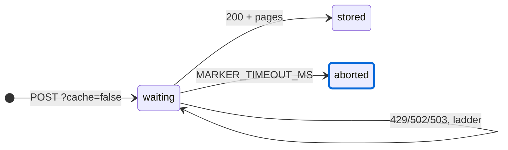

# Writing PR descriptions

`.github/pull_request_template.md` is the shape: keep its three headings (What and why, How it was tested, Checklist) and replace its comments. For tone, read one recent PR first: `gh pr view 80` (a fix with tests) or `gh pr view 82` (docs only).

## Title

A plain sentence that says what changes, like a commit subject (CONTRIBUTING.md): "Accept dataset and catalog ids whose slash the ingress decoded". A PR that only proposes ADRs starts with "Propose".

## What and why

Write it as short bullets a reviewer takes in at a glance, never paragraphs:

- **Why** first: one or two bullets with the bug as someone met it, the issue, or the requirement.
- **What changes** next: one fact per bullet, in plain words, at most about 12 words a bullet. When several parts change, group the bullets under a bold lead-in per part (`**Server**`, `**Settings**`, `**Docs**`), three to six bullets each. Name the concrete things (routes, settings, env vars, files) and every ADR, doc and i18n catalogue the PR touches.
- **Depth** a reviewer may want to check (exact numbers, quotes from docs, the mechanism, decisions a reviewer will ask about) goes after the bullets in a collapsed `<details>` block titled "More background", itself in short bullets. The bullets above must stand without it.
- Link the issue: `Closes #41` when the merge finishes it, `Part of #41` when its acceptance criteria need work after the merge, such as a deploy, checks on Azure or a timed restore. A merge closes an issue its PR says `Closes` to, before that work is done.
- Hold scope. Work that belongs elsewhere gets its own PR and a last bullet: "Not in this PR: ...".
- After later pushes, rewrite the section so it describes the PR as it stands.

For #127:

```markdown
- Marker conversions longer than five minutes failed with `UND_ERR_HEADERS_TIMEOUT` (#127)

**Marker client**

- Waits `MARKER_TIMEOUT_MS` for the headers and the body
- Asks the host to keep nothing (`cache=false`)
- A timeout is a `MarkerFailed`, so the ladder retries it

<details>
<summary>More background</summary>

- Global `fetch` gives up on headers after 300 s (undici's `headersTimeout`)
- The error was a `TypeError`, so nothing retried it

</details>

Closes #127
```

The diff carries the how. Explanations, mental models and reference tables belong in code, docs or an ADR, where they outlive the PR. The exception is a diagram, see below: it shows the reviewer the change faster than prose and replaces paragraphs rather than adding to them.

## Diagrams

When the PR changes how something behaves over time or across parts, show it as a before/after diagram under the end-state paragraph, in What and why. GitHub draws Mermaid code blocks; raw SVG is stripped. A PR that only renames, restyles or edits docs gets none.

Pick the kind by what changes:

- **Statechart** (`stateDiagram-v2`) for a lifecycle: a job, run, document, request, secret or connection that moves through states, and retries, timeouts, leases, deletes and purges. Label each transition with its trigger (`300 s, no headers`, `429 → ladder`).
- **Sequence diagram** (`sequenceDiagram`) for a call across parts (client, API, worker, outside host), with the waits as notes.
- **Flowchart** (`flowchart LR`) for structure: which package, role or table reaches which, with the moved boundary as a `subgraph`.

Rules:

- Before and after side by side as two diagrams under `**Before**` and `**After**`, or one diagram with what changed marked. Keep each to about ten nodes; a reviewer reads it in seconds.
- Mark what the PR changes with `classDef changed stroke:#0969da,stroke-width:3px` and what fails or loses data with `classDef broken stroke:#cf222e,stroke-width:3px`. Set stroke only, never `fill` or `color`: GitHub themes Mermaid per reader, and a fixed fill breaks dark mode.
- Name things as the code does (`markerConverter`, `conversion_failed`, `UND_ERR_HEADERS_TIMEOUT`, `MARKER_TIMEOUT_MS`), never "Component A".
- A block that does not parse shows on GitHub as an error box. Before posting, write each block to a `.mmd` file in a scratch directory outside the repository and draw it with `npx -y -p @mermaid-js/mermaid-cli mmdc -q -i <file>.mmd -o <file>.png -s 2 -b white`, then read the PNG: it must parse, read left to right without crossed labels, and show the marked outlines. After `gh pr create` or `gh pr edit`, open the PR in a browser you can drive, such as the agent-browser CLI, and take a screenshot of each diagram (`agent-browser screenshot <dir>/diagram.png`, then read the PNG). Fix the block and edit the body again if it shows an error.

For #127, a request that waits for Marker:

````markdown
**Before**



**After**


````

## How it was tested

- The commands you ran and what they gave: "`npm run check` (446 files, 4606 tests pass)", `npx vitest run <paths>`.
- The new tests by name, in quotes, since each name states a rule.
- What shows the change does something: how many tests fail with it switched off, or how the bug was reproduced first (a probe against genki-test, the route that answered 404).
- Checks by hand, and in which environment.
- For a change to the portal, console, workspace or System Atlas, a short numbered list a reviewer can follow after `npm start`: the app and port, the test person to log in as, what to do, what to see, and how it differs from main or genki-test. Ports are in `docs/development.md`, test persons in `apps/api/config/local/identity.yaml`.

## Checklist

Keep every line of the template. Tick a line when it holds or does not apply. Tick "`npm run check` passes" only after running it, with `(docs only)` when only docs changed. A line that does not hold stays unticked, with the reason under the list.

## Screenshots

For a visible UI change you exercised in the browser, add collapsed sections at the end of What and why, before How it was tested. Default to two or three stills, before and after. Record a video only when stills cannot carry it: several steps, a drag or reorder, a transition.

Capture with a browser you can drive, such as the agent-browser CLI (`agent-browser skills get core` for usage): `agent-browser screenshot <dir>/after.png` for a still, `agent-browser record start <dir>/walkthrough.webm` and `agent-browser record stop` around a walkthrough (`--cursor` shows the pointer in drags). Take them on a stack of your own: `npm start`, or a second copy on other ports as under "Other ports" in `docs/development.md` when another stack already runs, so you never wait for or stop someone else's. Log in with the mock login, so no token, `.env.local` value or real person from Ansattporten is in the frame. Keep the files outside the repository.

`gh pr create` and `gh pr edit` upload a file with `--attach <path>`, repeated per file (up to 50). Older gh versions lack the flag: check `gh pr edit --help`. Text after `#` is the alt text: `--attach '<dir>/after.png#After: the run shows the error'`. A reference to that path already in the body is rewritten in place to the uploaded file and keeps the alt text written there; an attachment the body does not reference is appended at the end. So write the body with the paths, in your own layout. A video has no alt text and renders as a player: put its path on a line of its own.

```html
<details>
<summary>:camera_with_flash: Screenshots</summary>

**Before:** a failed pipeline run shows only its status


**After:** the run shows the error and the document it stopped at


</details>

<details>
<summary>:movie_camera: Walkthrough</summary>

<dir>/walkthrough.webm

</details>
```

```bash
gh pr edit --body-file <body.md> \
  --attach '<dir>/before.png#Before: the failed run with its status only' \
  --attach '<dir>/after.png#After: the failed run with the error and the document' \
  --attach <dir>/walkthrough.webm
```

Paths in a `--body-file` resolve against its directory first, then the working directory, so use absolute paths. A non-zero exit means some uploads failed: the PR is still created or updated with the rest, and the failed local paths stay in the body. Read the body back with `gh pr view` and fix those, and move a video that was appended at the end instead of rewritten in place, before review.

## Style

- English, plain sentences, present tense.
- No em-dashes. Use a comma, a colon or a new sentence.
- Each paragraph and bullet on one line; GitHub wraps it.
- People by role ("a new team member"), not by name.

## Finally

Hand over the title and the body, ready to paste. Run `gh pr create` or `gh pr edit` only when asked to.
