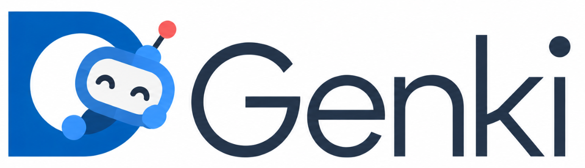
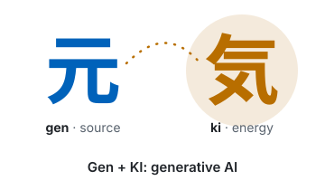
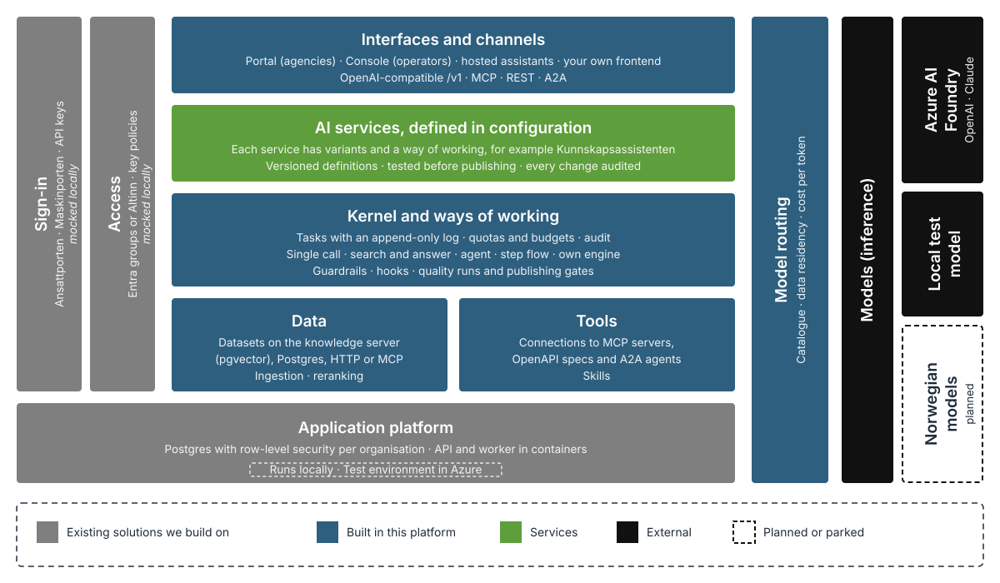
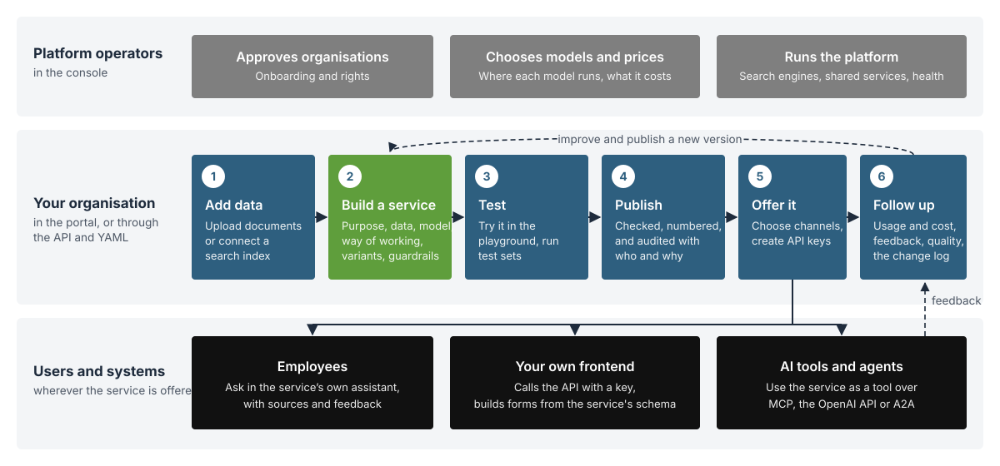
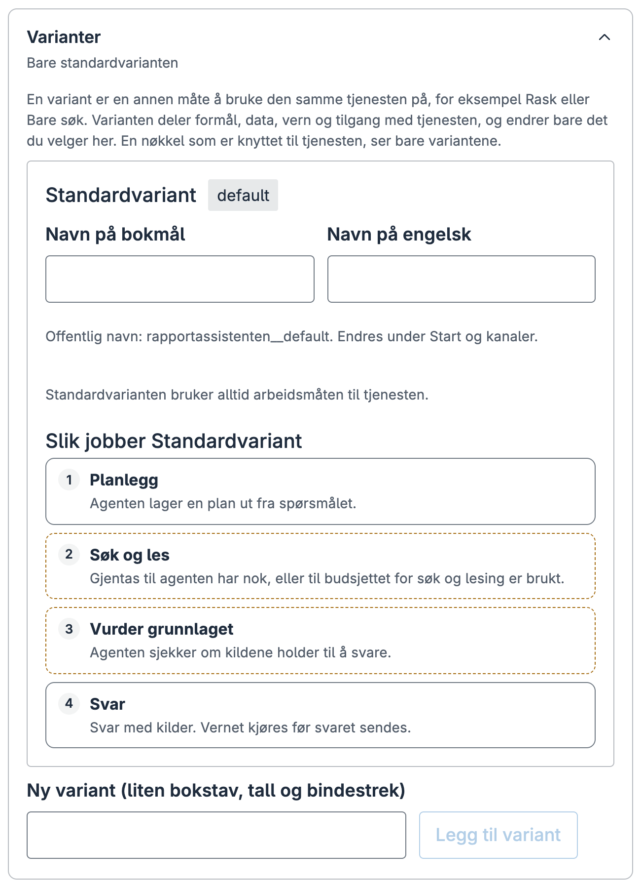
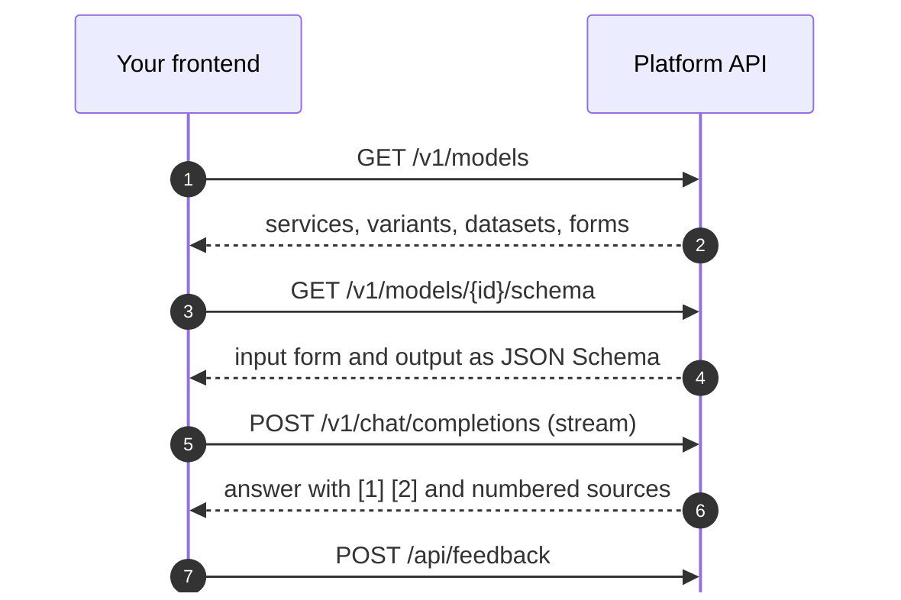

<div align="center">

<picture>
  <source media="(prefers-color-scheme: dark)" srcset="docs/images/genki-dark.png">
  
</picture>

[](#status)
[](https://github.com/digdir/genki/actions/workflows/ci.yml?query=branch%3Amain)
[](https://scorecard.dev/viewer/?uri=github.com/digdir/genki)
[](https://www.bestpractices.dev/projects/16298)
[](LICENSE)
<br>
[](mise.toml)
[](https://www.typescriptlang.org)
[](https://designsystemet.no)

[Run it](#run-it-locally) · [How it works](#how-it-works) · [Build on it](#build-on-it) · [API](docs/api/README.md) · [Decisions](docs/adr/) · [Docs site (Norwegian)](https://digdir.github.io/genki/) · [Contributing](CONTRIBUTING.md)

</div>

> [!NOTE]
> **An exploration (proof of concept), not in production.** It is intended as a joint national solution for stat and kommune, together with KS and KS Digital, not only from Digdir. There is one test environment in Azure; locally, login and rights are mocked. See [Status](#status) before you rely on it.

This repository explores shared building blocks for generative AI in the Norwegian public sector. An organisation describes a service in a short definition: what it is for, which documents it may search, which model answers, and where people can reach it. The platform runs it, with sources, access control, cost tracking and quality checks.

It has:

- **A headless API** that runs every service the same way, whether it is called as an OpenAI-compatible model, an MCP tool, an A2A agent or over REST
- **Web apps on that API**: the **portal**, where an organisation builds, tests and publishes services; the **console**, where the platform's operators run it; and a **hosted assistant** that draws a service's own assistant on a hostname of its own ([ADR 0061](docs/adr/0061-genki-hosts-a-services-assistant.md))
- **Definitions instead of code**: a service, variant, prompt, dataset or guardrail is versioned configuration, and every change is audited with who made it and why
- **Datasets and ingestion** on a Postgres knowledge server with pgvector ([ADR 0042](docs/adr/0042-the-knowledge-database.md)), or on another source over HTTP or MCP
- **Quality checks**: test sets, judges and publishing gates, plus a parity harness that compares answers with [digdir-headless-rag](https://github.com/digdir/digdir-headless-rag)

## Quickstart

You need [mise](https://mise.jdx.dev) and a running Docker. No secrets.

```sh
git clone https://github.com/digdir/genki.git && cd genki
mise trust && mise install   # Node 24, pinned in mise.toml
npm start                    # Postgres in Docker, then the API, the worker and the apps
```

Open the portal at <http://localhost:5173>, log in as **Kari Testansatt**, open **Tjenester** and try **Lokal testchat**. [Run it locally](#run-it-locally) has the details.

## About the name

**genki** means generative AI in two languages:

- **Norwegian:** _Gen_ + _KI_ (_kunstig intelligens_, "artificial intelligence") is generative AI.
- **Japanese:** 元気 (_genki_) means energetic, lively, healthy.
  - 元 (_gen_) is the root or source: the models and human knowledge.
  - 気 (_ki_) is energy: the potential they unlock.

<p align="center">
  <picture>
    <source media="(prefers-color-scheme: dark)" srcset="docs/images/genki-name-dark.svg">
    
  </picture>
</p>

> [!NOTE]
> The code uses the plain English `genai` prefix, for example `@genai/client` and `GENAI_DEV_MODE`.

## Documentation map

| Doc                                                                          | Use it for                                                                                                                                                                           |
| ---------------------------------------------------------------------------- | ------------------------------------------------------------------------------------------------------------------------------------------------------------------------------------ |
| [digdir.github.io/genki](https://digdir.github.io/genki/)                    | The documentation site, in Norwegian: building blocks, flows and the target picture, for leaders, service owners and architects. Source in [`apps/docs`](apps/docs/)                 |
| [`docs/development.md`](docs/development.md)                                 | Running locally in detail: ports, dev mode, test persons, secrets, tests, package layout                                                                                             |
| [`docs/api/README.md`](docs/api/README.md)                                   | The HTTP API: sign-in, rights, errors, and a guide per area                                                                                                                          |
| [`docs/build-a-frontend.md`](docs/build-a-frontend.md)                       | The shortest path to your own frontend                                                                                                                                               |
| [`docs/run-your-own-frontend.md`](docs/run-your-own-frontend.md)             | A frontend your team runs itself, registered in genki, with Ansattporten login                                                                                                       |
| [`docs/frontend-contract.md`](docs/frontend-contract.md)                     | Every field and rule a frontend relies on                                                                                                                                            |
| [`docs/bring-your-own-logic.md`](docs/bring-your-own-logic.md)               | A tool step or a whole engine you run yourself                                                                                                                                       |
| [`apps/admin-mcp`](apps/admin-mcp/README.md)                                 | An MCP server that lets a coding agent work on services through the API, as you                                                                                                      |
| [`docs/architecture/system-atlas.html`](docs/architecture/system-atlas.html) | Every module, what it does and what it talks to. Open it locally in a browser                                                                                                        |
| [`docs/adr/`](docs/adr/)                                                     | Architecture decisions. Start with [0001](docs/adr/0001-foundations.md), [0023](docs/adr/0023-extension-model.md) and [0031](docs/adr/0031-services-variants-and-ways-of-working.md) |
| [`docs/security/`](docs/security/README.md)                                  | Reporting a vulnerability, what genki protects, what operators must configure, key rotation and hardening                                                                            |
| [`docs/security/assurance-case.md`](docs/security/assurance-case.md)         | The threat model, trust boundaries and why the security requirements hold                                                                                                            |
| [`CONTRIBUTING.md`](CONTRIBUTING.md)                                         | Branches, checks, coding standards and pull requests                                                                                                                                 |
| [`ROADMAP.md`](ROADMAP.md)                                                   | What the next year intends, and what genki will not do                                                                                                                               |
| [`ACCESSIBILITY.md`](ACCESSIBILITY.md)                                       | Our accessibility commitment, where we are, known limitations, and how to report a barrier                                                                                           |

## Repository layout

- **`apps/`**: the API, the worker, the portal, the console, the hosted assistant (`assistant`), the MCP server for coding agents (`admin-mcp`), `docs` (the documentation site), and `parity` (compares answers with headless-rag).
- **`apps/api/config/local/`**: the definitions the API publishes at startup: services, flows, models, prices, datasets, test persons. Services in `dev-services/` are published only in development mode
- **`packages/`**: the kernel, definitions, ports, providers, strategies, channel adapters and platform services, each behind a contract ([layout](docs/development.md#repository-layout))
- **`docs/`**: the API guides, frontend contract, ADRs and the System Atlas
- **`infra/`**: the Azure setup for the test environment
- **`scripts/`**: setup, running everything locally, and building the atlas

---

## Run it locally

You need [mise](https://mise.jdx.dev) and Docker. No secrets are needed to get a working stack: login, rights and a test model are all local.

```sh
mise trust     # once per clone: without it, mise ignores mise.toml
mise install   # Node 24, pinned in mise.toml
npm start
```

**Docker must be running**, or setup stops at Postgres. `npm start` runs `npm run setup` (dependencies, Postgres with pgvector and the knowledge server in Docker, and a `.env.local` with a local database, generated keys and the local test model), then `npm run dev:all` (the API, the worker and the apps in one terminal). If a port is taken, it names the port; [docs/development.md](docs/development.md) shows how to move every port.

| Address                           | App           | For                                             |
| --------------------------------- | ------------- | ----------------------------------------------- |
| <http://localhost:5173>           | Portal        | Organisations: build, test and publish services |
| <http://localhost:5174>           | Console       | Operators: tenants, models, shared services     |
| <http://localhost:8080/reference> | API reference | Developers: every operation, searchable         |

<details>
<summary><strong>Log in and try a service</strong></summary>

Each app sends you to a mock Ansattporten with a list of test persons. **Kari Testansatt** has every right in Digdir; the other test persons and what they may do are in `apps/api/config/local/identity.yaml` and [docs/development.md](docs/development.md). The mock login only exists in development mode (`GENAI_DEV_MODE=true`), which `npm start` turns on.

In the portal, open **Tjenester** (Services) and try **Lokal testchat**. It answers with what you wrote. That is on purpose: the local test model echoes, so you can try login and chat without a real model or any cost. Choose **Ny tjeneste** (New service) to build your own: describe what it is for, pick a model, try it, and publish it. Publishing gives it a version number and records who published it and why.

</details>

<details>
<summary><strong>Call it from your own code</strong></summary>

Everything the apps do goes through the same API. Setup put an API key in `.env.local` as `DEV_API_KEY`:

```sh
curl -s http://localhost:8080/v1/chat/completions \
  -H "Authorization: Bearer $DEV_API_KEY" -H 'Content-Type: application/json' \
  -d '{"model":"local-test-chat__default","messages":[{"role":"user","content":"Hei!"}]}'
```

See [Build on it](#build-on-it) for the other channels.

</details>

<details>
<summary><strong>Add real models and search</strong></summary>

The example services, such as Kunnskapsassistenten, Klarspråk and Nynorsk, need real models (`FOUNDRY_OPENAI_*`, `FOUNDRY_CLAUDE_*` in `.env.local`) and a filled dataset. Without them they are skipped and logged at startup, so **Lokal testchat** is the only service until you add them. Every setting is listed in [`.env.example`](.env.example), with what happens when it is empty. Restart after you change `.env.local`.

</details>

<details>
<summary><strong>Stop it</strong></summary>

Press Ctrl-C in the terminal running `npm start`. Postgres and the knowledge server keep running in Docker and keep your data. `docker compose down` stops them, and `docker compose down -v` throws the data away as well.

</details>

---

## How it works

<p align="center">
  <picture>
    <source media="(prefers-color-scheme: dark)" srcset="docs/images/architecture-dark.svg">
    
  </picture>
</p>

| Part            | Role                                                                                                                                                                               |
| --------------- | ---------------------------------------------------------------------------------------------------------------------------------------------------------------------------------- |
| **Definitions** | What each service is, in versioned configuration. Every change is audited with who made it and why.                                                                                |
| **Channels**    | Turn each protocol into one kind of request. A service exposed on several channels behaves the same on all of them.                                                                |
| **Kernel**      | Runs the published version of a service. Every call is a task with an append-only log, and access, quotas and budgets are enforced there.                                          |
| **Backends**    | Models, search engines and tools sit behind ports, so a provider can be swapped in configuration.                                                                                  |
| **Tenants**     | Organisations. Rights come from Altinn or from Entra groups, and data is isolated with row-level security in Postgres ([ADR 0022](docs/adr/0022-tenant-isolation-in-postgres.md)). |

### How you use it

The platform's operators choose the models. Your organisation adds its data and builds services. People and systems use the services wherever you offer them, and their feedback goes into the next version.

<p align="center">
  <picture>
    <source media="(prefers-color-scheme: dark)" srcset="docs/images/how-you-use-it-dark.svg">
    
  </picture>
</p>

### Five words

The platform uses five nouns, the same in the portal, the API and the docs ([ADR 0031](docs/adr/0031-services-variants-and-ways-of-working.md)).

| Word               | Norwegian   | What it is                                                                           |
| ------------------ | ----------- | ------------------------------------------------------------------------------------ |
| **Service**        | Tjeneste    | What people and integrations pick, such as Kunnskapsassistenten                      |
| **Variant**        | Variant     | Another way to use the same service: a faster model, search only, a specialised flow |
| **Way of working** | Arbeidsmåte | How a variant answers: a ready-made strategy with settings, or a step flow           |
| **Step**           | Steg        | One step in a step flow                                                              |
| **Building block** | Byggekloss  | Something in the catalogue: a model, a dataset, a tool or a skill                    |

In the portal, each variant shows its way of working as plain steps, so a service owner can see what it does without reading configuration:

<p align="center">
  
</p>

### From draft to answer

A service is drafted and tested in the portal, then published as a numbered version. Publishing checks the definition against the catalogues and refuses unknown models, a model outside the service's data residency, a strategy configuration its schema refuses, and duplicate public names. Every published version is kept, with who changed it and why.

### A service, abridged

Kunnskapsassistenten answers questions with sources from public reports in Kudos. It is one example service, defined like any other in [`apps/api/config/local/services`](apps/api/config/local/services/). Shortened here; the full definition also has example questions, accepted input, retrieval settings, a tool and the layout of its assistant:

```yaml
apiVersion: genai/v1
kind: Service
metadata: { tenant: '991825827', id: kunnskapsassistenten, name: Kunnskapsassistenten }
spec:
  purpose: Svar med kilder fra offentlige rapporter i Kudos
  audience: [employees]
  riskClass: limited
  variants:
    - id: default
    - id: mini
      title: { nb: Rask (GPT-5 mini), en: Fast (GPT-5 mini) }
      model: foundry-openai/gpt-5-mini
    - id: retrieve-only
      title: { nb: Bare søk, en: Search only }
      chat: false
      strategy: { id: rag-single-shot, version: 1, config: { generate: false } }
  output: { kind: answer, withSources: true }
  strategy:
    id: agent-loop
    version: 1
    config: { budget: { searches: 4, reads: 6, readChars: 24000 }, temperature: 0.3 }
  knowledge:
    datasets: [{ dataset: digdir/kudos }]
  model: { primary: foundry-openai/gpt-5.6-terra, residency: global }
  exposure: { chat: true, mcp: true, openai: true, rest: true, a2a: true }
```

Three variants, one service:

| Variant         | Does                              |
| --------------- | --------------------------------- |
| `default`       | Searches by itself                |
| `mini`          | Answers faster on a smaller model |
| `retrieve-only` | Only searches                     |

> [!IMPORTANT]
> A frontend should show this as one service with a variant picker, never as three services.

### Configuration or code?

| Change                                                      | How                                                                                    |
| ----------------------------------------------------------- | -------------------------------------------------------------------------------------- |
| A new service, variant, prompt, dataset choice or guardrail | Definition, in the portal or YAML, versioned with a reason                             |
| A variant with its own flow of steps                        | Step flow, picked as the variant's way of working                                      |
| A new model, an OpenAI-compatible vendor, prices            | `models.yaml`, `prices.yaml`                                                           |
| A dataset on another search engine                          | `knowledge.yaml` ([ADR 0025](docs/adr/0025-search-engine-switching.md))                |
| A tool from an MCP server, an OpenAPI spec or an A2A agent  | Tool connection, then the service's tools                                              |
| A new strategy, step type, search engine or protocol        | **Code:** one package behind a contract ([ADR 0023](docs/adr/0023-extension-model.md)) |

---

## Build on it

The platform is headless: the portal, console and hosted assistant are clients of the same API you can use.



| Channel           | Routes                                                                |
| ----------------- | --------------------------------------------------------------------- |
| OpenAI-compatible | `GET /v1/models`, `POST /v1/chat/completions`                         |
| MCP               | `POST /api/mcp`, one tool per variant                                 |
| A2A               | `GET /a2a`, agent cards, `POST /a2a/:agent`                           |
| REST              | `/api/datasets`, `/api/facets`, `/api/conversations`, `/api/feedback` |
| Administration    | Everything else, documented in `/openapi.json` and at `/reference`    |

Authentication:

- **A system** sends an API key as `X-API-Key` or `Authorization: Bearer`. Keys are made in the portal, under **Tilgang** (Access). A Maskinporten token works instead of a key when Maskinporten is configured.
- **A person** signs in with Ansattporten. Their rights come from Altinn for each organisation, or, where Altinn is off, from the Entra groups they are in.

Details are in [docs/api/README.md](docs/api/README.md).

**Where to start**

1. [Build a frontend](docs/build-a-frontend.md): the shortest path.
2. [Frontend contract](docs/frontend-contract.md): every field and rule. Two frontends were built from the published contract alone, with no access to the repository ([ADR 0030](docs/adr/0030-frontends-from-schemas.md)).
3. [Bring your own logic](docs/bring-your-own-logic.md): a tool step or a whole engine you run yourself.

---

## Working on it

### Tests

```sh
npm run check
```

This runs prettier, eslint, the type check, dependency boundaries, the apps' size budgets, the API and definition compatibility checks and every test. Docker must be running: the database suites start containers with Testcontainers. Run a part with `npx vitest run <paths>`. Tests never call real models; the live suites skip themselves unless their settings are set.

CI runs the same check, a secret scan with gitleaks and a Docker image build.

### Configuration

The API reads `.env.local`, and nothing else. Secrets in definitions are referenced as `secret://env/<name>`, which reads the environment variable `<NAME>`: `foundry-openai-key` reads `FOUNDRY_OPENAI_KEY`.

Definitions live in the database once published. The files in `apps/api/config/local` are a starting point: at startup the API publishes the ones that do not exist yet, and leaves the rest alone. Change a published service in the portal or through the API, not by editing its file.

### Deployment

The test environment in Azure is deployed from `main` by running the `deploy` workflow by hand (`gh workflow run deploy.yml`), using [`infra/`](infra/README.md). There is no production environment.

### Troubleshooting

- **Setup says Node is too old.** Run `mise trust` in the repository, then `mise install`. An untrusted `mise.toml` is ignored without an error.
- **Setup stops at "Starting Postgres".** Docker is not running, or port 55432 is taken. Start Docker, or move the port as shown in [docs/development.md](docs/development.md).
- **"Ports already in use".** Another copy, or something else, holds one of the app ports. Stop it, or give this copy its own ports.
- **The API refuses to start and names missing settings.** It is not in development mode. `npm start` turns it on; to run the API alone with `npm run dev`, add `GENAI_DEV_MODE=true` to `.env.local`.
- **Only Lokal testchat shows up.** The other services need model and search settings. The API log names each service it skipped and why.

---

## Status

An exploration (proof of concept), not a production service.

| Area                       | Where it stands                                                                                                                                                                                                                                                                                                                                                                                                                 |
| -------------------------- | ------------------------------------------------------------------------------------------------------------------------------------------------------------------------------------------------------------------------------------------------------------------------------------------------------------------------------------------------------------------------------------------------------------------------------- |
| **Running**                | One test environment in Azure, on `genki.digdir.cloud` (`portal.`, `console.` and `api.`), deployed from `main` by hand. No production environment.                                                                                                                                                                                                                                                                             |
| **Login and rights**       | The test environment signs in through Ansattporten with an Entra ID login, and rights come from Entra groups in Digdir (991825827). Altinn rights are off there for now. Locally, login and rights are mocked in development mode.                                                                                                                                                                                              |
| **Hosted assistants**      | Kunnskapsassistenten runs as a hosted assistant on `kunnskap.apps.genki.digdir.cloud` ([ADR 0061](docs/adr/0061-genki-hosts-a-services-assistant.md), proposed).                                                                                                                                                                                                                                                                |
| **Search**                 | Datasets such as Kudos are on genki's own knowledge server, Postgres with pgvector ([ADR 0042](docs/adr/0042-the-knowledge-database.md), proposed).                                                                                                                                                                                                                                                                             |
| **Replacing headless-rag** | Every capability of [digdir-headless-rag](https://github.com/digdir/digdir-headless-rag) is covered or a written difference in [ADR 0017](docs/adr/0017-parity-scope-and-intentional-divergences.md). On a draft test set nobody has reviewed yet, the judge score shows no significant difference (platform minus headless-rag: -0.03, 95% CI -0.09 to 0.03; [report](apps/parity/reports/rerun-citations/quality-report.md)). |
| **Decisions**              | Each [ADR](docs/adr/)'s status line says what is built and what is missing.                                                                                                                                                                                                                                                                                                                                                     |

---

## Contributing

Contributions are welcome.

1. Read [CONTRIBUTING.md](CONTRIBUTING.md).
2. Run `npm run check` before you open a pull request.
3. Report vulnerabilities privately as described in [docs/security](docs/security/README.md#reporting-a-vulnerability), never in a public issue.

Everyone taking part follows the [Code of Conduct](https://github.com/digdir/.github/blob/main/CODE_OF_CONDUCT.md). genki is released under the [MIT licence](LICENSE).

---

<p align="center">
  Started by <a href="https://www.digdir.no">Digdir</a>, the Norwegian Digitalisation Agency. Intended as a joint solution for stat and kommune, together with KS and KS Digital.
</p>
