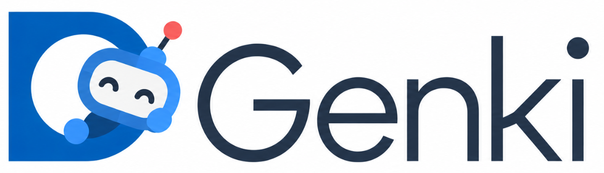
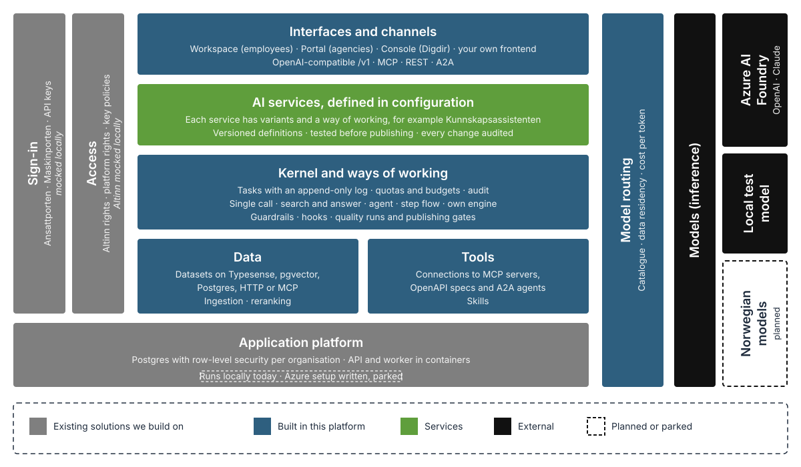
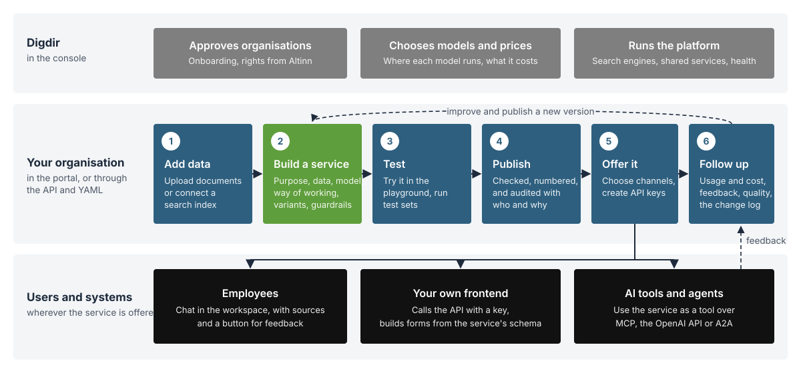
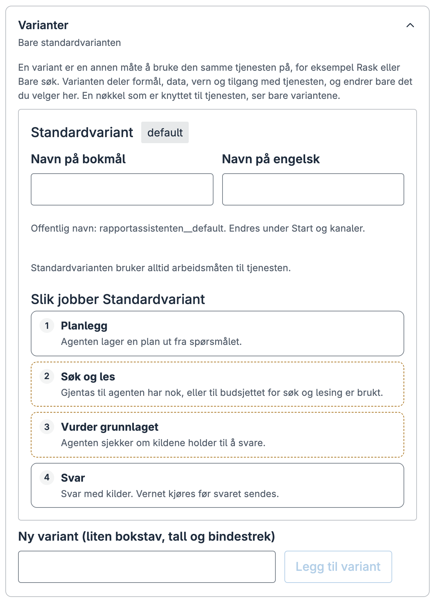
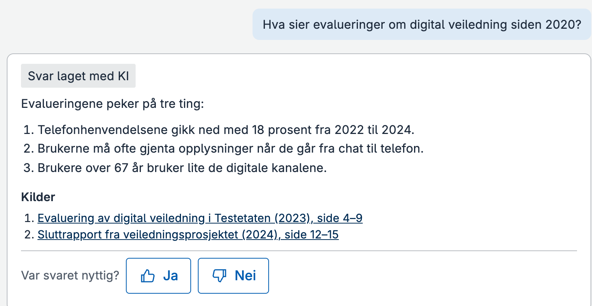
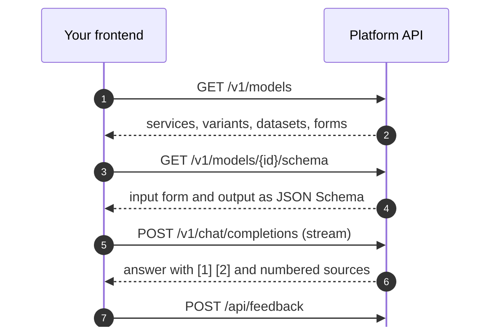

<div align="center">



[](#status)
[](mise.toml)
[](LICENSE)

[Run it](#run-it-locally) · [How it works](#how-it-works) · [Build on it](#build-on-it) · [API](docs/api/README.md) · [Decisions](docs/adr/) · [Contributing](CONTRIBUTING.md)

</div>

> [!NOTE]
> **Under development, not in production.** It runs locally, with Ansattporten and Altinn mocked in development mode. See [Status](#status) before you rely on it.

genki is a shared platform for generative AI services in the Norwegian public sector, from Digdir. An agency describes a service in a short definition: what it is for, which documents it may search, which model answers, and where people can reach it. The platform runs it, with sources, access control, cost tracking and quality checks built in.

It provides:

- **A headless API** that runs every service the same way, whether it is called as an OpenAI-compatible model, an MCP tool, an A2A agent or over REST
- **Three web apps** on that API: the **portal**, where an organisation builds, tests and publishes services; the **workspace**, where employees use them; and the **console**, where Digdir runs the platform
- **Definitions instead of code**: a service, variant, prompt, dataset or guardrail is versioned configuration, and every change is audited with who made it and why
- **Datasets and ingestion** on Typesense, pgvector, Postgres, HTTP or MCP, with reranking
- **Quality checks**: test sets, judges and publishing gates, plus a parity harness that compares answers with [digdir-headless-rag](https://github.com/digdir/digdir-headless-rag)

## About the name

**genki** means generative AI in two languages:

- **Norwegian:** _Gen_ + _KI_ (_kunstig intelligens_, "artificial intelligence") is generative AI.
- **Japanese:** 元気 (_genki_) means energetic, lively, healthy.
  - 元 (_gen_) is the root or source: the models and human knowledge.
  - 気 (_ki_) is energy: the potential they unlock.

> [!NOTE]
> The code uses the plain English `genai` prefix, for example `@genai/client` and `GENAI_DEV_MODE`.

## Documentation map

| Doc                                                                          | Use it for                                                                                                                                                                           |
| ---------------------------------------------------------------------------- | ------------------------------------------------------------------------------------------------------------------------------------------------------------------------------------ |
| [`docs/development.md`](docs/development.md)                                 | Running locally in detail: ports, dev mode, test persons, secrets, tests, package layout                                                                                             |
| [`docs/api/README.md`](docs/api/README.md)                                   | The HTTP API: sign-in, rights, errors, and a guide per area                                                                                                                          |
| [`docs/build-a-frontend.md`](docs/build-a-frontend.md)                       | The shortest path to your own frontend                                                                                                                                               |
| [`docs/frontend-contract.md`](docs/frontend-contract.md)                     | Every field and rule a frontend relies on                                                                                                                                            |
| [`docs/bring-your-own-logic.md`](docs/bring-your-own-logic.md)               | A tool step or a whole engine you run yourself                                                                                                                                       |
| [`docs/architecture/system-atlas.html`](docs/architecture/system-atlas.html) | Every module, what it does and what it talks to. Open it locally in a browser                                                                                                        |
| [`docs/adr/`](docs/adr/)                                                     | Architecture decisions. Start with [0001](docs/adr/0001-foundations.md), [0023](docs/adr/0023-extension-model.md) and [0031](docs/adr/0031-services-variants-and-ways-of-working.md) |
| [`CONTRIBUTING.md`](CONTRIBUTING.md)                                         | Branches, checks and pull requests                                                                                                                                                   |

## Repository layout

- **`apps/`**: the API, the worker, the portal, the workspace, the console, and `parity` (compares answers with headless-rag)
- **`apps/api/config/local/`**: the definitions the API publishes at startup: services, flows, models, prices, datasets, test persons
- **`packages/`**: the kernel, definitions, ports, providers, strategies, channel adapters and platform services, each behind a contract ([layout](docs/development.md#repository-layout))
- **`docs/`**: the API guides, frontend contract, ADRs and the System Atlas
- **`infra/`**: the Azure setup for the test environment
- **`scripts/`**: setup, running everything locally, and building the atlas
- **`mise.toml`**: the pinned Node version

---

## Run it locally

You need [mise](https://mise.jdx.dev) and Docker. No secrets are needed to get a working stack: login, rights and a test model are all local.

### 1. Install Node

```sh
mise trust
mise install
```

This installs Node 24, pinned in `mise.toml`. Run `mise trust` once per clone: without it, mise ignores `mise.toml` and you get whatever Node is on your `PATH`, and setup stops if that is older than 24.

### 2. Start it

```sh
npm start
```

This runs two steps, which you can also run on their own:

1. `npm run setup` installs dependencies, starts Postgres (with pgvector) in Docker on `127.0.0.1:55432`, and creates `.env.local` with a local database, generated keys and the local test model. It is safe to run again: an existing `.env.local` is never changed, only checked, and setup names the settings it lacks.
2. `npm run dev:all` starts the API, portal, console and workspace in one terminal, with prefixed output. At startup the API runs database migrations and publishes the definitions in `apps/api/config/local`.

**Docker must be running** before you start, or setup stops at Postgres. If a port is already taken, `dev:all` refuses to start and names the port; [docs/development.md](docs/development.md) shows how to move every port.

### 3. Open the apps

| Address                           | App           | For                                                   |
| --------------------------------- | ------------- | ----------------------------------------------------- |
| <http://localhost:5176>           | Workspace     | Employees: chat with published services, with sources |
| <http://localhost:5173>           | Portal        | Organisations: build, test and publish services       |
| <http://localhost:5174>           | Console       | Digdir operators: tenants, models, shared services    |
| <http://localhost:8080/reference> | API reference | Developers: every operation, searchable               |

### 4. Log in

Each app sends you to a mock Ansattporten with a list of test persons. Pick one:

| Person          | Use it for                                    |
| --------------- | --------------------------------------------- |
| Kari Testansatt | Every right in Digdir: start here             |
| Ola Drift       | Platform operator, for the console            |
| Ingrid Berg     | Limited rights: use services, datasets, usage |
| Erik Larsen     | Rights in other organisations                 |
| Hensynsløs Måke | No access                                     |

Rights come from a mock Altinn. The test persons are in `apps/api/config/local/identity.yaml`.

The mock login only exists in development mode (`GENAI_DEV_MODE=true`), which `npm start` turns on. Without it, the API refuses to start until a real database, login provider and Altinn are configured.

### 5. Ask something

In the workspace, pick **Lokal testchat** and write a message. It answers with what you wrote. That is on purpose: the local test model echoes, so you can try login, chat, conversations and feedback without a real model or any cost.

### 6. Build a service

In the portal, open **Tjenester** (Services) and choose **Ny tjeneste** (New service). Describe what the service is for, pick a model, try it in the playground, and publish it. Publishing gives it a version number and records who published it and why. It then shows up in the workspace for the people it is offered to.

On a fresh clone the only model is the local echo model, so every answer repeats the question. That is enough to try the whole path from draft to published service.

### 7. Call it from your own code

Everything the apps do goes through the same API. Setup put an API key in `.env.local` as `DEV_API_KEY`:

```sh
curl -s http://localhost:8080/v1/chat/completions \
  -H "Authorization: Bearer $DEV_API_KEY" -H 'Content-Type: application/json' \
  -d '{"model":"local-test-chat__default","messages":[{"role":"user","content":"Hei!"}]}'
```

See [Build on it](#build-on-it) for the other channels.

### 8. Add real models and search

The example services, such as Kunnskapsassistenten, Klarspråk and Nynorsk, need real models and search. Without those settings they are skipped and logged at startup, so **Lokal testchat** is the only service until you add them.

| Works on a fresh clone, no secrets                           | Needs settings in `.env.local`                                  |
| ------------------------------------------------------------ | --------------------------------------------------------------- |
| Login with test persons, rights, portal, console, workspace  | Real models: `FOUNDRY_OPENAI_*`, `FOUNDRY_CLAUDE_*`             |
| Postgres storage, migrations, API keys, conversations, audit | Kudos and public-docs search: `TYPESENSE_*`                     |
| Lokal testchat, and your own services on the local model     | Reranking: `COLBERT_API_*`; Langfuse, Maskinporten, real Altinn |

Every setting is listed in [`.env.example`](.env.example), with what happens when it is empty. Restart after you change `.env.local`.

### 9. Stop it

Press Ctrl-C in the terminal running `npm start`. That stops the API and the apps. Postgres keeps running in Docker and keeps your data, so starting again picks up where you left off. To stop Postgres too:

```sh
docker compose down
```

To throw the database away as well and start from nothing:

```sh
docker compose down -v
```

---

## How it works

<p align="center">
  
</p>

| Part            | Role                                                                                                                                                          |
| --------------- | ------------------------------------------------------------------------------------------------------------------------------------------------------------- |
| **Definitions** | What each service is, in versioned configuration. Every change is audited with who made it and why.                                                           |
| **Channels**    | Turn each protocol into one kind of request. A service exposed on several channels behaves the same on all of them.                                           |
| **Kernel**      | Runs the published version of a service. Every call is a task with an append-only log, and access, quotas and budgets are enforced there.                     |
| **Backends**    | Models, search engines and tools sit behind ports, so a provider can be swapped in configuration.                                                             |
| **Tenants**     | Organisations. Rights come from Altinn, and data is isolated with row-level security in Postgres ([ADR 0022](docs/adr/0022-tenant-isolation-in-postgres.md)). |

### How you use it

Digdir runs the platform and chooses the models. Your organisation adds its data and builds services. People and systems use the services wherever you offer them, and their feedback goes into the next version.

<p align="center">
  
</p>

### Five words

The platform uses five nouns, the same in the portal, the API and the docs ([ADR 0031](docs/adr/0031-services-variants-and-ways-of-working.md)).

| Word               | Norwegian   | What it is                                                                           |
| ------------------ | ----------- | ------------------------------------------------------------------------------------ |
| **Service**        | Tjeneste    | What people and integrations pick, such as Kunnskapsassistenten                      |
| **Variant**        | Variant     | Another way to use the same service: a faster model, search only, a specialised flow |
| **Way of working** | Arbeidsmåte | How a variant answers: a ready-made strategy with settings, or a step flow           |
| **Step**           | Steg        | One step in a step flow                                                              |
| **Building block** | Byggekloss  | Something in the catalogue: a model, a dataset, a tool or a skill                    |

In the portal, each variant shows its way of working as plain steps, so a service owner can see what it does without reading configuration:

<p align="center">
  
</p>

### From draft to answer

A service is drafted and tested in the portal, then published as a numbered version. Once published, employees use it in the workspace, and every answer is marked as made with AI, with numbered sources and a way to give feedback:

<p align="center">
  
</p>

Publishing checks the definition against the catalogues. These are refused:

- unknown models
- a model outside the service's data residency
- a strategy configuration its schema refuses
- duplicate public names

Every published version is kept, with who changed it and why.

### A service, abridged

Kunnskapsassistenten answers questions with sources from public reports in Kudos. It is one example service, defined like any other in [`apps/api/config/local/services`](apps/api/config/local/services/). Shortened here; the full definition also has example questions, accepted input and retrieval settings:

```yaml
apiVersion: genai/v1
kind: Service
metadata: { tenant: '991825827', id: kunnskapsassistenten, name: Kunnskapsassistenten }
spec:
  purpose: Svar med kilder fra offentlige rapporter i Kudos
  audience: [employees]
  riskClass: limited
  variants:
    - id: default
    - id: mini
      title: { nb: Rask (GPT-5 mini), en: Fast (GPT-5 mini) }
      model: foundry-openai/gpt-5-mini
    - id: retrieve-only
      title: { nb: Bare søk, en: Search only }
      chat: false
      strategy: { id: rag-single-shot, version: 1, config: { generate: false } }
  output: { kind: answer, withSources: true }
  strategy:
    id: agent-loop
    version: 1
    config: { budget: { searches: 4, reads: 6, readChars: 12000 }, temperature: 0.3 }
  knowledge:
    datasets: [{ dataset: digdir/kudos }]
    reranker: colbert
  model: { primary: foundry-openai/gpt-4o-2m-tps, residency: global }
  exposure: { chat: true, mcp: true, openai: true, rest: true, a2a: true }
```

Three variants, one service:

| Variant         | Does                              |
| --------------- | --------------------------------- |
| `default`       | Searches by itself                |
| `mini`          | Answers faster on a smaller model |
| `retrieve-only` | Only searches                     |

> [!IMPORTANT]
> A frontend should show this as one service with a variant picker, never as three services.

### Configuration or code?

| Change                                                      | How                                                                                    |
| ----------------------------------------------------------- | -------------------------------------------------------------------------------------- |
| A new service, variant, prompt, dataset choice or guardrail | Definition, in the portal or YAML, versioned with a reason                             |
| A variant with its own flow of steps                        | Step flow, picked as the variant's way of working                                      |
| A new model, an OpenAI-compatible vendor, prices            | `models.yaml`, `prices.yaml`                                                           |
| A dataset on another search engine                          | `knowledge.yaml` ([ADR 0025](docs/adr/0025-search-engine-switching.md))                |
| A tool from an MCP server, an OpenAPI spec or an A2A agent  | Tool connection, then the service's tools                                              |
| A new strategy, step type, search engine or protocol        | **Code:** one package behind a contract ([ADR 0023](docs/adr/0023-extension-model.md)) |

---

## Build on it

The platform is headless: the portal, console and workspace are clients of the same API you can use.



| Channel           | Routes                                                                |
| ----------------- | --------------------------------------------------------------------- |
| OpenAI-compatible | `GET /v1/models`, `POST /v1/chat/completions`                         |
| MCP               | `POST /api/mcp`, one tool per variant                                 |
| A2A               | `GET /a2a`, agent cards, `POST /a2a/:agent`                           |
| REST              | `/api/datasets`, `/api/facets`, `/api/conversations`, `/api/feedback` |
| Administration    | Everything else, documented in `/openapi.json` and at `/reference`    |

Authentication:

- **A system** sends an API key as `X-API-Key` or `Authorization: Bearer`. Keys are made in the portal, under **Tilgang** (Access). A Maskinporten token works instead of a key when Maskinporten is configured.
- **A person** signs in with Ansattporten, and their rights come from Altinn for each organisation.

Details are in [docs/api/README.md](docs/api/README.md).

**Where to start**

1. [Build a frontend](docs/build-a-frontend.md): the shortest path.
2. [Frontend contract](docs/frontend-contract.md): every field and rule. Two frontends were built from the published contract alone, with no access to the repository ([ADR 0030](docs/adr/0030-frontends-from-schemas.md)).
3. [Bring your own logic](docs/bring-your-own-logic.md): a tool step or a whole engine you run yourself.

---

## Working on it

### Tests

```sh
npm run check
```

This runs prettier, eslint, the type check, dependency boundaries and every test. Docker must be running: the Postgres, pgvector and Typesense-writer suites start containers with Testcontainers. Run a part with `npx vitest run <paths>`. Tests never call real models; the live suites skip themselves unless their settings are set.

CI runs the same check, a secret scan with gitleaks and a Docker image build.

### Configuration

The API reads `.env.local`, and nothing else. Secrets in definitions are referenced as `secret://env/<name>`, which reads the environment variable `<NAME>`: `foundry-openai-key` reads `FOUNDRY_OPENAI_KEY`.

Definitions live in the database once published. The files in `apps/api/config/local` are a starting point: at startup the API publishes the ones that do not exist yet, and leaves the rest alone. Change a published service in the portal or through the API, not by editing its file.

### Deployment

Every merge to `main` deploys to the test environment in Azure (`genki-test.digdir.cloud`), using [`infra/`](infra/README.md) and the `deploy` workflow. Production is not set up yet.

### Troubleshooting

- **Setup says Node is too old.** Run `mise trust` in the repository, then `mise install`. An untrusted `mise.toml` is ignored without an error.
- **Setup stops at "Starting Postgres".** Docker is not running, or port 55432 is taken. Start Docker, or move the port as shown in [docs/development.md](docs/development.md).
- **"Ports already in use".** Another copy, or something else, holds one of the app ports. Stop it, or give this copy its own ports.
- **"Login will fail: add these callbacks".** You moved an app to a port the mock login does not know. Add the callback it names to `apps/api/config/local/identity.yaml`.
- **The API refuses to start and names missing settings.** It is not in development mode. `npm start` turns it on; to run the API alone with `npm run dev`, add `GENAI_DEV_MODE=true` to `.env.local`.
- **Only Lokal testchat shows up.** The other services need model and search settings. The API log names each service it skipped and why.

---

## Status

| Area                       | Where it stands                                                                                                                                                                                                                                                                                                                                                                                                                 |
| -------------------------- | ------------------------------------------------------------------------------------------------------------------------------------------------------------------------------------------------------------------------------------------------------------------------------------------------------------------------------------------------------------------------------------------------------------------------------- |
| **Running**                | A test environment in Azure, deployed on every merge to `main`. Production is not set up yet.                                                                                                                                                                                                                                                                                                                                   |
| **Login and rights**       | Ansattporten, Maskinporten and Altinn are wired behind settings, mocked in development mode.                                                                                                                                                                                                                                                                                                                                    |
| **Replacing headless-rag** | Every capability of [digdir-headless-rag](https://github.com/digdir/digdir-headless-rag) is covered or a written difference in [ADR 0017](docs/adr/0017-parity-scope-and-intentional-divergences.md). On a draft test set nobody has reviewed yet, the judge score shows no significant difference (platform minus headless-rag: -0.03, 95% CI -0.09 to 0.03; [report](apps/parity/reports/rerun-citations/quality-report.md)). |
| **Kudos search**           | Reads the shared index headless-rag keeps up to date. The platform only searches it.                                                                                                                                                                                                                                                                                                                                            |
| **Decisions**              | Each [ADR](docs/adr/) says whether it is built, and names what is missing if not.                                                                                                                                                                                                                                                                                                                                               |

---

## Contributing

Contributions are welcome.

1. Read [CONTRIBUTING.md](CONTRIBUTING.md).
2. Run `npm run check` before you open a pull request.
3. Report vulnerabilities privately as described in [SECURITY.md](SECURITY.md), never in a public issue.

Everyone taking part follows the [Code of Conduct](CODE_OF_CONDUCT.md). genki is released under the [MIT licence](LICENSE).
