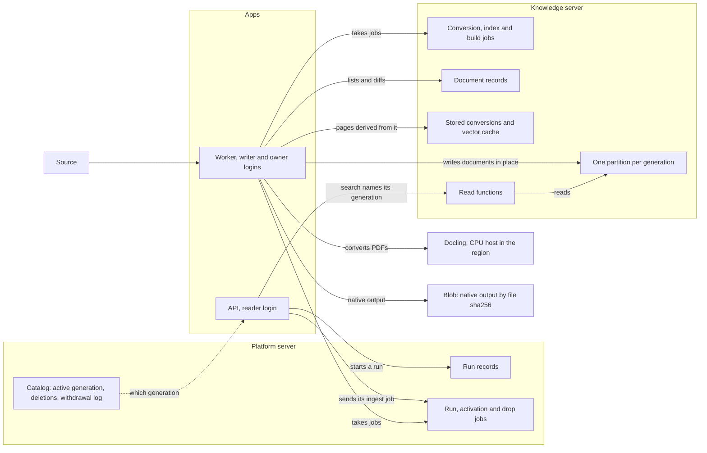
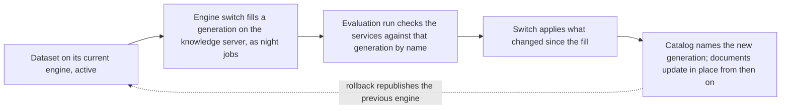

# 0042 The knowledge database

Status: proposed, 2026-10-27 (the connection to the knowledge server built: settings, roles, logins, pools, `connection: knowledge` and the binding, 2026-10-30; generations as partitions, their filter indexes and the catalog naming the active generation, 2026-10-30; stale ingestion runs found by heartbeat, 2026-10-29; the read functions, the read pool and the generation check, 2026-11-02; the knowledge job queues, run states, admission on the run, the reconciler and sending back, 2026-11-02; document records, in-place updates, the change sequence and data version, deletes by source kind and the citation read, 2026-11-03; a knowledge server per environment in the infra template, with its own network, identities, principals job and connect fence, not yet deployed, 2026-11-03; heavy work in the night window, its bypass, the VACUUM workaround's lock, VACUUM after runs, and the freeze and recall checks, 2026-11-03; engine switches into the knowledge database through ingestion runs, a run's own generation, prepared by its first ingest job and built and attached when the run ends, and `knowledge.drop` for one generation, 2026-11-04; Kudos ids by UUID with earlier ids on the record, complete Kudos listings by distinct count, 2026-11-04; folder document ids by owner and a hash of the path, 2026-11-04; records copied by an engine switch, owned by `_copy` and taken over by a pipeline, 2026-11-05; index and fill jobs side by side, `KNOWLEDGE_INDEX_CONCURRENCY`, 2026-11-06; the dataset delete route, which writes the deletion version, holds the id and leaves records and partitions on the knowledge server until `knowledge.drop` is sent, 2026-11-10; throttled embedding calls wait instead of failing a document, 2026-11-06; the Blob container `conversions` with versioning, its 30-day rule for earlier versions and the knowledge worker's role on it, and the native output store, in the template, not yet deployed and not yet written by `knowledge.convert`, 2026-11-12; stored conversions with the text layer, the convert job, records waiting on a conversion, and chunks with their file, pages, heading path and ids from them, 2026-11-12; `docling-pages` 1, one accepted list for every pipeline with Docling kept before the text layer, and the seed of conversions from native output in Blob as `knowledge.seed` jobs, 2026-11-13; amended, not built: PDFs converted with Docling on a CPU host instead of Marker, accepted and kept converters per pipeline, converters' native output in Blob storage keyed by file sha256 first, and the derivation and its version in a stored conversion's key, 2026-11-12; only errors known to be about the file stored as a refusal, others retried, 2026-11-13; U+0000 left out of stored pages, and each failed attempt of a knowledge job logged, 2026-11-13; the Docling server in the infra template, on internal TCP ingress with a key only the worker is given, scaling from zero, and what it keeps, not yet deployed and not yet called, 2026-11-13; a queued or running run admitted again, and when its admission runs out shown, 2026-11-15; an unhandled rejection logged and survived in the worker and the API, 2026-11-16; a switch's fill run sent back before activation, 2026-11-16; a file a convert job cannot fetch stored as `unreachable` and fetched again when a record that lists it is written again, 2026-11-16; amended, not built: conversion parts as the derivations `docling-parts` 1 and `text-layer-parts` 1, stored a unit (page, slide, sheet or section) a row in `src_conversion_units`, chunks that record their parts, and `kn_parts` (ADR 0055), 2026-11-13; the recall check inside a 90-minute deadline, judged on the searches that ran, and `knowledge.check` not retried, 2026-11-16; a fields-only refresh of stored documents, `knowledge.fields`, sent by an operator, 2026-11-16; hits from `kn_search`, `kn_fetch` and `kn_range` carry their chunk's page, page range, file and heading path, and the address the document's record gives a PDF file, 2026-11-16; text search with every word first and at most 5,000 matches ranked, and hybrid searches as two statements whose vector hits survive a slow text half, 2026-11-17; the url and `orgs_short` of a Kudos document, written by the index job and by the `kudos-links-and-abbreviations` fill, 2026-11-17; a Kudos document's publisher, `publisher_names`, written by ingest and the same fill, 2026-11-17; a Kudos document's report key, whether it is the agency's own record and its page count (`report`), written by ingest and the `kudos-report-keys` fill, 2026-11-18; PDFs converted with Docling in `knowledge.convert` when the worker has `DOCLING_URL`, a file Docling refuses read with the text layer in the same job, conversions with pages read before refusals, and replacement runs, sent as a run ends, carrying their sender's admission until their files are converted and converting in the night window, with `KNOWLEDGE_CONVERT_CONCURRENCY`, 2026-11-17; `doc_num` and `title` filters on the document's own id and title, and text filters that need every word of one option, 2026-11-19; seeded Docling conversions cut short at the export's timeout, filled from the text layer and converted with Docling again by replacement runs, and index jobs that keep the vectors their generation holds for a document's unchanged texts, 2026-11-19; a stored conversion's number and `src_conversion_units`, with parts stored by the seed and the convert job (ADR 0055), 2026-11-19; the API's knowledge pools at `KNOWLEDGE_DATABASE_POOL_MAX` connections and a search batch a quarter of its pool at once, 2026-11-20; the ColBERT residency item closed by removing ColBERT, 2026-11-20; filtered vector searches ranked exactly up to 250,000 matching chunks, read documents first, and with raised index limits above, 2026-11-20; Docling conversions on the async route, polled on one connection a job, so the TCP ingress's 300-second idle limit no longer cuts them, and KUDOS file downloads with a 15-second connect timeout, 2026-11-21; one Docling task a replica, a busy replica's submit refused and sent again on a new connection, a replica restarted when idle above half its memory, a line for each Docling task, and alerts on a Docling replica out of memory, 2026-11-21; a Docling replica told to stop finishes its task within 570 seconds, and reads its memory from cgroup v1 or its own process when cgroup v2 is missing, in the Docling image, not yet deployed, 2026-11-21; KUDOS file downloads at most 2 at once on kept connections, and a download KUDOS does not take waiting worker-wide instead of using a convert try, 2026-11-21; a convert job's waits ended under the key it was sent with, across a change of Docling's version or settings, 2026-11-22; every pgvector endpoint on the knowledge server and the platform server's shared `kn_*` tables dropped, with the #128 workaround, 2026-11-20; the shared Typesense cluster no longer configured, and Kudos and public-docs seeded on `kunnskapsserveren`, 2026-11-23)

Left: which datasets move into the knowledge database, and when. Moving the whole Kudos corpus, removing the shared Typesense (issue 150; genki no longer configures it since issue 690, 2026-11-23, and Kudos and public-docs run here, but other systems still read it), where Kudos may be processed (issue 131), and the server size and standby that Kudos would need are separate decisions, each taken with its cost (issue 175). This record says what any dataset gets when it moves in, and sizes Kudos only to show what moving it would need.

## Context

Search data for pgvector datasets lives in shared tables on the platform database (`kn_docs`, `kn_chunks`, `kn_phrases` in `packages/providers-pgvector/src/schema.ts`). Every dataset and every generation shares them: the full-text GIN indexes span all datasets, vectors are stored as `vector` with a partial HNSW index per dataset, and nothing above 2,000 dimensions is indexed. The API reads them as the owner role, and isolation between organisations rests on the router and on every statement naming its dataset. The pgvector endpoint accepts no database other than the platform's (`pgvectorEndpointOptions` in `engine.ts`). Each ingestion run builds a complete new generation and promotes it (`packages/ingest/src/index-writer.ts`), and nothing between the source and the index is kept, so a new chunker or embedding model means fetching and converting every document again. Pipelines are config entries on the platform server, and their runs are records in its `ingestion_executions` table, which are `running`, `succeeded`, `failed` or `cancelled` (`apps/api/src/ingestion.ts`, `packages/providers-postgres/src/executions.ts`). A run runs in the API process that started it.

That fits small datasets. It does not fit a dataset like Kudos, which the platform today only reads from a shared Typesense cluster: 45,961 documents in the KUDOS API listing on 2026-10-27, about 3.1 million pages by the page counts in that listing (2.96 million in primary files and 181,000 in attachments; the pilot's 300 documents averaged 55 pages, 16,611 in all), about 3.1 million vectors at the pilot's 20,248 for those documents (`benchmarks/kudos-pilot/results/timings.md` and `index-report.md` at tag [`evidence/kudos-pilot`](https://github.com/digdir/genki/tree/evidence/kudos-pilot/benchmarks/kudos-pilot/results)). One million 1,536-dimension `halfvec` vectors need a 3.8 GB HNSW index. Azure caps `maintenance_work_mem` at 2,097,151 kB, about 2 GiB ([Azure: memory parameters](https://learn.microsoft.com/en-us/azure/postgresql/parameters/parameters-resource-usage-memory?pivots=postgresql-17)), which holds the graph of about 570,000 such vectors; a larger build spills to disk and slows down sharply. The knowledge database is meant to hold many datasets owned by different organisations.

## Decision

The platform keeps one knowledge database for all pgvector datasets, keeps what it has fetched, converted and embedded, updates documents in place, builds a new generation only when the way documents are processed changes, and lets the API read it only through functions that check the dataset. Its work runs as jobs on pg-boss (ADR 0041).

How the parts meet, for one dataset:

### The knowledge server

- **Its own Azure Database for PostgreSQL flexible server.** The API and the worker reach it with an Entra ID token for their own identity (below): `KNOWLEDGE_PGHOST`, `KNOWLEDGE_PGDATABASE`, `KNOWLEDGE_PGUSER` and `KNOWLEDGE_AZURE_CLIENT_ID`, through `knowledgeIdentityTokenSource`, a managed identity credential for that client id only, which never falls back to the Azure CLI or another developer login as the token source for `PGHOST` does. `KNOWLEDGE_DATABASE_URL` is for local development only. The pgvector endpoint option `connection` accepts `knowledge` beside `platform`; an endpoint set to `knowledge` with no knowledge server configured stops the API from starting outside development mode, so data never falls back to the platform database unnoticed.
- **One per environment.** Each environment's template creates its own knowledge server (`knowledgePostgres` in `infra/main.bicep`), set up as its platform server is: the same module (`infra/modules/postgres.bicep`), private access in a delegated subnet, its own private DNS zone and Entra ID auth only. It sits in a network of its own (`genai-<env>-knowledge-vnet` in `infra/modules/knowledge-network.bicep`: test `10.43.0.0/24`, prod `10.42.0.0/24`), peered both ways with the environment's network, and its DNS zone is linked to both. A server cannot move to another network once it is made, so a network peered with the knowledge network later reaches the knowledge server and nothing else of the environment. Each server holds one database, `genai_knowledge`, bound to its own environment's platform server, and a change to a server (a parameter, a restart, a resize) is tried on test's before prod's.
- **Only the database's own logins connect.** Roles are global to a server ("Database roles are global across a database cluster installation", [PostgreSQL: database roles](https://www.postgresql.org/docs/17/database-roles.html)), and every role may connect to every database by default, so a login made for another database on the same server, such as another environment's, could otherwise log in to this one as a knowledge role it holds. The setup (`setUpKnowledgeServer` in `packages/providers-pgvector/src/knowledge-setup.ts`) revokes `CONNECT` from `PUBLIC`, grants it only to its two logins and, on Azure, to `azure_pg_admin`, takes back every other grant it can, and fails, naming each grant left and its grantor, when one remains. A role that inherits one of the two logins connects through it, and one that may set it acts as it wherever it connects, so the setup also fails, naming it, while any role but its own admin and the server's admins holds a login either way; the admin option alone, which PostgreSQL gives the role that created a login, is allowed. Tests: "a login of one environment cannot connect to the other environment's database", "setup takes back a connect grant to any login but its own two", "setup fails, naming the grant, while a connect grant it cannot take back is left" and "setup fails, naming the member, while another role can act as one of its logins".
- **In its environment's region.** Each server, its backups and the converters' native output in Blob storage (below) stay in the region its environment runs in (`location` in `infra/env/*.bicepparam`), inside the EU/EEA (ADR 0045). Its backups are kept 7 days and are not geo-redundant, unlike the platform server's (30 days, geo-redundant). Azure sets geo-redundant backup only when a server is created ("You can configure geo-redundant storage for backup only during server creation", [Azure: backup and restore](https://learn.microsoft.com/en-us/azure/postgresql/backup-restore/concepts-backup-restore)), so turning it on later means a restore into a new server. What neither the sources nor Blob storage can give back is small, and the nightly export copies it there too: earlier ids and tombstones (below). Losing the server then costs deriving the pages again from the native output in Blob, converting again only the files that had the text layer, the counts of listings a document has been missing from, so a delete waits for two more listings, and the data versions older results recorded. Geo-redundant backups would go to the paired region, also inside the EU/EEA, so residency is not the reason against them. Blob storage is a locally redundant storage account, like the platform's file share today (`Standard_LRS` in `infra/modules/storage.bicep`).
- **Bound to one platform server.** The platform server gets a random id once, when its migrations first run (`platform_identity`), and the knowledge server setup (`scripts/knowledge-server-setup.ts`) stores that id once (`knowledge_binding`). The worker compares the two when it starts, every minute until they match, and before every drop (in the `knowledge.drop` handler, issue 250). While they differ it runs no knowledge job, logs the mismatch as an error and answers 503 on `/readyz`, so a worker pointed at another environment's platform server changes nothing. A worker with no knowledge server configured is ready and runs no knowledge job. A restore keeps a server's id, so it needs no rebinding. Binding a knowledge server to another platform server, such as a copy given to another environment, is done only by the setup script with `--rebind` and a reason, run by an admin of both servers, and recorded in the platform server's audit log as `platform.knowledge.rebind` with the old id, the new id and the reason. It is not an API task as ADR 0010 describes, because the API has no right to change the knowledge server.
- **Three roles.** `genai_knowledge_owner` runs migrations and partition DDL, in the worker's build and drop jobs and when an ingest job prepares a generation that does not exist yet. `genai_knowledge_writer` is the worker's role for every other job: DML on the knowledge and `pgboss` tables, no DDL. `genai_knowledge_reader` is the API's role: `EXECUTE` on the read functions below and on the console's job-state function, and nothing else, so no `SELECT` on any knowledge table and no rights on `pgboss`. The `knowledge.ingest` and `knowledge.index` handlers run as the writer. Preparing a generation grants the writer `SELECT`, `INSERT`, `UPDATE` and `DELETE` on its standalone tables, so index jobs fill a generation that is not attached yet without DDL, and write through the parents once it is attached.
- **Each app logs in with its own identity.** The API reaches the knowledge server with a managed identity of its own that maps only to `genai_knowledge_reader`; the worker's maps to the writer and owner roles. The identity the apps share for the platform server has no rights on the knowledge server, so no code in the API can log in as anything stronger than the reader.
- **A principals job per environment sets the server up.** The environment's knowledge admin identity (`genai-<env>-knowledge-admin-id`) is an Entra admin of its knowledge server beside the admin group, and only the principals job holds it: `genai-<env>-knowledge-setup`, a Container Apps job started by hand, running `scripts/knowledge-server-setup.ts --principals` from the worker image. The job makes the API's and the worker's logins by object id (`pgaadauth_create_principal_with_oid`, in the `postgres` database), runs the setup and the binding, and prints the server's settings, extensions, logins, the two logins' memberships and who may connect, since the server can only be reached from inside the environment's network. It reads the platform id as `appIdentity`, the only identity that can read `platform_identity`.
- **The API reads only through `SECURITY DEFINER` functions,** as ADR 0022 does for API keys and cross-organisation reads: `kn_search`, `kn_fetch`, `kn_range`, `kn_facets`, `kn_documents`, `kn_resolve_citation` and, once conversion parts are built, `kn_parts` (ADR 0055), one for each read of the knowledge port, and `kn_generation`, which gives the recipe of the generation a search reads, so the query is embedded with the model that built it rather than the one the catalog names now. The router checks the caller as today (`dataset.tenants` and residency in `packages/port-knowledge/src/router.ts`) and only then hands the connection the datasets it allowed (`DatasetConfig.allowed`); the connection sets `app.datasets` to them once for the transaction, beside `statement_timeout`, and refuses a dataset the router did not hand it. Each function first refuses a dataset that is not in `app.datasets`, then runs its query in PL/pgSQL as dynamic SQL with the dataset and generation written in as literals (`format('%L', …)`), so the planner reads one partition. Filters, profiles and weights are typed arguments, filters as clause rows in `jsonb` that become containment on `fields` so the partition's filter index serves them, except `doc_num` and `title`, which compare the document's own `id` and `title_tsv`; a function whose arguments change gets a new name (`kn_search_v2`), so old and new API replicas both work during a deploy. Each function's statement comes from an owner-only helper (`kn_search_sql` and the like), so the plan tests run on the SQL the functions execute (`packages/providers-pgvector/src/read-functions.ts`).
- **Text search needs every word, and ranks a bounded number of matches.** The query is read as a web search (`websearch_to_tsquery`): every word must match, quoted words match as a phrase, and `-word` excludes. The matches are found through the GIN index, and at most 5,000 of them are read and ranked (`textRankCap`); which 5,000 follows the scan, not relevance, and finding the matches still grows with their number. Any-word search ranked all 441,895 Kudos chunks holding one of four words in 111 s (https://github.com/digdir/genki/issues/675). A text profile, which has no vector half, adds chunks holding some of the words after those holding all, scored below them, unless the query excludes a word. A hybrid profile does not, unless its query could not be embedded; then it searches as a text profile. Hybrid searches run as two statements, the text half limited to 5 s (`textSearchMs`), merged by the same RRF in TypeScript (`packages/providers-pgvector/src/hybrid.ts`); when one half fails, the other's hits come back with a warning. A `text` filter (`contains`) keeps a value that holds every word of one of its options; the options are alternatives, so `title: { contains: ['Årsrapport Tolletaten 2025'] }` keeps that report and not every title with 2025 (https://github.com/digdir/genki/issues/752). A clause row without `options`, from an API before that change, keeps any of its words, as before. `kn_search` keeps its arguments, so a hybrid profile without its vector is the text half: old and new API replicas both work during a deploy.
- **Search reads through its own pool,** set by `KNOWLEDGE_READ_PGHOST`, which is the knowledge server itself until a read replica is added (heavy work, below). Nothing on the search path writes. A search names the generation it reads, the active one from the catalog or a candidate from the request, and embeds its query for that generation. A server that does not have that generation attached answers that it is not ready (SQLSTATE `KN503`), and the search goes to the primary, whose answer is final; a replica that does not answer (no connection, SQLSTATE class 08, or 57P01 to 57P03) sends the search to the primary too. A statement timeout or a refusal is the answer and is not repeated. On the primary, a generation the catalog names but no partition holds yet reads as empty. When `KNOWLEDGE_READ_PGHOST` is unset or names the primary, the API has one pool and nothing is read twice. Each of the API's knowledge pools holds `KNOWLEDGE_DATABASE_POOL_MAX` connections, 20 by default, and a batch of searches runs a quarter of that at once, so one agent search cannot take every connection and starve the rest (test: "a search batch larger than the pool does not fail every request waiting for a connection"). Each read also returns the data version of the server that answered. Everything else uses the primary.
- **A candidate is searched only by a person with the right to manage datasets in the organisation that owns the dataset** (ADR 0027), never on the strength of a right in an organisation it is shared with. Services read a candidate only in an evaluation run or live comparison that such a person started. The same holds for a generation that an engine switch is filling (ADR 0025): it can be checked through a service's full retrieval path before the switch is activated.
- **The two content caches are shared across organisations.** Stored conversions and cached vectors are keyed by content, so the same file or text is converted and embedded once, whoever holds it. Cache hits per run are shown to operators, not to organisations, since a hit tells whether anyone else holds an exact file or a short text.
- **The worker fetches as the API does today:** through the ingestion fetch guard, which connects only to the addresses it validated and validates every redirect again (`guardedFetchStream` in `packages/ingest/src/website.ts`), and with a tenant secret only for the hosts it is set for (ADR 0015).

### What is stored

Each layer can be rebuilt from the one before it, so a later step never needs the source again:

| Layer              | Table                        | Key                                                                   | Holds                                                                                                                                                                                                                |
| ------------------ | ---------------------------- | --------------------------------------------------------------------- | -------------------------------------------------------------------------------------------------------------------------------------------------------------------------------------------------------------------- |
| Document records   | `src_documents`, `src_files` | Dataset and document id; dataset, document and file                   | A number of its own, the pipelines that own it, the source record as received, a metadata hash, each file's sha256, state, when last seen, earlier ids, its change number                                            |
| Native output      | Blob container `conversions` | `<sha256>/<converter>/<version>/<settings hash>.json.gz`              | The converter's own output, gzipped, with `<settings hash>.meta.json` beside it, no images                                                                                                                           |
| Stored conversions | `src_conversions`            | File sha256, converter, version, settings, derivation and its version | Text derived from the native output or from another stored conversion, per page or as conversion parts (ADR 0055), that output's Blob path, and an `id` from a sequence, null on rows stored before parts were built |
| Conversion parts   | `src_conversion_units`       | Stored conversion's id and unit                                       | The parts that start in the unit (a page, slide, sheet or section), its label, size and text span (ADR 0055)                                                                                                         |
| Vector cache       | `kn_embeddings`              | Hash of the text, the model's deployment and version, dimensions      | The vector, as `halfvec`                                                                                                                                                                                             |
| Index              | `kn_docs`, `kn_chunks`       | Generation partition, id                                              | Chunks, vectors and full-text data that searches read                                                                                                                                                                |

- **The platform keeps no source files it can fetch again.** A converter upgrade downloads them again; a new derivation does not, since it reads the native output (conversion, below). Uploaded files are the exception: they exist only in the platform's blob store (`apps/api/src/dataset-uploads.ts`), where they stay.
- **Unused cache entries are removed.** A nightly `knowledge.cleanup` job deletes stored conversions and cached vectors that a file record or a kept generation used and none uses any more, after a grace period of 7 days, and each native output in Blob once no stored conversion holds its Blob path. That also removes what an older converter version or derivation left behind. A seeded conversion that no record has used yet is not unused, so a seed is not removed before the fill that uses it.
- **A converter's native output goes to Blob storage when it is made,** gzipped, keyed by the file's sha256 first: `<sha256>/<converter>/<version>/<settings hash>.json.gz`, where the settings hash is the sha256 of the settings as canonical JSON, with `<settings hash>.meta.json` beside it (converter, version, settings, pages, when), so two settings of one version keep apart. Listing `<sha256>/` finds every native output of a file without the database, and deleting that prefix erases them. The container has versioning, and an earlier version is deleted 30 days after it was written, since Azure counts a version's age from its write, not from when it was replaced; an output older than that loses its earlier version at a later lifecycle run, at no fixed time, once it is overwritten or deleted. Blob soft delete, which would hold it longer, is off, since a withdrawal must erase at once. The worker reaches it with its knowledge identity's data role on the container, never an account key or SAS token; the account's shared key, kept for the file share mount, opens it too (open, below). `src_conversions` keeps the pages and the output's Blob path, not the output itself: for Kudos the Docling output is about 51 GB raw, about 20 KB a page. The text layer has no native output.
- **The nightly `knowledge.export` copies each dataset's earlier ids and tombstones** to Blob storage, and no conversions, since their native output is already there. A new server, region or host is filled from Blob: the pages are derived again from the native output with no converter call, and only the files that had the text layer are downloaded and converted again.
- **Deleting a dataset** writes a catalog version that deletes it, with who, when and the reason, and sends a `knowledge.drop` job in the same transaction (jobs, below). Its id cannot be used for a new dataset until that job has finished.
- **A deleted document leaves a tombstone** in its dataset, whether its source deleted it (deletes, below) or it was withdrawn on request: the keyed hash of its id (below) and the date, nothing else. The API passes `kn_resolve_citation` the keyed hash of the id it resolves, so an old citation says the document was withdrawn instead of linking nowhere, and it answers the same for both kinds, so it does not tell whether anyone asked for erasure. Until issue 178, tombstones hold a plain sha256 of the id (`tombstoneHash` in `packages/port-knowledge/src/tombstone.ts`), not the keyed hash.
- **Withdrawing a document on request,** for example on an erasure request, is an admin action with a reason, audited (ADR 0010): the API writes the withdrawal's log entry (below) and sends a `knowledge.withdraw` job with it, and the job deletes the document from every generation of its dataset, kept generations and candidates included, in one transaction; deletes its stored conversions and cached vectors at once when no other record uses them; and, when no other record uses the file, deletes the file's `<sha256>/` prefix in Blob storage, earlier versions included, in the same job. It leaves a tombstone like any deleted document, so the knowledge server keeps neither the id, which can be a path that names a person, nor the title. The id cannot be read from the hash, and without the key a guessed id cannot be confirmed either.
- **Withdrawals are logged where a restore cannot undo them.** Each withdrawal is recorded on the platform server (`knowledge_withdrawals`: a number, the dataset, the keyed hashes of the document's id and of each of its files, and the date) and kept as long as its dataset, since it also keeps the document out of later runs. The knowledge server records the last withdrawal it has applied, and each search passes the platform's latest number. A server that is behind, after a restore from a backup or a fill from the Blob copy, answers that it is not ready until the worker has applied the log; on the primary that fails the search, which is the price of never serving withdrawn content.
- **A withdrawn document stays out.** A run skips a listed document whose id's keyed hash is in the withdrawal log, and a file whose keyed hash is, and its report counts the skips, so a source that still lists the document does not bring it back.
- **Tombstones and the withdrawal log hash with a key per dataset.** A keyed hash is HMAC-SHA256 under the dataset's key, of the document's id or, for a file, of its sha256. The dataset's key is HMAC-SHA256 of the dataset id under one secret, `KNOWLEDGE_ID_KEY` (32 random bytes in Key Vault), which the API and the worker read and neither database holds. A table, a backup or the Blob copy alone then confirms no guessed or listed id, and the same document gives different hashes in two datasets. The key is never rotated, since the ids are gone and old entries cannot be hashed again, and it is kept as long as any dataset, under Key Vault's soft delete and purge protection (`infra/modules/keyvault.bicep`). The platform server keeps a check value, the key's HMAC of a fixed string, stored the first time the worker starts with a key. While the key an app reads does not give it, the worker runs no knowledge job and fails its readiness check, and the API refuses withdrawals, so a lost or replaced key cannot quietly let withdrawn documents back in.
- **How long withdrawn content lasts:** it leaves the knowledge server, the caches and Blob storage at once, a read replica when the replica has caught up, and the server's backups within their 7 days. Stored answers and traces that cited it keep their excerpts and chunk ids for their own retention (ADR 0011). The Docling host keeps no files or results past its replica: uploads spooled to the replica's temporary folder and results held in memory until they are fetched, and OCR errors that name the uploaded file and page in its logs (conversion, below).

### Identity and chunks

- **A document's id names its source instance and its id there:** `kudos:<uuid>`, `folder:<owner>/<hash of path>`, `cms:<endpoint>:<id>`. A folder document's owner is the dataset's scope (`platform` or the organisation number), and the hash is of the file's path from the folder root (`INGEST_FOLDER_ROOT`). So within a dataset the id is the same on every machine, two pipelines that list the same file name the same document, as co-ownership below needs, and no file path, which can name a person, reaches a stored answer through the id (`folderDocumentId` in `packages/ingest/src/sources.ts`; tests "a folder document keeps its id when the folder root moves", "two folder pipelines over one file give it the same id" and "a folder document's id names no path"). The path stays in the record's metadata, where withdrawal reaches it. Records are kept per dataset, so the same document in two datasets has two records; its conversion and vectors are still shared.
- **A source id stays in records and chunks, where withdrawal reaches it.** An id can name a person (a file path, a title in a URL), so job data, stored job errors and logs name a document by its record's own number instead.
- **When a source renumbers,** the earlier ids stay on the record. A citation is resolved through them only inside a dataset the caller may read (`kn_resolve_citation`).
- **A chunk's id is a hash of its document id, file, page and position,** so two documents never share a chunk id, even with the same text, and a chunk id that a stored answer keeps carries no path. Today's chunk ids start with the document's key (`${document.key}#n` in `apps/api/src/ingestion.ts`).
- **Every chunk carries** its document id, file, page or page range, and heading path when the converter gives one. A chunk made from conversion parts also carries its stored conversion's id, the `seq` range of its parts and its span of the conversion's text (ADR 0055). How a document is cut into chunks is part of the recipe, not of this contract.

### Ingestion runs

- **A document record is owned by the pipelines that list it.** A dataset can be filled by several pipelines, and a run compares, deletes and brakes only on its own pipeline's records. When a pipeline lists a document another pipeline owns, it takes the document over only when the file sha256 or metadata hash differs; otherwise it becomes a co-owner. A document is deleted only when no owner lists it any more.
- **A copy owns what it copies until a pipeline takes it over.** An engine switch that copies a dataset in from another engine (ADR 0025) writes its records owned by `_copy`, which no pipeline id can be. A pipeline's run counts them among its own: a copied record it lists is processed as changed, so it is converted and indexed again, and it becomes the pipeline's; a copied record it does not list stays as copied, since only its owner deletes it (tests "a pipeline that takes over a copied dataset processes each listed document as changed" and "a pipeline that takes over a copied dataset leaves the copied documents it does not list").
- **Disabling a pipeline pauses it and keeps its documents.** Deleting a pipeline starts a removal run of its own: it gives up its ownership and deletes the documents no other pipeline owns, through the change brake.
- **A run lists its pipeline's source and compares the listing with the records its pipeline owns.** A new id, a changed file sha256 or a changed metadata hash marks a document to process. The run sends a `knowledge.convert` job for each file without a stored conversion and a `knowledge.index` job for each document ready to index. A file that is already being converted with the worker's converter version and settings gets no second job: its record waits, and the run that marks it waiting and the conversion that finishes take the same lock on the file, so the finished conversion sends an index job for every waiting record. A record waits under its convert job's key (file, converter, version and settings), and the queue keeps that key with the job through its retries, its dead letter and a redrive. A conversion ends the waits under the key its job was sent with as well as under the version and settings it was made with, and a job sent again for the night window keeps its key, so a job queued before a change of Docling's version or settings still ends its records' waits after it (issue 945). A run after such a change waits under the new key and sends a second job for a file whose old job is still queued; whichever runs second finds the stored conversion and converts nothing, unless both run at once. Not covered: while a deploy that changes those settings rolls out, a worker of the release before it can make a record wait under the old key just after the conversion is stored, and that record waits until it is written again; and a worker that does not read its job's key (before issue 945) ends only the waits under its own settings, so a change of Docling's version or settings is safe for queued convert jobs only once a release that reads it is fully rolled out. Unchanged work is free: stored conversions and cached vectors are reused.
- **Documents are replaced in place,** each in one transaction inside the active generation, so search never sees half a document. Every change to a dataset's document records takes the next number in the dataset's change sequence. A generation's data version is the highest number below which it has every change; it moves forward as index jobs apply changes. A document stored or skipped (no text, an unsupported type) has its change applied; one whose index job fails is marked `failed` with a reason code and is not applied, so its generation keeps what it held and the data version stays below its change until a later run, a send-back or a catch-up writes it. A catch-up then never skips it, and two reads with the same data version both hold every change up to it. An index job whose record changed while it ran writes nothing and fails, so its retry reads the record again and writes the newer change.
- **A run has six states.** `ingestion_executions` gains `queued`, for a run that waits for its pipeline's open run, and `waiting`, for a run stopped at the change brake until it is approved, beside `running`, `succeeded`, `failed` and `cancelled`. A run started while its pipeline has an open run is created `queued`, and at most one run per pipeline is `queued` (a unique index); a start or an approval while one is queued is refused with that reason. A run started with no open run is created `running` with its ingest job, and the transaction that ends a run makes its pipeline's queued run `running` and sends that run's ingest job. A run that runs as jobs is marked so on its record, and the API's check for stale runs (`failStaleRuns`, a heartbeat two minutes old) leaves it alone: it ends with its jobs (jobs, below).
- **One ingestion run per pipeline is open at a time,** from its start until its last job has ended. A run started while one is open waits, and at most one waits per pipeline. A record waiting on another run's conversion counts as open work of its own run. When a run's last job ends, the run ends with `VACUUM (ANALYZE)` (heavy work, below) and is marked finished.
- **Pushes and explicit deletes do not wait.** A source that pushes or deletes documents by id (uploads, a CMS) changes only those documents, each in its own transaction, beside any open run of its pipeline. Each push is a one-document run in `ingestion_executions`, admitted by the API like any run but not its pipeline's open run, and sends a `knowledge.push` job on the platform server in the same transaction; the worker writes the record and sends its convert or index job.
- **Deletes follow the kind of source:**
  - explicit sources (uploads, a CMS that pushes and deletes by id) delete at once;
  - listed sources (Kudos, folders, databases, Parquet) delete a document after two complete listings in a row without it. A listing is complete when every page came back without error and, for a source that reports a total (Kudos's `meta.total`), the count of distinct documents matches. A source can repeat some documents and skip others between pages, as KUDOS does for documents that share a publish date, so a raw count can match while documents are missing; a search that comes back short is listed again in the other order, up to three passes, and stays incomplete if the union is still short;
  - crawled sources delete a page after a 404 or 410 seen twice, or after three complete crawls without it.
- **A change brake stops large runs.** A run that would change, take over or delete more than 5 % and more than 50 of the documents its pipeline owns in the dataset stops before writing. A pipeline's first run in a dataset is exempt for new documents, not for takeovers. A stopped run is `waiting` and releases its pipeline; when a person with the right to manage datasets in the dataset's organisation approves it (`platform.pipeline.approve`, audited), the run lists again and goes on.
- **A bad run is undone by fixing the cause and running again.** The records say what to redo, and stored conversions and cached vectors make the rerun cheap. Bad data from the source needs the source fixed or the document excluded.
- **Schedules stay per pipeline** (`none`, `daily`, `weekly` at 03:00). A firing creates the run and sends its `knowledge.ingest` job instead of starting the run in the API.
- **An engine switch into or out of the knowledge database counts as an open run of every pipeline of the dataset** while it copies or re-ingests (ADR 0025). Runs into other engines, such as Typesense, stay in the API as today.

### Conversion

- **The converter port returns pages, not one string.** `DocumentConverter` returns a `Conversion`: the pages, the converter's native output when it has one, and the converter's name, version and settings.
- **PDFs are converted with Docling on a CPU host.** The PDF text layer runs inside the platform. Docling runs as an HTTP server in the environment's region, with no public ingress, reachable only from the worker, and scales to zero when no conversion waits (issue 476): docling-serve on Container Apps' Consumption profile, 4 vCPU and 8 GiB a replica, one conversion per replica, 0 to 24 replicas (8 until issue 922: one conversion uses about 2.6 cores however many it gets, so the server converts more pages an hour with more replicas, not bigger ones), behind internal TCP ingress, since HTTP ingress ends a request after 240 seconds. Only apps in the environment reach it, and of those only the worker is given its key (`X-Api-Key`, the Key Vault secret `docling-api-key`); an app with the platform identity could still read the key from Key Vault, as it can every secret there. Replicas start on open connections, from zero. It is called from `knowledge.convert` jobs, on docling-serve's async route: the job submits its file (`POST /v1/convert/file/async`), polls the task every 30 seconds (`GET /v1/status/poll/{task_id}`) and fetches the result (`GET /v1/result/{task_id}`), all on one connection of its own. The TCP ingress closes a connection that sends nothing for 300 seconds (measured from the worker in genki-test, 2026-11-21: an idle connection closed at 300.0 s, one polled every 30 s open after 900 s, issue 906), so no connection waits in silence; the server's `local` engine ignores the poll's `wait`, and keeps a task only in the memory of the replica that took it, which is why one connection carries a job's polls. When that connection is lost, the client looks for the task on up to 16 new connections; when those find none, such as after Azure stopped the replica to scale in, it submits the file again, at most 3 times a try in all (the exception in ADR 0041), and logs `docling task lost` each time. After 2 lost tasks in a try, the third submit asks for pypdfium2 as Docling's PDF reader (`pdf_backend`), and its `docling task` line says so (`pdfBackend`): a lost task is most often a replica killed out of memory, and on 2026-11-21 one Kudos file (69 pages) killed every replica it reached 9 times, since docling-parse could not read one of its pages, an A3 map with 2,210 embedded images, within 16 GiB (and not within 26 GiB locally), while pypdfium2 converted the whole file in 3.99 GiB and 186 seconds (issue 922). The client cannot tell why a task was lost, so any two lost tasks in a try switch the file to pypdfium2, also those lost to a deploy that restarts Docling or a scale-in during a conversion longer than the drain's 570 seconds; pypdfium2 reads a little worse than docling-parse and far better than the text layer, which is what a file that kills replicas keeps otherwise: on 11 of the parser benchmark's Kudos files (398 pages, TableFormer accurate) the era page tests found 306 of 342 passages, 109 of 119 orders and 79 of 167 table cells with pypdfium2, against 321, 117 and 100 with docling-parse and 277, 87 and 0 with the text layer; the text layer found the most text on digital pages (242 of 244, against 223 and 226) but none on most scanned pages (35 of 98, against 83 and 95). Tredalen has no page tests, and 11 files is few. For now only the `docling task` line says which reader made a conversion: it is stored under its job's key like any Docling conversion, so the database cannot tell it apart, and the line lasts only as long as the logs are kept (Open, below). The next try starts with Docling's own reader again. Then the job fails, and the queue's retries stand in for a retry ladder. A poll the server fails to answer (5xx) is asked again at the next poll, also on a connection the search found, and 10 in a row fail the try; and a task that ended without a result (`404 Task result not found.`) fails the try without being submitted again. The submit a replica first takes asks Docling to stop after 5 hours 50 minutes (`document_timeout`, 21,000 seconds), and a later one only for the time left; the try ends ten minutes after that, counted from that submit, and with at most 50 minutes of waiting for a replica before it, inside the job's 7-hour expiry. The server has no route to cancel a task and does not stop one when the client leaves, so the document timeout is what frees a replica. **A replica takes one task at a time** (issue 922): docling-serve queues every task it accepts in memory, and the TCP ingress spreads connections, not work, so on 2026-11-21 three conversions sat on one replica until it was killed out of memory (exit 137) while the other replicas idled. A middleware of genki's in the image (`docker/docling/genki_busy.py`) answers a submit that carries the key with 503 and its replica's name while its replica holds or is taking a task, or holds a finished task's result its client has not fetched (unfetched for 10 minutes, it counts as abandoned), so the next file's kill cannot take a finished result with it, and the client keeps that connection open for 15 seconds, so the waiting job still counts toward scaling, then submits the file again on a new connection, which the ingress may send to another replica, for at most 50 minutes; the document timeout and the try's deadline count from the submit a replica took. A busy answer, a submit refused or reset before an answer (at most 8 in a row, as while a replica restarts), and a submit that could not connect within 10 seconds (kept as a guard; the connect timeouts of 2026-11-21 were KUDOS downloads, not Docling, issue 931) are not among the 3 submits; a 503 that names no replica fails the try. A replica keeps memory after a conversion (locally 0.76 GiB at start, 4.7 after a 452-page file, 5.5 after a 331-page one; after the 452-page file 2.4 GiB instead of 4.4 in a second run, with glibc's malloc tuned in the image), so one that holds no task and no result waiting, with more than half its memory (cgroup v2 or v1, else the process's resident memory), restarts itself. Docling's page pipeline holds at most 4 pages between its steps (`DOCLING_SERVE_QUEUE_MAX_SIZE`, 100 by default): a page is freed only after the last step, so at 100 a long file sat in memory almost whole, and five Kudos files of 248 to 766 pages killed 8 GiB replicas in test on 2026-11-21; locally the 248-page one peaked at 11.0 GiB by default and 4.75 GiB at 4, in about the same time. Azure's scale-in picks replicas without regard to their work, so a replica told to stop while it holds a task keeps serving it until its result is fetched, for at most 570 of the 600 seconds Azure gives it, and refuses new files meanwhile. The client tells each task's end once, and the worker logs it as `docling task` with the task id, the file's sha256, its page count (pdf.js, before the submit), the submit, the replica that took it (`X-Docling-Replica`), the time queued and converting, the busy answers before it and the result; no file name. The middleware logs each task it accepts and ends with its replica's running and queued tasks, and two alerts watch for a replica killed with exit code 137 and a replica above 85 % of its memory (infra/README.md, "Docling server"). The worker converts as many files at once as the server has replicas (`KNOWLEDGE_CONVERT_CONCURRENCY`, 2 when unset, which the template sets from `doclingMaxReplicas`). The server pins an exact Docling version and reads scans with Tesseract (`nor`), with TableFormer fast; its version and settings are part of each conversion's key. Fast replaced accurate on 2026-11-22 (issue 922): on 11 of the parser benchmark's Kudos files (398 pages, Docling called directly with 4 CPUs), fast converted at 2.18 s a page against 2.64, and up to 46 % faster on files full of tables, and the benchmark's era page tests on those pages scored the same: table cells 102 of 167 against 100, text 434 of 461 against 438. Conversions stored with accurate stay kept, since other settings do not convert a kept file again (below); a file the worker converted with accurate that is short counts as short again, so a replacement run converts it once more with fast. The server reports neither, so the client names them (`doclingIdentity`: Docling as `docker/docling/requirements.txt` pins it, and those settings), and a pin that changes without the client fails a test. Every dataset's PDFs may go there, since the host runs inside the environment as the worker does. The text layer is the fallback when no Docling host is configured.
- **The Docling host keeps nothing past a replica.** The client asks it to keep nothing, and the host has no cache of files or results, no volume, and logs no request bodies. What a replica holds while it runs: an upload over 1 MB spooled to its temporary folder, each region Tesseract reads written there as an image and deleted when it is read, a result in memory until it is fetched and then for 1 second (`DOCLING_SERVE_RESULT_REMOVAL_DELAY`), or until the replica stops when it is never fetched, as after a cut request; and its logs, at `WARNING`, where Docling's Tesseract stage logs an OCR failure with the uploaded file's name and the page, never text. So the client sends a name that says nothing, and the logs keep those lines for the Log Analytics retention (30 days). The API docs, version, capabilities and metrics routes are off; the status, result and clear routes stay, behind the key.
- **A caller with the key can make the host fetch.** docling-serve fetches any URL a request names (`/v1/convert/source`) and posts to any callback, and no setting turns either off. Only the worker is given the key and it sends only files; a leaked key would let its holder reach addresses inside the environment's network through the host. The host itself cannot get a token for the platform identity (`lifecycle: 'None'`, used only to pull its image and read its key), so a flaw in a parser it runs on a PDF does not reach Key Vault or the database.
- **Marker stays a possible converter.** `markerConverter` remains for the API's in-process runs into other engines, and nothing calls it from jobs until a Marker host exists.
- **A pipeline names the converters it accepts, in order, and which of them are kept.** Until pipelines name them, one list holds for every pipeline: Docling, then the text layer (`acceptedConverters`). A file is converted when it has no stored conversion from an accepted converter. For Kudos: Docling, any version and settings, is kept; the text layer is accepted and replaced. A file whose only conversion is one to be replaced is converted again later, by a replacement run, so a fill never waits for it. A run that ends with such files, when the worker has a Docling server, sends one replacement run for them: a run of its own in `ingestion_executions` (`replaces` names the run that sent it) that, like a push, is not its pipeline's open run, so the pipeline's next run does not wait for it, and a pipeline has one at a time. A cancelled run, a copy and a replacement run send none. It carries the admission of the run that sent it, since the worker cannot admit a run, and in lockdown (ADR 0033) that admission lasts until its files are converted, not 24 hours: a person admitted the run that sent it, and a backlog can take weeks of nights (about 567,000 Kudos pages, about 21 nights at 5,413 pages an hour in the window `01:00-06:00`). A run whose admission has run out when it ends sends none. Its first job, `knowledge.replace`, makes every record of its pipeline in its dataset that is stored or skipped as `no_text`, and holds a file whose conversions with pages are all from replaced converters and which has none from a kept one, refusals included, wait on Docling, 500 records at a time; before those, it makes the records holding a short file (below) wait on its text layer, or on Docling when the text layer is stored or refused. Its convert jobs are sent at the lowest priority with `startAfter` at the next night window; one taken outside the window is sent again for the next, one started inside runs to its end, and a change of the window moves the waiting ones, and only those, as it moves heavy jobs. A run's own convert job never waits on such a file, since a file with a text layer is not missing, so a replacement job is never moved to now. Each new conversion sends index jobs for every document that holds the file, and those documents are replaced in place; a replacement run's conversion also sends them for its pipeline's documents that no longer wait on it, since a run that wrote the record again meanwhile ended its wait; a document still waiting on another file is left to that conversion, and one whose index job is still queued or running has the convert job tried again. It holds nothing a person waits on: a dataset delete and a field refresh do not wait for it, and a pipeline's state and latest run leave it out. A kept conversion is never converted again on its own: a newer Docling version or other settings on the server do not queue the files it already holds. The exception is a file whose kept conversions are all cut short (below). Converting kept files again, such as Tesseract on image-only pages, is an explicit upgrade with its own scope.
- **Which conversion a document reads.** The first converter in the pipeline's list that the file has a stored conversion with pages from, and of that converter the newest stored conversion with the generation's derivation; a refusal only when the file has no conversion with pages, so a Docling refusal never hides a text layer. When that conversion was cut short, its empty pages after its last page with text being more than 5 % of its pages, each of those pages takes the page of the same number from the file's conversion by a later converter in the list, when one with pages is stored, so a Docling conversion the KUDOS export cut reads the text layer's pages after its cut. An empty page before the cut stays empty, since Docling leaves a page with only its page number or a picture empty on purpose (issue 749; tests "a page after a short Docling conversion's cut takes the text layer's page", "a page Docling left empty before its last page with text stays empty"). A new one, from the background replacement or an upgrade, is applied in place, as any changed document is.
- **Only files a converter reads get stored conversions.** PDF and Word files are converted by a convert job and stored; HTML pages and plain text are read by the index job as before, since they are cheap and a website page may have no sha256 until it is downloaded. A PDF whose text layer is empty is stored with its empty pages and indexed as `no_text`, so a scan is converted once and not on every run; Docling replaces it later like any text-layer conversion. A file its converter refuses with an error known to be about the file (too large, too many pages, a type it does not read, a PDF it cannot open or that needs a password) is stored as that refusal, with no pages and a reason (`too_large`, `unsupported_type`, `conversion_failed`): documents skip the file with the reason and index their other files, and it is not converted again until a converter replaces it. A file the job cannot have, since its source answers that it is gone or leads to no file, or its download passes the size limit although it was listed under it or with no size, is stored as `unreachable` the same way, but it is fetched again when a record that lists it is written again, since that is about the URL and not the bytes; every try of a convert job fetches it again, so a job tried again after a busy index job fetches it once more. Every other error is not a refusal, whether the job cannot fetch the file over the network, the converter cannot read a Word file, its host times out or answers with a status, or the converter has a bug: the job is tried again and ends as a dead letter, so the file shows as a failed document and is never left out unseen. Docling answers a file it cannot read with HTTP 200 and `status: failure`, never with a 4xx: a failure from the user's input of category `backend_failure` (a PDF it cannot open, one that needs a password, one that is not a PDF) is `conversion_failed`, one of category `policy` (over the server's limits) is `too_large`, and `partial_success` with `timeout` errors (past its document timeout) is `too_large`. A file whose first 1,024 bytes have no `%PDF-` header is `unsupported_type` without a request, since a KUDOS file is named by its id alone. Every status (401, 404, 422, 504), a dropped connection, a timeout and a failure of another category is tried again. After Docling refuses a file, the same job reads it with the text layer, unless it has a text-layer conversion already, and stores that before the refusal, so the documents that waited read its pages. A PDF page the text layer cannot read is the exception inside a file: that page is left empty and logged (`a PDF page could not be read`, by the file's sha256 and the page), and the file keeps its other pages; a file none of whose pages can be read fails as above. pdf.js can leave such a page's parse error unhandled, so the worker and the API log every unhandled rejection by error name and code, never its message, and keep running (`keepRunningOnRejection`); an uncaught exception is logged and still ends the process, since its state is unknown.
- **KUDOS file downloads are paced.** A worker runs at most 2 at once (`kudosDownloadsAtOnce`), on connections it keeps open to each host and set of checked addresses, still pinned as every guarded fetch is. A download that gets a DNS answer to try again (`EAI_AGAIN`), no connection or no answer (`fetch failed` with a connect timeout or a refused or reset connection), or a 429 or 503, is not the file's fault: it holds back every KUDOS download in the worker for a wait from 5 s that doubles with each refusal in a row, up to 2 min, with full jitter (a 429 at least as long as its `Retry-After`), and is tried again in the same try. When its waits add up to more than 30 minutes, not counting the downloads between them, the try fails with its last error as before; a job that is cancelled or expires stops waiting at once. A body cut off after KUDOS answered, and every other status, fail the try at once. In run `f92f3e71` (2026-11-21), 318 convert jobs dead-lettered on `UND_ERR_CONNECT_TIMEOUT` from KUDOS, each try failing in 15 s, while each download opened a new connection (issue 931).
- **The text the chunker reads is derived, and records how.** A stored conversion's key is the file sha256, converter, version and settings, and the derivation and its version: `docling-pages` 1 for Docling, `text-layer` 1 for the text layer, and `docling-parts` 1 and `text-layer-parts` 1 for conversion parts (ADR 0055). A new derivation is made from the native output in Blob by sha256, with no file download and no converter call, or, where the converter keeps none, from its pages in the convert job that stores them, as `text-layer-parts` is, and is stored beside the old one until a generation built from it is active.
- **`docling-pages` reads a `DoclingDocument` in reading order,** groups it by the page of each item's first box, leaves out page headers and footers, empty items and bare page numbers (a number of 1 to 4 digits alone in the top or bottom tenth of its page), and writes tables as Markdown tables, a column header of several rows joined into one as Docling's own Markdown does. Headings are `#` lines; when at least 30 % of a document's headings start with a section number, a numbered heading takes the level of its number's depth ("2.1" is level 2, at most 4), and every other heading stays level 1, as every heading does in a document with fewer. Levels from the PDF's outline and text size are a later derivation (issue 516). Text inside a picture is left out, except on a page with under 20 characters of other text, which takes the text inside its pictures; a picture's caption stays in the page and does not count toward those 20 characters. In five samples of 300 random files of the KUDOS export, 1.7 to 2.8 % of pages (2,155 of 91,466) had text only inside pictures, 1.6 % with 200 characters or more, and would otherwise be empty ([`picture-text/results.md`](../../benchmarks/ingestion/blocks/picture-text/results.md)). It needs no file, so no text-layer guard: the text layer is not compared page by page as it was planned for Marker.
- **Conversions made outside the platform can be seeded.** A Docling export of KUDOS PDFs, made outside the platform from the public files, is seeded as kept conversions (issue 474): 40,505 files, about 2.55 million pages, Docling 2.123.1 with EasyOCR (`no,en`) and TableFormer accurate. The parser benchmark measured Docling with Tesseract, not EasyOCR, so the seeded conversions' quality on scanned pages is not measured (open, below); on the 36 page-test documents of the parser benchmark that the export holds, `docling-pages` passes as many page tests as Docling's own Markdown of the same output ([`docling-pages-check.md`](../../benchmarks/ingestion/blocks/results/docling-pages-check.md)). The export gave each file 900 seconds, and Docling ended a longer one with the pages it had read: its output lists every page, but the pages after the cut hold nothing, and the seed stored them empty. In test, 868 files (75,806 pages past their cut) were cut this way (issue 749). A file is **short** when its one conversion by a kept converter ends in blank pages for more than 5 % of its pages (`shortEnd`); a page is blank when it holds only the characters `blankPageClass` names, the same in the index job and in SQL. Each stored conversion keeps its page count and blank end (`page_count`, `blank_end` on `src_conversions`), set when it is stored; for older ones a replacement run's first job fills them in, 200 at a time (`measure`), and until then they are not short, so finding short files never reads pages and the reconciler never waits on that: reading every Kudos page took 260 seconds in test. A run that ends while any conversion is not measured sends a replacement run. By that rule 2,087 Docling files in test are short (209,107 pages), the 868 cut by the timeout and also files that end in picture-only or blank pages; for those the text layer adds what it holds, often nothing. A file is no longer short once it has a second kept conversion, refusals included, or its one is from the worker's own Docling version and settings, so a Docling conversion that also ends in blank pages, such as a back cover with only a picture, does not send it again. A replacement run makes every record holding a short file wait on its text layer first, sending those convert jobs before its Docling jobs; once the text layer is stored or refused and the records' index jobs are sent, the same job makes the records that waited on it wait on Docling, whichever run they are in, also one that still waits on another file (`store` answers it as `held`), so the file is converted again in full under the document timeout of 5 hours 50 minutes. A record whose index job was still queued waits on Docling when the convert job is tried again, so it is indexed with the fill first. A short file that already has its text layer, such as one whose job stopped before it sent the Docling wait, waits on Docling in the next replacement run. That Docling conversion is the newest, so documents read it; a refusal leaves the cut conversion with its pages filled from the text layer. A run that ends with short files sends a replacement run as it does for text-layer files.

### Generations, recipes and experiments

- **A generation is one partition.** The knowledge tables are partitioned by list on the generation id, and every generation belongs to one dataset. GIN and btree indexes are declared on the parent; each partition has its own HNSW index.
- **Vectors of different sizes share the parent.** The parent's `vec` column is `halfvec` without dimensions; each partition's HNSW index is on `(vec::halfvec(N))` for its recipe's dimensions, and every query writes the same cast, since a query without it falls back to a sequential scan without an error.
- **Each partition indexes its own dataset's declared filters** (`dataset.filters` in the catalog: `select`, `multiselect`, `text`, `range`, `boolean`). `select`, `multiselect` and `boolean` filters share one GIN index on `fields` (`jsonb_path_ops`, for `@>`), and each `range` filter gets a btree index on its value cast to its type, such as a year, through `kn_int` or `kn_text` (compared bytewise, `collate "C"`, as the read functions compare text bounds), which give no value for a list or a value of another type, so a bad value is stored and matched by no range query instead of failing the write. A partition belongs to one dataset, so no index serves another dataset, and changing a dataset's filters adds or drops indexes on its own partitions only, as a `knowledge.build` job when the partition is above the heavy threshold. The worker makes that change when it sees the dataset's filters change in the catalog. Containment can use the GIN index because reads go through the read functions, not row-level security. Source-specific fields, such as Kudos's `type`, `concerned_years` and `orgs_short`, stay in `fields` rather than in columns or tables of their own. Two filters read the document's own columns instead: `doc_num` matches its `id` through the documents' key, from where the chunks' `doc_id` index finds that document's chunks for the text and the vector half, and `title` matches through `title_tsv`.
- **A new generation is built standalone and attached.** It is created with `LIKE … INCLUDING ALL`, so it has the parent's generated columns, loaded, given the parent's indexes and a `CHECK` constraint matching its partition bound, and then attached with `ATTACH PARTITION`, which then needs no scan. `ATTACH` locks the parent only in `SHARE UPDATE EXCLUSIVE` mode, so searches never wait for it; `lock_timeout` keeps it from queueing behind other DDL or a VACUUM of the parent. An old generation is detached with `DETACH PARTITION ... CONCURRENTLY` and dropped. A detach that was cancelled leaves the partition pending, and the next partition DDL on that table finishes it first (`DETACH PARTITION ... FINALIZE`).
- **A generation records its recipe:** the accepted converters in order, which of them are kept, and their derivations; the chunking and search-phrase settings of each pipeline; embedding model and dimensions; and full-text configuration. These settings move from the pipeline (`chunking`, `phrases` in `apps/api/src/ingestion.ts`) into the recipe, so a change to them takes effect through a candidate, never in the active generation, and unchanged chunks reuse cached vectors. A search embeds and parses its query with the recipe of the generation it reads. The engine is not part of the recipe: moving to another engine stays an engine switch (ADR 0025).
- **A new generation is built only when the recipe changes, and activating it is a catalog change,** as an engine switch is (ADR 0025): a new version of the dataset's catalog entry names the active generation and its embedding, published with a reason through the audited admin path. The previous generation is kept for `knowledge.switchRetentionDays` and then dropped by a `knowledge.drop` job. `kn_active` goes.
- **The catalog names a dataset's generation.** A dataset entry on a `knowledge` endpoint carries `generation`. A publish without one keeps the generation the previous version named; a new dataset gets a new one, named by the date and a short random part (`g-20261030-7f3c2a`), empty until the worker fills it. A plain publish that moves a dataset from another endpoint onto the knowledge server is refused, since it would go live empty: an engine switch fills a generation first and publishes the entry naming it. Attaching a generation never makes it active.
- **Activating a candidate catches it up first.** A `knowledge.activate` job pauses the dataset's pipelines and applies the record changes after the candidate's data version (new, changed and deleted documents) with the candidate's recipe; the catch-up publishes the catalog change when it is done and lets the pipelines go on.
- **Rollback switches at once and catches up afterwards.** It publishes the previous catalog version, then applies the changes the previous generation missed. If that generation's embedding model is no longer served, rollback is refused with that reason; a catch-up reads each file's conversion by the generation's accepted converters and derivations, as any index job does.
- **Provenance names the data, not only the generation.** A task records each dataset it read with the generation and the data version of the server that answered, so two results are only compared when they read the same data (ADR 0003, ADR 0004).
- **Recipes are tried on a frozen sample first,** a small dataset with fixed documents and test cases, where a candidate builds in seconds. The winning recipe is then built as a full candidate beside the active generation and compared there. Recipes are chosen on the train and validation cases of a test set; the holdout (ADR 0003) is used only for the check before a candidate is activated, so the recipe is never tuned on it.

How a dataset moves in from another engine, such as Kudos from Typesense:

### Vectors and full text

- **Vectors are `halfvec`** (today `vector`), indexed with HNSW (`m` 16, `ef_construction` 64) and searched with iterative scans on, as today. `halfvec` indexes up to 4,000 dimensions. Binary quantisation with re-ranking is a recipe option for very large generations, not yet measured (open, below).
- **A filtered vector search ranks up to 250,000 matching chunks exactly, and raises the index's limits above that.** An HNSW scan drops the rows a filter rejects and stops at its limits, so a rare value came back short: on Kudos in test (about 3.5 million chunks, the server's 4 MB `work_mem`), a search filtered to Instruks (5,800 chunks) found 0.331 of the exact top 10, and 87 of 100 lists held fewer than the 50 candidates asked for (issue 800). `kn_search` counts the rows the filter keeps in the target's table, chunks or phrases, from its doc index alone and stopping at 250,001 (70–80 ms for Kudos's largest type):
  - up to 250,000 it ranks them exactly: the filter's documents first, then each document's rows by the doc index, every distance computed. Joined plainly, the planner ranked all of the generation's chunks before filtering for the types it guessed at 1,392–1,855 documents (Retningslinjer, Veileder, Årsrapport; 130–295 s a search where timed). Measured with documents first, ten questions each: Retningslinjer (34,060 chunks) repeat p95 178 ms, Strategi/plan (79,749) 431 ms, Årsrapport (240,780) 1.04 s (1.25 s on its first pass), all with recall@10 1.0; a first search on a cold cache took 1.7 s, 5.5 s and about 12 s. Instruks was ranked exactly at 0.43 s repeat p95 before documents first, with the same plan;
  - above it, the HNSW scan runs with `hnsw.ef_search` 200, `hnsw.max_scan_tuples` 100,000 and `hnsw.scan_mem_multiplier` 4 for that search's transaction, never below the server's own. On Årsrapport (55 questions), `ef_search` 100 or 200, alone or with 100,000 tuples, gave recall@10 0.82–0.83 against 0.815; adding memory ×4 gave 0.938 (0.893–0.971), with repeat p95 2.9 s and first-search p95 22 s. On Instruks neither tuples nor memory alone helped, and the two together gave 0.657. On the types above the cutoff, twenty questions each: NOU (305,771 chunks) 0.895 → 0.965 (0.91–1.0), its repeat p95 7.0 s → 11.2 s; Evaluering (714,462) 0.97 both, its repeat p95 5.1 s → 1.5 s. Exact search there took 14 s and 60 s, on a repeat too;
  - four searches side by side on test's two vCores, for two minutes: four exact Årsrapport searches took 4.3 s each (p95 4.5 s), and unfiltered searches beside them p95 19 ms instead of 5 ms; four Årsrapport searches through the index with the raised limits took p50 3.2 s but p95 22 s. The times above are for one search at a time;
  - a search without a filter keeps the server's settings. The settings and the cutoff are in `packages/providers-pgvector/src/read-functions.ts`; `scripts/knowledge-filter-probe.ts` measures them again on a generation.
- **An embedding input is at most 8,191 UTF-8 bytes.** A longer text, such as a long table an engine switch copies in (ADR 0025), is embedded by its start and stored whole, so full-text search and reading still see all of it. text-embedding-3 takes 8,192 tokens and none of its tokens is shorter than a byte, so no input is refused (`embedIndexDocument` in `packages/ingest/src/index-writer.ts`; test "a chunk over 8,191 UTF-8 bytes is embedded by its start and stored whole").
- **An index job embeds only texts the generation does not hold for the document.** Before embedding, it reads the vectors its generation holds for the document's chunks and phrases, and a text among them keeps its vector, whatever its position, so writing a document again after a page is added or filled embeds only the new texts (`heldVectors`; tests "a re-indexed document embeds only the chunk texts its generation does not hold for it" and "a held vector is reused when its chunk moved to another position"). A generation has one model, so a held vector is always the model's own.
- **The full-text configuration is one per generation,** chosen in the recipe and `norwegian` by default, as today's `textSearchConfig`. Azure's extension list has no `pg_textsearch` (BM25) ([Azure: extension versions](https://learn.microsoft.com/en-us/azure/postgresql/extensions/concepts-extensions-versions)), and as far as its documentation shows, Azure gives no way to install the files Hunspell dictionaries need, so compound words are not split.

### Heavy work

- **Heavy work runs only in a night window,** `knowledge.nightWindow`, 01:00 to 06:00 Europe/Oslo by default. Work is heavy above `knowledge.heavyThreshold` (100,000 chunks by default): an index build of a generation that size, writing more chunks than that into one generation (a candidate fill, a catch-up or an ingestion run), and VACUUM of a partition above that size. Builds, catch-ups and VACUUM are `knowledge.build` jobs, and the documents of a heavy fill or run are `knowledge.fill` jobs. Both start at the next window, `knowledge.build` jobs are taken one at a time per knowledge server, and nothing starts one earlier unless an operator sets `knowledge.nightWindow` to `always` through the audited settings path: heavy work then runs at any hour, as to fill datasets before a service goes live, until the window is set back. The worker moves the start of waiting `knowledge.build` and `knowledge.fill` jobs whenever the window changes. Work below the threshold, including a frozen sample and a small catch-up, runs at any time. An ingestion run counts its chunks as it writes; once it has written `knowledge.heavyThreshold`, its remaining documents go as `knowledge.fill` jobs: an index job that starts after its run's report counts `knowledge.heavyThreshold` chunks sends itself again as a `knowledge.fill` job.
- **In the window, a build runs at full speed:** `max_parallel_maintenance_workers` is set for the build to the server's vCores minus one (`KNOWLEDGE_VCORES`; without it, PostgreSQL's default), since few searches run at night.
- **A build is estimated in two parts before it is sent.** Vectors up to `maintenance_work_mem` divided by the size of one graph element (about 3.8 KB at 1,536 dimensions) count at the in-memory rate, and the rest at the spilled rate, both measured on the server. A build is refused, with its estimate, when it does not fit in the window, or when its new graph does not fit in the memory the active indexes leave free; it then needs a larger server or a smaller recipe, such as fewer dimensions or binary quantisation. A build still running an hour after the window ends is cancelled and reported with its progress.
- **Outside the window, VACUUM is throttled** (`vacuum_cost_delay` 2 ms). The server keeps memory for its active indexes plus one build, and reads the active indexes back into memory after a heavy job (`pg_prewarm`, which Azure allows with `shared_preload_libraries`). A nightly check reports to operators when the active indexes outgrow the memory kept for them, since in-place growth is not checked as a build is.
- **A read replica can be added later without code changes,** if a night is not enough or search needs more room: setting `KNOWLEDGE_READ_PGHOST` to the replica moves search there. A server with a zone-redundant standby can have read replicas, and a replica has no standby of its own ([Azure: high availability](https://learn.microsoft.com/en-us/azure/postgresql/high-availability/concepts-high-availability), [Azure: read replicas](https://learn.microsoft.com/en-us/azure/postgresql/read-replica/concepts-read-replicas)), which is why the read pool falls back to the primary. Replication is asynchronous, and Azure says lag can reach hours under heavy writes, as during an index build. The generation check covers a generation the replica does not have yet; within a generation, a lagging replica returns older documents, including withdrawn ones, until it catches up, and provenance records the data version it answered with.
- **The VACUUM workaround for pgvector 0.8.2.** Azure ships pgvector 0.8.2 ([Azure: extension versions](https://learn.microsoft.com/en-us/azure/postgresql/extensions/concepts-extensions-versions)). In that version, VACUUM while rows are inserted can corrupt an HNSW index without an error; the bug has been there since HNSW first shipped and is fixed in 0.8.3 ([pgvector #988](https://github.com/pgvector/pgvector/pull/988)), and 0.8.4 fixes a "hnsw graph not repaired" error that 0.8.3's new check raised ([changelog](https://github.com/pgvector/pgvector/blob/master/CHANGELOG.md)). So, until Azure ships 0.8.4 or later:
  - partitions that take in-place updates have autovacuum off;
  - every writer tries a per-generation advisory lock in shared mode (`pg_try_advisory_xact_lock_shared`), and VACUUM takes it exclusively, so VACUUM never runs beside a write. A job that does not get the lock is sent again later instead of waiting, since a waiting exclusive request blocks every later shared one;
  - each ingestion run ends with `VACUUM (ANALYZE)`, as a `knowledge.build` job in the next window when the partition is above the heavy threshold, and a nightly check runs `VACUUM (FREEZE)` in the window before a partition's `age(relfrozenxid)` reaches half of `autovacuum_freeze_max_age`, since PostgreSQL starts an anti-wraparound autovacuum even with autovacuum off;
  - a nightly check compares search on a sample of each active generation's own vectors with exact search, recall@10 at the `hnsw.ef_search` search uses. A generation's first result is its baseline, kept on `kn_generations` until a `REINDEX` resets it; a night more than a margin below it sends a `REINDEX INDEX CONCURRENTLY` of the generation's HNSW indexes as a `knowledge.build` job. The sample size and the margin are set in code from the noise measured on real page vectors (`scripts/knowledge-recall-noise.sql`): 200 queries and 0.01, and fewer queries above 500,000 chunks (at least 50, with the margin widened to match), since each exact search reads the whole partition. The check starts no exact search 90 minutes after `knowledge.check` starts, 30 minutes before its expiry, and checks the active generations smallest first under that one deadline. It judges the searches that ran, with the margin widened to their number (0.01 × √(200 / n)); when the deadline cut a sample below 20 searches, the night gives no verdict, sends nothing and leaves the baseline, and a generation smaller than its sample is judged on all its vectors. A generation reached after the deadline draws no sample, since the draw alone reads its partition. The job's abort cancels the running search and starts no other.
- **Quotas per organisation:** stored size of its datasets' generations, rows and indexes together (`knowledge.quota.storedGb`, 20 GB by default), and candidate generations (two per dataset), checked when a generation is prepared. An organisation with a dataset the size of Kudos gets its quota set explicitly. The shared caches are not charged to anyone.
- **A standby is decided with the first service that depends on the server,** with its cost; for Kudos, that is issue 175. A restore from backup is done and timed before that service switches.

### Jobs

- **A job that follows a platform record lives on the platform server** (ADR 0041) and is sent in the same transaction as that record: `knowledge.ingest` with a run's start, its approval or a schedule's firing; `knowledge.push` with a push; `knowledge.withdraw` with a withdrawal's log entry; `knowledge.activate` with an activation or a rollback; `knowledge.drop` with a dataset's deletion, or from the nightly check for a generation past its retention, which is scheduled on the platform server. The API sends jobs only there, as `genai_runtime` with grants that let it send a job and nothing more, and the worker runs them as `genai_worker` (ADR 0041).
- **A job that follows a document record lives on the knowledge server,** sent by the worker as the writer in the same transaction as the change it follows: `knowledge.convert`, `knowledge.index`, `knowledge.fill` and `knowledge.build`. The nightly `knowledge.cleanup` and `knowledge.export` live there too, and so does `knowledge.seed`, which stores conversions from native output already in Blob.
- **Every queue states its contract in code,** and keeps ADR 0041's retention:

  | Queue                | Server    | Policy and key                                                                                | Expiry, heartbeat                       | Retries                           | Notes                                                                                                                                                                                                                                                                                                                                                                                                              |
  | -------------------- | --------- | --------------------------------------------------------------------------------------------- | --------------------------------------- | --------------------------------- | ------------------------------------------------------------------------------------------------------------------------------------------------------------------------------------------------------------------------------------------------------------------------------------------------------------------------------------------------------------------------------------------------------------------ |
  | `knowledge.ingest`   | Platform  | `exclusive`, keyed by pipeline                                                                | 2 h, 60 s                               | 2, with backoff, then dead letter | Lists the whole source in one job and sends convert and index jobs; sent when its run becomes `running`                                                                                                                                                                                                                                                                                                            |
  | `knowledge.push`     | Platform  | `exclusive`, keyed by dataset and document record                                             | 15 min, 60 s                            | 2, with backoff, then dead letter | Writes one pushed or deleted document's record and sends its convert or index job, beside any open run                                                                                                                                                                                                                                                                                                             |
  | `knowledge.withdraw` | Platform  | `exclusive`, keyed by dataset and the id's hash                                               | 15 min, 60 s                            | 2, with backoff, then dead letter | Removes a withdrawn document from every generation, the caches and Blob storage, leaves its tombstone and records the withdrawal as applied                                                                                                                                                                                                                                                                        |
  | `knowledge.activate` | Platform  | `singleton` per dataset                                                                       | 15 min, 60 s                            | 2, with backoff, then dead letter | Pauses the dataset's pipelines and sends the catch-up; a rollback publishes the previous catalog version first                                                                                                                                                                                                                                                                                                     |
  | `knowledge.drop`     | Platform  | `singleton` per dataset                                                                       | 1 h, 60 s                               | 2, with backoff, then dead letter | Reads its deletion or retention again, finishes a pending detach, then deletes a deleted dataset's records and partitions, or an old generation                                                                                                                                                                                                                                                                    |
  | `knowledge.fields`   | Platform  | `singleton` per dataset                                                                       | 1 h, 60 s                               | 2, with backoff, then dead letter | Writes new fields on a dataset's stored documents in every generation that holds their current change, and the url when the fill gives one, without re-chunking or embedding: each changed document takes the next change number, which each such generation applies with the fields, in one transaction per batch. Records copied from another engine are counted and left to the next run, which takes them over |
  | `knowledge.convert`  | Knowledge | `exclusive`, keyed by file sha256, converter, version and settings                            | 1 h above the converter's timeout, 60 s | 2, with backoff, then dead letter | Priority: uploads before ingestion runs before candidates before replacement runs. Writes the native output to Blob, then the parts (ADR 0055), then the pages; sends index jobs for every record waiting on the file                                                                                                                                                                                              |
  | `knowledge.replace`  | Knowledge | `exclusive`, keyed by the replacement run                                                     | 2 h, 60 s                               | 2, with backoff, then dead letter | A replacement run's first step: makes its dataset's records with only text-layer files wait on Docling, 500 at a time, convert jobs at the lowest priority for the night window                                                                                                                                                                                                                                    |
  | `knowledge.index`    | Knowledge | `exclusive`, keyed by generation and document record                                          | 30 min, 60 s                            | 2, with backoff, then dead letter | Chunks, embeds and writes one document in one transaction; sent again later when VACUUM holds its generation                                                                                                                                                                                                                                                                                                       |
  | `knowledge.fill`     | Knowledge | `exclusive`, keyed by generation and document record                                          | 30 min, 60 s                            | 2, with backoff, then dead letter | Index jobs of a fill or run above the heavy threshold, taken only in the night window                                                                                                                                                                                                                                                                                                                              |
  | `knowledge.build`    | Knowledge | `singleton` per knowledge server                                                              | 24 h, 60 s                              | 1                                 | Index builds, catch-ups, VACUUM, `VACUUM (FREEZE)` and `REINDEX`, started at the next night window; a run's VACUUM names the run                                                                                                                                                                                                                                                                                   |
  | `knowledge.check`    | Knowledge | `singleton`                                                                                   | 2 h, 60 s                               | 0                                 | Nightly at the window start: the freeze check and the recall check; the next night is its retry                                                                                                                                                                                                                                                                                                                    |
  | `knowledge.cleanup`  | Knowledge | `singleton`                                                                                   | 2 h, 60 s                               | 2                                 | Nightly: removes unused cache entries after the grace period                                                                                                                                                                                                                                                                                                                                                       |
  | `knowledge.export`   | Knowledge | `singleton`                                                                                   | 2 h, 60 s                               | 2                                 | Nightly: copies earlier ids and tombstones to Blob storage                                                                                                                                                                                                                                                                                                                                                         |
  | `knowledge.seed`     | Knowledge | `exclusive`, keyed by converter, version, settings hash, sha256 prefix and a parts derivation | 1 h, 60 s                               | 2, with backoff, then dead letter | Stores conversions for the native outputs in Blob under one two-character sha256 prefix that have none; sent by `conversions:seed`                                                                                                                                                                                                                                                                                 |

- **Deletion follows an explicit record, never absence.** A `knowledge.drop` job is sent only with a catalog version that deletes a dataset, or for a generation the catalog shows past its retention, and its handler reads that record again before it deletes anything. Data on the knowledge server for a dataset the catalog does not know at all is reported to operators every night and never dropped, so a worker that reads the wrong platform server, or a platform server restored from before the dataset existed, deletes nothing.
- **Two steps cross back, and a reconciler repairs them.** The worker, one instance at a time under the leader lease, checks every minute that a run whose jobs have all ended is ended, and that a catch-up that ended without publishing its catalog version publishes it. Every night, an active generation behind its dataset's change sequence with nothing working on it gets a catch-up.
- **A run is open while it has work left.** Its jobs carry its id, and a record waiting on another run's conversion counts as its work too. The reconciler leaves alone a run that is `waiting`, starts a `queued` one as below, and drops a job whose run is gone, finished or cancelled. Cancelling a run marks its record on the platform server; a handler checks it between documents, the worker cancels the run's queued jobs on the knowledge server, and a conversion another run waits on is left running. Sending a dead letter back reopens its run.
- **One open run per pipeline.** Runs, their states and their ingest jobs are all on the platform server, so the records decide: an ingest job is sent only for a run that becomes `running`, in the same transaction, and `knowledge.ingest` is `exclusive`, keyed by pipeline, as a guard. The reconciler starts a `queued` run whose pipeline has no open run, in case the run before it ended without doing so. An engine switch of a dataset in the knowledge database holds every pipeline of the dataset the same way.
- **External services are called from the job (push).** A job that needs a service of its own, such as the Docling converter, calls it and waits (ADR 0041). The Docling host runs in the environment, reachable only from the worker; a service outside Azure is called over HTTPS with an API key. Neither needs access to the database or a platform login.
- **The night window is enforced twice.** Heavy jobs are sent with `startAfter` at the next window start, and the worker calls `work()` for `knowledge.build` and `knowledge.fill` only inside the window and stops at its end. A replacement run's convert jobs are sent the same way, one taken outside the window is sent again for the next, and a change of the window moves the waiting ones; they are worked at any time, so one started inside the window runs to its end. A build still running an hour after the window ends is cancelled.
- **Handlers are idempotent.** A handler writes its result under a key that a second run writes again: a conversion under its file sha256, converter, version, settings and derivation, and its native output under the same Blob path; a document in one transaction that replaces the whole document.
- **Index and fill jobs run side by side.** One worker works up to `KNOWLEDGE_INDEX_CONCURRENCY` `knowledge.index` jobs at once (8 when unset, a whole number from 1 to 32), and as many `knowledge.fill` jobs. Their documents are read and embedded side by side; each write still takes its generation's row lock, so writes to one generation follow one another. A job holds a connection while it waits for that lock, so each of the worker's knowledge pools holds twice the setting plus 6 connections. The jobs that start a generation's run together all keep the chunking the first one set.
- **In lockdown (ADR 0033), a job that fetches, converts or embeds is checked at its start against what admitted it, and admission lasts 24 hours.** Production does not run in lockdown. A job carries only the id of what admitted it: its ingestion run, or a generation build, activation or rollback a person started through the audited admin path. Before a handler lists a source, downloads a file, calls a converter or calls a model (embeddings, search phrases), the worker reads that record, whose admission and the time it was given only the API sets after it has checked the caller and lockdown. The worker refuses the job when the record was not admitted, or was admitted more than 24 hours ago; a run refused that way is marked failed with the reason and keeps what it wrote. A replacement run stays admitted until its files are converted (conversion, above). Approving a braked run, sending its jobs back, starting it again and admitting a queued or running run again (`.../readmit`, ADR 0033) admit it again from that moment; admitting again keeps its jobs as they are. A conversion runs while any run waiting on it is admitted. A run still `queued` when its admission runs out fails without starting. Nothing in the job's data can admit it. In lockdown, a scheduled run sends no job and is recorded as failed with the reason, as today. Approving a braked run (`platform.pipeline.approve`), activation, rollback, sending knowledge jobs back and admitting a run again join the routes lockdown locks for ingestion.
- **Throttling slows a run instead of failing its documents.** An index or fill job opens its embedder without the SDK's own retries and retries itself (`throttledEmbedder` in `packages/ingest/src/throttled-embedder.ts`). A 429 waits as long as the provider asks (`retry-after-ms` or `retry-after`), or 1 s doubling to at most 60 s when it names no wait or a wait of 0, and pauses every job's calls to that model on the same worker until then, so the worker settles at the quota's pace whatever `KNOWLEDGE_INDEX_CONCURRENCY` is. The waits of one try add up to at most 20 minutes, inside the job's 30-minute expiry; after that the 429 fails the try as other errors do, so a document fails only after waiting 20 minutes on each of its 3 tries. An unavailable embedder (5xx, a timeout, 408 or 409) is tried 3 more times, 0.5, 1 and 2 seconds apart, as the SDK did. A cancelled run stops the wait within 30 seconds, and a 429 the job waits out, or a 5xx it retries, is not logged as `model call failed`, so it does not count toward the `model-provider` alert; the job logs `model call failed` once, with its code, when it gives up. Tests: "an embedding call the provider throttles is tried again after the wait it asked for", "one throttled call pauses every job's calls to that model until the wait is over", "a throttled call still refused after 20 minutes fails as other errors do", "a 429 that asks for no wait backs off as if it named none", "a cancelled run stops a throttled call's wait", "a 429 on an embedder that retries itself is logged as throttled, never as a failed call", "an index job whose embedder gives up logs model call failed once, with its code", "a run cancelled while its index job waits out a 429 stops the job at once", "index jobs open their embedder without the SDK's retries, since they wait out a 429 themselves" and "a copy whose embedder answers 429 for its first calls stores every document and fails none".
- **A run ends with its jobs.** The reconciler ends a run when none of its jobs on either server is waiting, retrying or running. The run fails only when its `knowledge.ingest` job ended as a dead letter, since then the source was not listed; document jobs that ended as dead letters leave it `succeeded`, with their count as `failedDocuments` in its report, so a few bad files do not fail a run of thousands. A cancelled run ends `cancelled` once its running jobs have stopped. Sending back reopens a run either way.
- **Sending back works per run.** A person with the right to manage datasets sends back a run's dead letters, and only those, with `POST /tenants/{tenant}/datasets/{dataset}/pipelines/{id}/executions/{execution}/redrive` and a reason, audited as `platform.jobs.redrive`. Nothing else of the run is listed, converted or indexed again. A run is sent back when it ran as jobs, whatever its dataset's engine is now, so a switch's fill into the knowledge database is sent back before the switch is activated (issue 598); the store refuses a run that did not run as jobs, and a run whose generation its engine switch has discarded is refused with `409` (ADR 0025). The API reopens the run, admits it from that moment and records the request in `knowledge_job_requests`; the reconciler sends the dead letters back on both servers within a minute. A send-back that finds no dead letter, as for a run refused for its admission, ends the run as it had ended, with its error. A queued run whose pipeline's last ingest job is still ending stays queued, and the reconciler starts it once the job has ended.
- **Failures are visible and recoverable without crossing organisations.** The console's job screen (ADR 0041) shows knowledge queue counts and dead letters per organisation. A shared conversion's job is shown to every organisation with a record waiting on its file, without showing who else waits: the job names those organisations under `tenants`, at most 12 since job data keeps 128 characters a value, and the dead-letter read shows an organisation that did not send the job only the file's sha256 and no error text. A convert job's error names its record by number and the error by its code, never a file name, a path or a dataset. Sending knowledge jobs back is allowed to people with the right to manage datasets in an organisation the job serves, which widens ADR 0041, where only operators send jobs back. The API records the request on the platform server and the worker sends the jobs back, since the API cannot change a job on either server (ADR 0041). An operator acts on an organisation's job only through a support session (ADR 0027).
- **Nightly jobs** (cleanup, export and the checks above) use pg-boss `schedule()` with `tz: 'Europe/Oslo'`, which sends one job per occurrence however many instances run.

## Open

- **The account key opens the conversions container.** The container sits in the storage account whose SMB file share `data` is mounted with the account key, so shared-key access stays on for the whole account, and whoever holds that key can read, overwrite or delete native output, earlier versions included. Mounting the share without the key, or a storage account of its own for the container, would close it.
- **The Docling host in Azure, before its first conversion there** (issue 476): whether the environment's Consumption cores allow the replicas beside the other apps: they do, 24 replicas take 96 of its 500 Consumption cores (35.75 in use on 2026-11-22, issue 922). Settled from the worker in genki-test (issue 906, 2026-11-21): the TCP ingress closes a connection that sends nothing for 300 seconds, and one polled every 30 seconds stayed open for 900 seconds, so the client polls; and scale-in stops a replica in the middle of a conversion: Azure picks the replicas to stop without regard to their work (Docling scaled from 4 to 3 replicas and closed a connection a client held), and docling-serve, which waits for a request in flight but not for a task between polls, loses the task, so the client submits the file again (above). A connection to Docling at zero replicas is held until the first replica is up and then answered, 74 seconds in test (issue 867); the worker reaches Docling by the app's name, since the internal FQDN leads to the environment's HTTP ingress, which has nothing on Docling's port. The rate on Consumption replicas was measured in test on 2026-11-21 and 22 (issue 922): 6.57 s a page in Docling's own time over 27,178 pages, about 550 pages an hour a replica, against the benchmark's 5,413 pages an hour (below) for 8 Docling processes on one 32-vCPU host. One conversion uses about 2.6 cores however many it gets, so the server converts more pages an hour with more replicas, not bigger ones (above).
- **The seeded Docling conversions' quality on scans.** They were made with EasyOCR, which the parser benchmark did not grade; it graded Docling with Tesseract. On the page-test pages the export holds, the seeded pages pass fewer tests on image-only pages than the benchmark's Docling with Tesseract (opb 75.6 against 85.4 %, 6 pages; era 74.3 against 88.6 %, 11 pages; fewer than 10 documents each, so a hint only), about as many on opb's digital pages (91.4 against 92.4 %), and 3.8 points fewer on the era set's (77.4 against 81.2 %, 18 of its 19 documents). They are kept all the same; reading image-only pages again with Tesseract is a later upgrade.
- **Docling on scanned pages.** The two benchmarks disagree. On the opb page tests (1,933 tests on 221 pages), Docling with Tesseract scored 75.2 on scanned pages against Marker 1.10.2's 90.3, a difference of −15.1 points (−46.1 to +8.3; `benchmarks/ingestion/opb/results/parsers.md` in PR 481), while on run 2's era set it led on image-only pages (88.6 against 74.3, from 5 documents, a hint). Both rest on few scanned documents. Which converter reads scans better is not settled; it decides whether image-only pages get their own converter or an upgrade later.
- **Which conversions pypdfium2 read** (issue 922): the reader is only in the worker's `docling task` line. Storing it with the conversion means storing under other settings than its job's key while ending that key's waits, which touches the conversion store, its lock and the short-file rule; a nullable `reader` column with the key unchanged is proposed instead (issue 940).
- **Heading levels.** Every heading in the KUDOS export is level 1, so a heading path has one step. Levels from the PDF outline or text size are a later derivation. Until then a `section` read of conversion parts (ADR 0055) runs from one heading to the next, whatever their level.
- **A Kudos-sized build on Azure** is not measured: about 3 million vectors at 2 GiB of `maintenance_work_mem` on the server size Kudos would need. Spilled build rates were measured up to one million vectors.
- **How much a build slows search at a realistic search rate** is not measured; the spike measured the worst case.
- **Binary quantisation for large generations** is future work and not measured. pgvector indexes `binary_quantize(vec)::bit(N)` with HNSW (`bit_hamming_ops`), one bit per dimension, so the vector in each index entry takes 192 bytes at 1,536 dimensions instead of 3,072 as `halfvec`; a search takes more candidates from that index and re-ranks them by the full vector ([pgvector: binary quantization](https://github.com/pgvector/pgvector#binary-quantization)). It would let far more vectors fit in the 2 GiB of build memory and in the server's memory, at some cost in recall. On pgvector 0.8.2, `binary_quantize` accepts `halfvec` and the index builds (checked in the spike container). Before it becomes a recipe, it needs recall@10 against exact search on the reviewed Kudos questions with re-ranking, and build time and index size at about 3 million vectors.
- **`pg_diskann` for large generations** is not measured. Azure lists it, and its graph lives on disk with compressed vectors in memory, which goes at the build memory problem; its documentation shows only `vector` operator classes, not `halfvec`, and says nothing about VACUUM ([Azure: pg_diskann](https://learn.microsoft.com/en-us/azure/postgresql/extensions/how-to-use-pgdiskann)).
- **What the missing BM25 ranking costs** in recall is not measured.
- **Files uploaded to a conversation** are out of scope; ADR 0011 already deletes them with the conversation.

## What the spikes showed

Throwaway `pgvector/pgvector:0.8.2-pg17` containers, scripts and results in [`benchmarks/knowledge-spikes/`](https://github.com/digdir/genki/tree/evidence/knowledge-spikes/benchmarks/knowledge-spikes) at tag `evidence/knowledge-spikes`:

- **Row-level security costs the keyword half of search** (`rls/`). With a policy on a table, PostgreSQL uses an operator as an index condition only when it is leakproof. Of the operators search uses, only equality is; full-text match (`@@`) and pgvector's distance are not. HNSW is still used, because ordering is not a condition, but full-text search loses its GIN index: ranked full text over the 180,000 rows of one dataset in a 200,000-row table took 31 ms with a policy against 0.36 ms without, as a sequential scan. On a partition per dataset with a policy that reads no column, it took 40 ms against 0.11 ms, also as a sequential scan (`partition-policy.sql`). Azure gives customers no superuser ([Azure: database users](https://learn.microsoft.com/en-us/azure/postgresql/security/security-manage-database-users)), so the functions cannot be marked leakproof. The same holds for jsonb containment (`@>`), which typed filters would need with a GIN index on `fields`.
- **Reads through `SECURITY DEFINER` functions cost nothing measurable on partitions** (`rls/definer-partitions.sql`, 301 partitions). Ranked full text took 0.09 to 0.12 ms through a PL/pgSQL function that writes the dataset and generation into dynamic SQL, against 0.06 to 0.10 ms read directly by the owner, and 86 to 93 ms through a plain SQL function, which plans every partition. The function refused a dataset outside `app.datasets`, and the reader's direct read was refused.
- **Swapping generations does not hold up searches; building one slows them** (`partitions/`; 4 CPUs, 16 GB, one million 1,536-dimension vectors, 8 clients searching as fast as they could). `ATTACH PARTITION` took 18.5 ms and `DETACH PARTITION ... CONCURRENTLY` 7.3 ms, neither hit its 1-second `lock_timeout`, and no search that overlapped them took more than 52 ms. Building a second generation of the same size beside the active one with one parallel worker raised search p95 from 39 ms to 62 ms while the HNSW graph fit in `maintenance_work_mem` (2 GB, the first 570,906 vectors), and to 195 ms once it spilled, with throughput down from 735 to 113 searches a second. Copying the rows in raised p95 to 778 ms. After the spill the build added about 7 vectors a second and was stopped after 78 minutes at 59 %; the same build with no searches running took 18 minutes. The clients never waited, so this is the worst case for CPU; a realistic search rate was not measured.
- **In-place updates with the VACUUM workaround keep the index healthy** (`churn/`). On 18,000 Kudos page vectors (text-embedding-3-large, 1,536 dimensions) with autovacuum off, 20 rounds each replaced 1 % of the rows and then ran VACUUM with no writer running (4.0 to 7.6 s each). No errors. Recall@10 against exact search for 676 Kudos questions was 0.9951 before, 0.9960 after, and 0.9945 for a fresh build on the same rows. This is the workaround at pilot size, not at millions of rows, and it does not reproduce the bugs themselves.

## Why

- **One server per environment, not per dataset.** The largest dataset sizes the server either way, and a server per dataset multiplies cost and operations. Search needs its indexes in memory, which the platform server (`Standard_D2ds_v5` in production: 2 vCores, 8 GiB, `infra/env/prod.bicepparam`) does not have room for once a large dataset moves in, and index builds and VACUUM must not compete with logins and conversations.
- **Read functions, not checks in every statement or row-level security.** With checks only in the application, every statement, and every future one, is one missing `dataset =` away from returning another organisation's rows, and the guard is a test that parses the statements the tests happen to run. Row-level security keeps isolation in the database but loses the full-text index, on partitions too. `SECURITY DEFINER` functions keep isolation in the database at no measurable cost on partitions, as ADR 0022 already does elsewhere; the cost is that search SQL lives in PL/pgSQL migrations. A database role per organisation with grants per partition would keep the SQL in TypeScript, but its grants would have to follow `dataset.tenants` in the catalog on the other server.
- **Records per dataset, caches shared.** Deletes, tombstones and the change brake are about one dataset's view of a source, so the records are per dataset. Conversion is the expensive step, so it is the part that is shared: stored, it takes about 7 KB a page (`benchmarks/knowledge-spikes/sizes.md` at tag `evidence/knowledge-spikes`).
- **Records owned by pipelines, and co-owned on overlap.** A listing only knows its own source, so a run can only judge its own pipeline's records; without ownership, a Kudos run would delete the documents a folder pipeline added to the same dataset after two listings. If the last writer always took a document over, two pipelines with overlapping sources would take the same documents from each other on every run.
- **A run lock per pipeline.** Records and the brake are already per pipeline. With one lock per dataset, a heavy run that writes only at night, or a run waiting for approval, would hold back uploads, other pipelines, activation and rollback for days.
- **Jobs on the server of the record they follow.** A run, an activation and a dataset's deletion are platform records, so their jobs commit with them there, and the API, which writes those records, needs no right to send jobs to the knowledge server. Document jobs commit with document records on the knowledge server. Only two steps cross back, each repaired by the reconciler. Sending ingest jobs from the API to the knowledge server would give the reader a right to write the queue, and need a repair for every run whose job was lost between the two servers.
- **Deletion from a record, not from absence.** Absence cannot tell a deleted dataset from a worker that reads the wrong server or a catalog restored from before the dataset existed. A deletion version says who deleted what and why, and the drop reads it again.
- **Tombstones keep a hash, not the id.** A tombstone exists so an old citation says withdrawn instead of linking nowhere. A hash of the id is enough for that, an id like a file path can itself be the personal data an erasure request is about, and one kind of tombstone for every delete does not tell who asked. The answer that cited the document already shows its title.
- **Keyed hashes, not plain sha256.** Ids can be listed or guessed: anyone who can read a source's listing can hash every id in it, and a folder path follows a pattern that can hold a person's name. With a plain sha256, whoever holds the withdrawal log, a backup or the Blob copy would learn which of those documents were withdrawn on request, and the same document would match across datasets. The cost is one secret that is never rotated and must outlive every dataset; the check value turns a lost or replaced key into a readiness failure instead. It is a secret of its own, not one derived from `CONTENT_MASTER_KEY`, so the key that wraps content keys can still be rotated. Chunk ids stay plain hashes, since the answers that keep them also keep the title and excerpts.
- **A server per environment, in a network of its own.** Each environment's server starts small (8 GiB, 64 GB) and grows with what that environment holds, so test's costs no more than test needs. Each database stays bound to one platform server, whose catalog, withdrawals and audit log it follows, and test tries every server change before prod. One server shared by test and prod was turned down: it saves a server, but a parameter change, a restart, a resize or an Azure upgrade reaches both untried, a restore brings back both databases, and an admin of the server is an admin of both. Inside the environment's network, the knowledge server could never be reached from another network without that network reaching the platform server too, since a server cannot move network; private endpoints would be a pattern apart from the platform servers'.
- **Backups for 7 days.** The sources, the Blob copy and its nightly copy of earlier ids and tombstones give back everything but listing counts and old data versions, so a longer retention buys little and keeps withdrawn content around longer.
- **In place, not a generation per run.** A generation per run costs as much as the whole dataset every night: the HNSW build alone took 709 s for one million vectors with 2 GB and two workers, against 153 s for half a million, so build time grows faster than the row count once the graph outgrows memory (`index-report.md`), and 1,069 s with one worker in the partition spike. In place, a night with a few dozen changed documents writes a few thousand rows. The cost that grows with the dataset is VACUUM, which runs in the night window.
- **A partition per generation.** VACUUM, index builds and memory then follow one generation instead of the whole database, autovacuum can be off for one partition, a candidate sits beside the active generation without touching its index (building it still competes with search for the server, as measured above), attaching and detaching one takes milliseconds, and dropping a generation takes seconds instead of deleting millions of rows. A partition per dataset would still put candidates into the active index; shared tables put every cost on the whole database.
- **One set of tables, not tables per source or per dataset.** Each generation is already a table of its own, with its own indexes, so a source's fields and filters fit in `fields` with indexes on that dataset's partitions. Tables per source kind would repeat generations, read functions and search SQL for every kind, and a dataset filled from two sources would span tables; tables per dataset would make every migration a loop over datasets. A source whose data is not documents and chunks, such as tabular rows or a graph, would get tables of its own.
- **Night only, at full speed, not throttled by day.** The partition spike shows that one build worker does not protect search: beside the active generation, search p95 rose 1.6 times while the graph fit in memory and 4.9 times once it spilled, and the build itself crawled. At night there are few searches to protect, so a fast build is better than a slow one, and a build that cannot fit in a night is a sizing problem to see before it starts.
- **A read replica later, not now.** A replica takes search off the build's CPU, but costs at least as much as the primary, lags most during the heavy writes it would isolate, and still replays the whole new index. A separate read pool and the generation check cost nothing now and keep the replica a configuration change for when a night is not enough.
- **Catch-up before activating, after rolling back.** Writing every ingestion run into every kept generation would multiply the nightly work by the number of generations, so a generation catches up when it is about to serve. A candidate can wait for that; a rollback is for when the active generation is wrong, so it switches first.
- **Docling on a CPU host, not Marker on a GPU host.** In the parser benchmark on 39 Kudos documents (1,100 pages, 24 with scans), Docling with Tesseract scored 81.0 on the era test set against 78.7 for Marker 1.10.2, the reference, a difference of +2.2 points (−3.3 to +8.3), with 54.5 against 45.0 on tables; with 8 workers on 32 vCPUs it converted 5,413 pages an hour, about $0.287 per 1,000 pages at list price, against $0.675 for Marker on a T4, one document at a time ([`run2.md`](../../benchmarks/ingestion/blocks/results/run2.md), [`throughput.md`](../../benchmarks/ingestion/blocks/results/azure-D32as_v6-swedencentral-run2/throughput.md); how it ran in [`README.md`](../../benchmarks/ingestion/blocks/results/README.md)). Docling is MIT-licensed and needs no GPU, so it runs in the environment's region beside the worker, where every dataset's files may go, instead of on a host whose place and retention would decide which datasets may use it.
- **Accepted and kept converters, not one configured converter.** With the converter, version and settings as the only key, a host with another Docling version or Tesseract would find none of the 40,505 seeded files stored and convert them all again: about 2.55 million pages, roughly 470 hours on the measured host, plus a second embedding run. Naming what a pipeline accepts and keeps makes an upgrade an explicit choice with its own scope, while the text layer, which ranks below Docling, is still replaced.
- **Native output in Blob, keyed by sha256 first.** Keeping the converter's own output makes a new chunking of the same text (a page builder, and conversion parts in ADR 0055) a derivation, with no download and no conversion. Blob holds it at a fraction of database storage, and a file's sha256 as the first part of the key lets erasure and a refill find every output of a file with one listing.
- **Push over pull.** Workers on the converter host could pull jobs through platform endpoints instead. That survives a deploy completely, but needs claim, heartbeat and upload endpoints, a machine login for the host and a worker program to maintain. The host is reachable from the worker, and a pushed job that loses its worker in a deploy is retried after its heartbeat lapses. The cost is that the retry converts the file again, since the host keeps nothing.
- **Lockdown on the record that admitted the job, for a day.** Trusting a mark in the job's data would let anything that can write the queue admit work. A run's admission is set only by the API, after it checked the caller, and starting a run is audited, which is the trust ADR 0033 already relies on. Only test runs in lockdown. There, a run can stay open for nights, and the person who started it may lose the right in the meantime; a day covers a normal run and one night window, and starting again is cheap because the records say what is left.
- **`pg_diskann` not yet.** It aims at the build memory problem, but its documentation shows no `halfvec`, it is not measured, and the platform's tests run on the plain pgvector image.
- **Recipes and named candidates** make a new chunker, embedding model or text configuration a measurement instead of a migration, which the platform's evaluation already supports (ADR 0003).
- **Ids from the source instance.** A source id is readable and stable as long as the source keeps it; naming the instance keeps two folders or two CMS sites from clashing. A platform-minted id would survive renumbering, but every lookup would go through a map.

## Consequences

- Existing knowledge tables cannot be converted into partitioned ones. The new tables are created beside them and datasets are re-ingested; the shared tables are dropped when no dataset uses them. `kn_phrases` is kept only for recipes that use search phrases. Built (issue 151): the datasets on the platform server's shared tables in test, `digdir/genki-docs` and one organisation's upload dataset, are moved to the knowledge server by engine switches before the drop is deployed; `pgvectorEndpointOptions.connection` takes only `knowledge`, its default, and a platform-server migration drops `kn_phrases`, `kn_chunks`, `kn_docs`, `kn_active` and `kn_generations` (`packages/providers-postgres/src/schema.ts`; test "the platform database has no kn_ tables after its migrations"). The shipped catalog's `kunnskapsserveren`, shared with every organisation, is the default endpoint for new datasets and connectors, so the API needs a knowledge server outside development mode. `database`, `episerver` and `parquet` sources, which only the shared tables took, cannot fill a dataset until issue 870.
- The shared tables ran autovacuum while ingestion wrote, so on pgvector 0.8.2 their HNSW indexes could be corrupted without an error. Until they were dropped (issue 151), they had the same workaround: autovacuum off and a VACUUM after each run with no writer running (issue 128); it went with them.
- Infra (issue 136, in the template, not yet deployed): each environment's template creates its knowledge server through `infra/modules/postgres.bicep`, in its own network with its own private DNS zone (`infra/modules/knowledge-network.bicep`), peered with the environment's network (`infra/modules/peering.bicep`), with 7-day backups that are not geo-redundant, `VECTOR,PG_PREWARM` in `azure.extensions` and `pg_stat_statements,pg_prewarm` in `shared_preload_libraries`, which takes a restart. Each environment gets an API, a worker and a knowledge admin identity and the principals job. `KNOWLEDGE_SERVER_STAGE` (`none`, `server`, `apps`) per GitHub environment rolls it out, so a merge changes nothing in Azure (`infra/README.md`); test's server comes first, prod's when genki prod runs. The apps keep sharing one identity for the platform server (`appIdentity` in `infra/main.bicep`), which is a Postgres admin there and has no role on the knowledge server. The server starts at the platform server's size (`Standard_D2ds_v5`: 2 vCores, 8 GiB, 64 GB) with no standby and grows with the datasets that move in; `max_connections` stays at Azure's default (859 on that size), since the pools take at most 162 in prod and 122 in test. For Kudos at 3.1 million vectors, the active generation's indexes would take about 19 GB (12.7 GB HNSW at 4.1 KB a vector from `index-report.md`, and about 6.8 GB GIN, an earlier lab estimate) and about 46 GB with its rows at 8.5 KB a row, and memory for the active indexes plus one build would come to about 39 GB, so the server would need 64 GiB, for example `Standard_E8ds_v5`, and about 100 GB of storage before candidates, sized for IOPS too, since Azure gives IOPS by provisioned size; that size is decided with the move (Left). `KNOWLEDGE_READ_PGHOST` is set to the same server until there is a replica. The container `conversions` is in the account `infra/modules/storage.bicep` makes, beside its SMB file share, with blob versioning, a lifecycle rule that deletes earlier versions after 30 days, and Storage Blob Data Contributor on the container for the knowledge worker identity; the worker gets `CONVERSIONS_BLOB_URL` with `KNOWLEDGE_SERVER_STAGE` `apps` (issue 473). Shared keys stay on for the file share mount. The Docling host is issue 476. The id key needs a Key Vault secret, `knowledge-id-key` in `keyVaultSecretNames` and `infra/README.md`, which `npm run setup` generates for `.env.local` like `CONTENT_MASTER_KEY`.
- `providers-pgvector` accepts the knowledge connection, and its search SQL (`sql.ts`) moves into the read functions in its migrations; its module description (`docs/architecture/modules/providers-pgvector.yaml`) changes with it. The `KNOWLEDGE_*` variables are in `docs/development.md`. `sql.ts` keeps only what the read functions and the writer share; `connection: platform` went with issue 151. Its writes run only in the worker, which holds the owner and writer roles.
- `knowledgeContract`, `knowledgeAdapterContract` and `indexWriterContract` run on pgvector with `connection: knowledge`, through the read functions, on `pgvector/pgvector:0.8.2-pg17` (`packages/providers-pgvector/src/read-functions.test.ts`). The writer contract lets a target make a generation active by naming it in its catalog, as the knowledge database does; such a target skips "promote returns the previous generation", and declares that its vectors keep about three decimals (`halfvec`).
- Today's Marker client (`markerConverter` in `packages/ingest/src/converter.ts`), which jobs do not call (conversion, above), has two defects of its own. It asks the host to keep every file (`cache=true`). And it calls the global `fetch` with only an abort signal, so a conversion that takes more than five minutes fails with `UND_ERR_HEADERS_TIMEOUT`; the error is a `TypeError`, not a `MarkerFailed`, so it is not retried either. The spike hit this before anything else, and the pilot never did because its PDFs were converted by a script first. The client needs `cache=false`, an `undici` agent with `headersTimeout` and `bodyTimeout` from `MARKER_TIMEOUT_MS`, and tests that a slow response is awaited and that the host is asked to keep nothing.
- When this is built, ADR 0004's provenance gains the data version, and three rows of ADR 0017 change: a run over its failure budget has already replaced some documents in place, PDFs in jobs go to Docling with the queue's retries instead of the Marker retry ladder, and a second run of a pipeline waits instead of being refused. ADR 0033 is amended for admission checked on the record that admitted a job, at the start of every job that fetches, converts or embeds, and lasting 24 hours in lockdown, except a replacement run's, which lasts until its files are converted. ADR 0011 gains withdrawals from the knowledge database. Those records, ADR 0022 and ADR 0025 point here; for datasets in the knowledge database, records owned by pipelines replace copying the other pipelines' documents into each new generation (issue 107).
- Built (issue 135): the queue table in code (`packages/jobs/src/knowledge-queues.ts`) without `knowledge.withdraw`, which comes with withdrawals; `knowledge.nightWindow` (`01:00-06:00`, platform only) with `nextNightWindowStart` and `inNightWindow` (`packages/jobs/src/night-window.ts`); the worker installs `pgboss` on both servers, the platform side with send grants for `genai_runtime` and the knowledge side worked by `genai_knowledge_writer`, with `genai_knowledge_reader` allowed only the two job read functions there (`apps/worker/src/knowledge-jobs.ts`), and works none of the knowledge queues until their handlers exist; `ingestion_executions` with `queued` and `waiting`, `runs_as_jobs`, `admitted_at`, a cancel mark, one queued and one open run per pipeline as unique indexes, and a trigger that refuses a change of `admitted_at` by `genai_worker`, in a migration of its own; runs as jobs in `IngestionService` for the datasets its `jobs` option names, (since issue 139, those on `connection: knowledge`); the handler wrapper that checks admission on the run (`admittedWork`); the reconciler (`apps/worker/src/reconciler.ts`), every minute under a leader lease; and sending back per run. The worker also holds the platform server's owner pool, which the trigger does not cover. The console screen (issue 181) is not built; it is to read the knowledge server's queues through those read functions. Tests: "each queue runs with the contract ADR 0042 gives it", "job payloads hold no document text", "the night window gives its next start across a daylight-saving change", "a file is never converted twice at once", "the API sends knowledge jobs only to the platform server and has no rights on the knowledge server's job tables", "the console reads the knowledge server's jobs only with platform access", "a run's ingest job commits with its record", "one run per pipeline is open at a time and at most one waits, as queued", "a start or an approval while a run is queued is refused" (a start; approval comes with issue 139), "a scheduled run in lockdown sends no job and is recorded as failed", "the check for stopped runs leaves a run that runs as jobs alone", "the worker installs the knowledge queues on both servers and works none of them", "the worker cannot admit a run", "the end of a run starts its pipeline's queued run", "the reconciler starts a queued run whose pipeline has no open run, and leaves a run waiting for approval alone", "a run whose last handler died is ended by the reconciler", "a run fails only when its ingest job is a dead letter, and counts its failed documents", "the reconciler drops the jobs of a finished run", "cancelling a run cancels its queued jobs" (leaving a conversion another run waits on came with issue 350), "a queued run stays queued while its pipeline's last ingest job still runs", "a send-back with no dead letters leaves the run as it ended", "a start while the pipeline's last ingest job still holds its key is refused", "sending back refuses a run of another pipeline", "counts a run's jobs on the platform server before the knowledge server", "the API sends a run's ingest job to the platform queues the worker installed", "a cancel or a send-back from the API reaches the knowledge server's queue through the worker", "sending a dead letter back reopens its run", "in lockdown, a job that was not admitted, or was admitted more than 24 hours ago, fetches, converts and embeds nothing", "approving or sending back admits a run again from that moment, and a queued run whose admission ran out fails without starting" (sending back; approving comes with issue 139), "a job's data never admits it in lockdown" and "sending back is audited and needs the dataset right".
- Built (issue 139), for datasets on `connection: knowledge`: the record tables in the knowledge server's migrations (`recordMigrations` in `packages/providers-pgvector/src/partitions.ts`): `src_documents` with owners, the source record, metadata hash, state and reason, `last_seen`, `missing`, a 404/410 count, earlier ids and change; `src_files`; `src_tombstones` with only the dataset, the id's hash and the date; `src_changes`, the per-dataset change sequence; `kn_applied`, the change each generation applied per document; and `kn_generations.data_version`, with DML for `genai_knowledge_writer`. The record store (`packages/providers-pgvector/src/knowledge-records.ts`) writes a run's record changes in one transaction, each content change with the next change number and its `knowledge.index` job sent in the same transaction; replaces or deletes one document in one transaction, leaves a tombstone on delete and moves the data version; and records a pipeline's chunking in its generation's recipe at the pipeline's first run and keeps it after. `planRun`, `ingestListing` and `indexRecord` (`packages/ingest/src/document-records.ts`) compare a listing with the pipeline's records: a listed source deletes after two complete listings without a document, a crawled one after three complete crawls or a 404 or 410 seen twice, an explicit one at once; an incomplete listing, an empty listing of a listed or crawled source and a Kudos listing that starts after its first page delete nothing; a 404 or 410 counts once per run; an unchanged document only gets `last_seen`, and the earlier ids its listing carries; index jobs embed with the model the generation was built with. Listing and fetching moved to `packages/ingest/src/pipeline-sources.ts` (`pipelineSpec`, `sourceOf`, `knowledgeListingOf`) for `folder`, `upload`, `website` and `kudos`; a website page with a sitemap `lastmod` is not fetched to compare it, one without is fetched and hashed, and a page not checked for 7 days is downloaded again so a removed page that its sitemap still lists is found by its 404; a re-checked page that still answers is not embedded or written again. The worker works `knowledge.ingest` on the platform server and `knowledge.index` on the knowledge server behind admission on the run and the knowledge binding (`apps/worker/src/knowledge-handlers.ts`), converts with the text layer and embeds without a cache; the reconciler cancels a run whose document dead letters reach its pipeline's `maxDocumentFailures` (`cancelled_by` `failure-budget`), and the run keeps what it replaced. The API runs these datasets' runs as jobs (`CatalogRegistry.datasetOnKnowledgeServer`) and refuses a second pipeline, `phrases`, a changed `chunking` and `database`, `episerver` and `parquet` sources (`docs/api/datasets.md`). `kn_resolve_citation` resolves a cited id as found, through earlier ids, as withdrawn by its tombstone, or unknown; every read function returns the data version; the knowledge port has `resolveCitations`; and provenance records the data version of the server that answered (`IndexProvenance.dataVersion`). Tests: "each record change takes the next number in the change sequence", "sends the index job of every record to process in the transaction that writes it", "a document is replaced in one transaction", "the data version is the highest change below which every change is applied", "a deleted document leaves only the hash of its id and the date", "counts a 404 or 410 and marks the record deleted at the second", "a changed chunking setting leaves the active generation unchanged", "lists the records a pipeline owns with the change its generation holds", "a listed source deletes only after two complete listings", "an incomplete listing deletes nothing", "an explicit delete removes at once", "a crawled page is deleted after three complete crawls without it", "a run writes every document its generation does not hold", "counts new, changed and unchanged documents", "an unchanged document is neither fetched nor written", "a website page whose lastmod has not moved is not fetched", "a crawled page not written for 7 days is downloaded again, so a removed page is found", "a re-checked page that still answers is neither embedded nor rewritten", "a held record is checked without being written again", "a page that answers 404 when its index job loads it is gone", "the worker's fetches go through the fetch guard, and a source that needs a tenant secret is refused", "an empty listing deletes nothing", "deleting the last upload removes it at the next run", "an index job whose record changed while it ran fails, so its retry writes the newer change", "a Kudos listing that starts after its first page is incomplete", "a blob listing that cannot read its folder fails instead of listing nothing", "a 404 delivered twice in one run counts once", "a stale index job changes nothing", "a document listed again is no longer withdrawn", "a redelivered ingest job keeps the run's first counts", "index jobs embed with the generation's embedding model, not the catalog's", "an index job refuses a record of another dataset", "a knowledge job does nothing while the knowledge server is bound to another platform server", "the knowledge port refuses more citations than its cap", "changing chunking after deleting and saving the pipeline again is refused", "a folder listing hashes each file and loads one document from its record", "an upload listing gives the blob store hash without reading the file", "a folder pipeline run twice with one file changed writes one document, reports 1 changed, and its generation's data version equals the dataset's last change", "a run's report counts new, changed, deleted, unchanged, stored, skipped and failed documents", "a handler run twice leaves the same result (knowledge.ingest and knowledge.index)", "an index job names its document by the record's number, never its source id", "a crawled page is deleted after a 404 or 410 seen twice", "a run over its failure budget stops and keeps the documents it replaced", "a failed index job keeps what its generation held and leaves the data version below its change", "the next run writes a failed document again without a source change, and the data version reaches the dataset's last change", "runs of a dataset on connection knowledge run as jobs", "a second pipeline into a dataset on the knowledge database is refused", "a pipeline with phrases into a dataset on the knowledge database is refused", "changing chunking on a pipeline into a dataset on the knowledge database is refused", "a database, Episerver or Parquet source into a dataset on the knowledge database is refused", "a disabled pipeline keeps its documents", "a cited id resolves to its document in the generation, and an unknown id to unknown", "a withdrawn document's citation resolves to its tombstone", "an earlier id resolves to its document" and "provenance records the data version of the server that answered". Not built yet: the change brake and approval, removal runs when a pipeline is deleted, and the engine-switch hold (issue 249); pushes and `knowledge.drop` (issue 250); keyed hashes (issue 178); co-owners, so one pipeline fills such a dataset; and Docling (issues 474 and 477); stored conversions came with issue 350. The vector cache, cleanup and the nightly export are issue 141. The fourth convert priority and the converter's timeout are not built either: the queue has three priorities (`packages/jobs/src/knowledge-queues.ts`) and its expiry reads `MARKER_TIMEOUT_MS` (`apps/worker/src/main.ts`). Built since (issue 144): a Kudos listing is complete only when each search's distinct documents reach its `meta.total`, a short search is listed again in the other order, and Kudos records keep the numeric ids of the earlier index as earlier ids (tests "a Kudos listing is complete only when every page came back and its distinct UUIDs reach meta.total", "a Kudos search that comes back short is walked again in the other order, up to three passes", "an earlier id resolves to its document, for 377252", "a seen record takes the earlier ids its listing carries, without a new change").
- Built (issue 140): `knowledge.heavyThreshold` (100,000 chunks, platform only) and `always` for `knowledge.nightWindow`, labelled in the console and the portal; `heavyWorkStart`, `nightWindowEnd` and `nightlyCron` (`packages/jobs/src/night-window.ts`); `sendAgain` and `retime` on the job queue (`packages/jobs/src/job-queue.ts`, `packages/providers-pgboss`); the generation's advisory lock, taken shared by `replace`, `remove` and the partition writer and exclusively by VACUUM, and VACUUM, builds, `REINDEX`, `pg_prewarm`, the freeze ages and the recall sample (`packages/providers-pgvector/src/heavy-work.ts`); index jobs that probe the lock before they embed and give way for two minutes without using a retry, count their run's chunks and become `knowledge.fill` jobs at the threshold (`apps/worker/src/knowledge-handlers.ts`); the worker's window (`heavyWindow`), `knowledge.build`, `knowledge.check` and the reconciler's VACUUM at a run's end (`apps/worker/src/heavy-work.ts`, `apps/worker/src/reconciler.ts`). A run's VACUUM covers its dataset's active generation as the catalog names it when the run ends. A `knowledge.build` of kind `index` has no sender until the engine switch, and `catch-up` is refused until candidates exist. A cancelled build is reported in the worker's log and the job's error, not on a screen. Tests: "a heavy job does not start outside the night window", "work above the heavy threshold waits for the window and work below it does not", "a build still running an hour after the window is cancelled", "a partition past half the freeze age gets `VACUUM (FREEZE)` in the next window", "a writer that cannot get its generation's lock is sent again later", "a drop in sampled recall sends a `REINDEX`", "a run ends with `VACUUM (ANALYZE)` before it is marked finished", "VACUUM never runs while a writer holds its generation's lock", "a run's index jobs become fill jobs once it has written the heavy threshold", "a build runs with the server's vCores minus one maintenance workers", "VACUUM outside the window is throttled", "the active indexes are prewarmed after a heavy job", "with the night window set to always, heavy jobs start at once", "a change of the night window moves waiting heavy jobs to its next start", "a heavy run's `VACUUM (ANALYZE)` is a build job that keeps the run open until it ends", "a writer sent again later uses none of its retries", "a generation's first recall check sets its baseline, and a `REINDEX` resets it", "recall inside the measured margin sends nothing", "a catch-up build is refused until candidates exist", "the nightly checks are scheduled at the window start in Europe/Oslo", "the worker stops taking heavy jobs at the window's end" and "`knowledge.heavyThreshold` and `knowledge.nightWindow` are labelled in the console and the portal in bokmål and English".
- Built (issue 473): the native output store (`packages/port-blob/src/native-output.ts`), which builds `<sha256>/<converter>/<version>/<settings hash>.json.gz` and its `.meta.json` with no tenant, hashes the settings as canonical JSON and gzips the output, on a folder (`DATA_DIR/conversions`) or the Blob container (`packages/providers-azure-blob`, chosen by `CONVERSIONS_BLOB_URL`, with `DefaultAzureCredential` for `KNOWLEDGE_AZURE_CLIENT_ID`), and `scripts/conversions-check.ts`, which writes, reads back and deletes a probe. Uploads keep the tenant-keyed `BlobStore`. No platform job writes native output yet (issues 350 and 477); the Docling export of KUDOS was copied once into the test environment's container by `scripts/upload-docling-export.ts` (issue 474), and deleting a file's earlier versions on withdrawal is not built. Tests: "a conversion's native output is written and read back by its converter and file sha256, with no tenant", "listing a file's sha256 finds every native output of it", "the Azure store authenticates with the worker's identity, never an account key", "the settings hash is the sha256 of the settings as canonical JSON, whatever their key order", "native output is stored gzipped, with its meta.json beside it", "a native output key with a bad sha256 or path segment is refused" and "nativeOutputStoreFromEnv picks the Azure store when CONVERSIONS_BLOB_URL is set and the folder store otherwise", "a native output whose meta.json could not be written is not listed".
- Built (issue 350): `DocumentConverter.convert` returns a `Conversion` with its pages, its native output when it has one, and the converter's name, version and settings, and callers that want one string join the pages (`toMarkdown`, `packages/ingest/src/converter.ts`); the text layer gives one page per PDF page and one for other types (`textLayer`, `text-layer` 1, `packages/providers-documents`). `src_conversions` and `src_conversion_waits` are in the knowledge server's migrations, with `src_files.converts` for files a converter reads and `kn_chunks.file_sha256` (`packages/providers-pgvector/src/partitions.ts`); the store is `knowledgeConversionsOf` (`packages/providers-pgvector/src/knowledge-conversions.ts`), behind `StoredConversions` (`packages/port-knowledge/src/conversions.ts`). The ingest job sends a `knowledge.convert` job, keyed by `conversionKey`, for each file a converter reads with no stored conversion from an accepted converter, and the record waits; a file already being converted gets no second job, and the record's organisation is added to it. The worker works up to 2 convert jobs at once: each fetches the file through its record's listing (`Listing.file`), checks its sha256, converts with the text layer, writes native output when there is some to the native output store (`nativeOutputStoreFromEnv`: the Blob container `CONVERSIONS_BLOB_URL` names, or `DATA_DIR/conversions` locally) before the pages, and keeps its path; the text layer has none, so nothing reaches Blob until Docling (issue 477, below), and stores the pages under the same lock as the waits, a row of `src_conversion_keys` locked `for update` rather than an advisory lock, since a first run makes tens of thousands of records wait in one transaction and advisory locks fill PostgreSQL's shared lock table; it sends an index job for every waiting record that waits on nothing else, and when that record's index job is still queued or running, the record keeps waiting and the convert job is tried again without converting again (`apps/worker/src/knowledge-handlers.ts`). A converter's refusal is stored as such, with its reason, only for an error known to be about the file (`DocumentTooLargeError`, `TooManyPagesError`, `UnsupportedDocumentError`, and pdf.js's `InvalidPDFException` and `PasswordException` as `conversion_failed`, issue 517). A fetch that says the file cannot be had is stored the same way, which ends its waits (issue 597): `FileUnreachable` (KUDOS answers 404 or 410, or leads to a landing page with no PDF) and a download past the size limit (`ResponseTooLarge`), both as `unreachable`, since a file gets a convert job only when its source lists it under the limit or with no size, so a larger download is not what was listed; documents skip such a file and are read from their other files, and one with no file left is skipped with the reason. Unlike a refusal, an `unreachable` row counts as missing, since it is about the URL and not the bytes: a record that lists the file and is written again, in any dataset, waits on it again and its convert job fetches it again (`missing` and `wait`, `packages/providers-pgvector/src/knowledge-conversions.ts`). Every other fetch error, such as a network error, and every other converter error are tried again and end as a dead letter. A run that writes a record first ends that record's earlier waits, so a wait on a conversion that ended as a dead letter does not hold it back. Index jobs read stored pages through `storedConverter` (`packages/ingest/src/stored-converter.ts`), never converting; one that meets a file with none makes its record wait and sends the convert job. In lockdown a convert job runs while its sender or any waiting run is running and admitted (`admittedConversion`); when the sender is gone, it fetches through the waiting run's own record. A waiting record is open work of its run while its convert job waits, retries or runs, and a conversion it waited on that ended as a dead letter counts among its run's failed documents. Cancelling a run ends its waits under each key's lock, cancels a conversion no one waits on any more, and hands one another run waits on to that run, so the cancelled run ends (`conversionRunJobs`, `apps/worker/src/knowledge-jobs.ts`). Each chunk carries its file by its listed name and sha256, the pages it spans, its heading path, and an id from its document, file, page and position (`placeChunks`, `packages/ingest/src/chunk-places.ts`); other engines keep their chunk ids. Docling converts from issue 477 (below). Tests: "the text layer gives one page per PDF page and one for other types", "a conversion is stored per page under its converter, version, settings and derivation", "without a Docling host, PDFs use the text layer", "every chunk carries its document, file and page", "a kept conversion is never converted again", "the same file in two datasets is converted once", "a file is never converted twice at once", "a record waiting on another run's conversion keeps its run open, and a finished conversion sends index jobs for every waiting record", "cancelling a run cancels its queued jobs and leaves a conversion another run waits on", "a shared conversion's dead letter is shown to every organisation waiting on it", "a conversion that ended as a dead letter no longer holds its waiting runs open", "a PDF with no text layer is stored as an empty conversion and not converted again", "HTML pages and plain text are read in the index job without a stored conversion", "in lockdown, a conversion runs while any run waiting on it is admitted", "in lockdown, a conversion no admitted run waits on converts nothing", "a document with several files is indexed once all its files are stored", "an index job without a stored conversion sends the convert job and waits", "a conversion with native output writes it to the native output store and keeps its path", "two documents with the same text get different chunk ids", "a chunk across a page break records the pages it spans", "chunk ids outside the knowledge database stay as they were", "a convert job fetches a Kudos file by the sha256 its record names", "an index job reads a Kudos file's stored conversion without downloading it", "another organisation never sees a shared conversion's error, and its sender's error names no file", "a file that is too large or of an unsupported type is stored as a failure and not converted again", "an error the converter does not name is retried and then dead-lettered, not stored", "a PDF that pdf.js cannot open or that has a password is stored as conversion_failed and not converted again", "a record whose conversion dead-lettered is indexed once its file changes", "a Kudos document with a file its converter refused is indexed from its other files", "a conversion that finishes while a record starts waiting still sends its index job", "a first run makes 20,000 records wait in one transaction", "a running header on every page does not move a chunk to an earlier page", "a conversion whose record's index job is still queued keeps the wait and is tried again", "a convert job whose sending run is gone fetches through a waiting run's record", "cancelling the last run waiting on a conversion cancels it", "ending a record's waits never deadlocks with a conversion that ends them", "an older run's dead conversion does not count against a run with a live one", "a convert job tried again after a busy index job does not convert again", "a converter that times out or loses its connection is tried again, not stored as a refusal", "a convert job whose file is unreachable stores it as failed and ends the waits, without failing", "a convert job whose download passes the size limit stores the file as unreachable", "a convert job whose fetch fails on the network is tried again", "a file stored as unreachable is fetched again when its record is written again", "a convert job fetches a file stored as unreachable again, also on a retry", "a convert job whose file changed since it was listed says so in its error" (`apps/worker/src/knowledge-conversions.test.ts`), "a document with an unreachable file is read from its other files" and "a document whose only file is unreachable is skipped as unreachable" (`packages/ingest/src/kudos-listing.test.ts`).
- Built (issue 474): `doclingPages` makes `docling-pages` 1 from a `DoclingDocument` (`packages/ingest/src/docling-pages.ts`). `acceptedConverters` (`packages/port-knowledge/src/conversions.ts`) accepts Docling, any version and settings, kept, before the text layer, for every pipeline, so a file with a Docling conversion gets no convert job and its documents read Docling's pages; a convert job reuses only a conversion of its own converter. `knowledge.seed` (`packages/jobs/src/knowledge-queues.ts`) takes one two-character sha256 prefix of one converter, version and settings hash: the worker lists the native outputs under that prefix in the native output store, skips the files that already have the conversion, and stores the rest with their Blob path (`apps/worker/src/conversion-seed.ts`); a file whose output cannot be read is skipped and logged, never stored as a failure (a parts batch stores an output that is not a `DoclingDocument` as a refusal, ADR 0055), and an error of the Blob service fails the batch, whose retry skips what it already stored. `npm run conversions:seed` (`node scripts/conversions-seed.ts` on the worker) sends the 256 batches, by default for the Docling export, and a batch whose job still waits or runs is not sent again. Tests: "page headers and footers are not in a seeded conversion's pages", "a page whose only text is inside pictures takes that text", "a caption does not count toward the text that keeps picture text out", "a lone number at the top or bottom of a page is left out", "a numbered heading takes the level of its number's depth", "in a document where fewer than 30 % of headings are numbered, every heading stays level 1", "joins a column header of several rows into one header row" (`packages/ingest/src/docling-pages.test.ts`); "seeding a file twice leaves one stored conversion", "a failed seed batch is retried without redoing the batches that finished", "a seeded file is not converted again in a Kudos run", "a seeded conversion's pages can be made again from its Blob copy alone", "a seed batch skips a file it cannot read and seeds the rest", "sending the seed again while its jobs wait sends no second job", "a convert job stores only its own converter's conversion when the file also has a seeded Docling one" (`apps/worker/src/knowledge-conversions.test.ts`).
- Built (issue 477): `doclingConverter` (`packages/ingest/src/docling.ts`) posts a file to `DOCLING_URL`'s `/v1/convert/file/async` as `document.pdf`, with `X-Api-Key` from `DOCLING_API_KEY`, `to_formats` json, Tesseract `nor`, TableFormer fast (accurate until issue 922), placeholder images and `document_timeout` 21,000, then polls the task every 30 seconds and fetches its result on one undici `Client` per submit (issue 906); it reads the answer so integers past 2^53 keep their digits (Docling's `origin.binary_hash`), makes the pages with `doclingPages` and keeps the `DoclingDocument` as native output. The worker refuses to start with `DOCLING_URL` and no key (`workerBootProblems`), and logs which converter it uses. A convert job tried again keeps the native output's Blob path. With a Docling server, every convert job names it (`converter: docling` in the job's data; a text-layer job names none, as the release before reads it), and its key, Blob path and stored conversion are Docling 2.146.0's with its settings hash. A convert job reuses a conversion stored by an earlier try only under its own version and settings. `find` orders conversions with pages before refusals. Replacement runs: `replaces` on `ingestion_executions`, left out of the one-open-run index, which keeps its name `ingestion_executions_one_open` so the release before starts beside a running replacement run, and of the open-run checks of `start` and `start_queued_job_ingestion_execution`, with an index of its own for one running replacement run a pipeline; the API leaves it out of `openRuns`, a pipeline's latest run and the time an admission runs out; `start_replacement_job_ingestion_execution` copies the sender's admission, generation and engine switch, so only that definer function starts one (`packages/providers-postgres`); `replacementRuns` sends it with its `knowledge.replace` job after the reconciler ends its sender, and `replaceable` selects its pipeline's files and `holding` the records its conversions index (`packages/providers-pgvector/src/knowledge-conversions.ts`); `admissionRefusal` leaves a replacement run's admission open in lockdown; `convertPriority.replacement` is 0, and `retime` and `sendAgain` take a priority, so the night window moves only replacement convert jobs (`apps/worker/src/heavy-work.ts`). `DOCLING_SERVE_MAX_SYNC_WAIT` is 21,600, which only the synchronous route the worker no longer uses reads, and the worker's `KNOWLEDGE_CONVERT_CONCURRENCY` comes from `doclingMaxReplicas` (`infra/modules/containerapps.bicep`). Tests: "the Docling client submits each file once to the async route", "the native output keeps Docling's binary_hash digits exactly", "the Docling client names the Docling version docker/docling pins", "polls well inside the ingress idle limit and the server keep-alive", "keeps a conversion alive through a proxy that closes connections idle longer than its limit", "polls a task on the job's own connection, so every poll reaches the replica that holds it", "finds its task again on a new connection after a drop, without submitting the file twice", "submits the file again when no replica knows its task, at most 3 times a try", "stops ten minutes past the document timeout, counted from the first submit", "fails a task Docling ended without a result, without searching or submitting again", "keeps polling a task through a server error, without submitting the file again", "stops polling a task that runs past the document timeout", "fails the try after 10 server errors in a row, without submitting the file again", "keeps a replica that answers a server error during the search, without submitting the file again", "asks Docling for only the time left in the try when it submits the file again", "refuses a file that is not a PDF as unsupported_type without asking the server" (`packages/ingest/src/docling.test.ts`); "gives KUDOS file downloads a 15 s connect timeout and leaves website fetches at 5 s" (`packages/ingest/src/kudos-listing.test.ts`); "a file Docling cannot open is stored as conversion_failed", "a file over Docling's limits is stored as too_large", "a conversion Docling stopped at its document timeout is stored as too_large", "a file Docling refuses is converted with the text layer in the same job", "a document reads a working text layer over a Docling refusal", "a Docling answer that is not about the file is tried again and then dead-lettered", "a dropped connection or a headers timeout is tried again", "a Docling conversion's native output is in Blob storage under the file's sha256", "a file with only a text-layer conversion is converted with Docling after the fill", "a seeded Docling conversion gets no convert job from the server", "a scan skipped as no_text in the fill gets a Docling conversion, and its document is indexed", "a Docling conversion of another version or settings counts as Docling: the seeded ones are not converted again", "a run that ends with text-layer files sends one replacement run, and none while one is open", "a replacement run's convert jobs start only in the night window, and one taken outside it waits for the next", "in lockdown, a replacement run keeps its sender's admission until its files are converted", "a record skipped for another reason than no_text does not wait in a replacement run" (`apps/worker/src/knowledge-conversions.test.ts`); "a replacement run is not its pipeline's open run" (`apps/api/src/ingestion-jobs.test.ts`); "a change of the night window moves waiting replacement convert jobs, and leaves a run's own convert jobs as they are" (`apps/worker/src/heavy-work.test.ts`); "KNOWLEDGE_CONVERT_CONCURRENCY must be a whole number from 1 to 32" (`apps/worker/src/knowledge-concurrency.test.ts`); "the template gives the Docling server a 6-hour wait and the worker 24 conversions at once" (`scripts/docling-server.test.ts`); "in lockdown, a run whose admission ran out sends no replacement run", "only an ended, admitted run that is not a replacement run starts one", "a queued run starts while a replacement run of its pipeline runs", "a file Docling refuses keeps its text layer and is not read with it again", "a convert job tried again keeps the native output's Blob path", "a record written again while it waits on a replacement run reads Docling once that converts", "a replacement run converts only its own pipeline's records", "a text-layer convert job sends the data the release before Docling reads", "a replacement's conversion leaves a record that still waits on another file to that file's conversion", "a replacement's conversion whose record's index job is still queued is tried again", "a replacement's conversion indexes no record of another pipeline that holds the file" (`apps/worker/src/knowledge-conversions.test.ts`); "a cancelled run, a copy and a replacement run send no replacement run", "in lockdown, only a run admitted within 24 hours sends one" (`apps/worker/src/replacement-runs.test.ts`); "the worker refuses to start with DOCLING_URL and no DOCLING_API_KEY" (`apps/worker/src/boot-guard.test.ts`); "a replacement run holds no field refresh or delete, and is not its pipeline's latest run", "the release before replacement runs still starts beside a running one" (`apps/api/src/ingestion-jobs.test.ts`).
- Built (issue 922): `docker/docling/genki_busy.py` wraps docling-serve's app (`python -m genki_busy`), refuses a keyed submit with 503 while its replica holds or takes a task or holds a result not yet fetched, names its replica (`X-Docling-Replica`), logs `task accepted`, `task ended`, `busy`, `restarting` and `memory unreadable`, and ends its process when idle above `GENKI_DOCLING_RESTART_IDLE_GIB`; the image sets `MALLOC_ARENA_MAX=2` and `MALLOC_TRIM_THRESHOLD_=131072`. `doclingConverter` waits `doclingBusyWaitMs` on a busy answer with the connection held, for at most `doclingBusyLimitMs`, asks again after at most `doclingUnansweredSubmitsInARow` early ends, and tells `onTask` once a task; the worker logs it as `docling task` with `pdfPageCount` (`packages/providers-documents`). `infra/modules/alerts.bicep` has `docling-out-of-memory` and `docling-memory`, from `doclingMemoryGiB`. Tests: "submits again on a new connection when a busy replica refuses the file, without counting it as a submit", "keeps asking a busy server every 15 s for at most 50 minutes, then fails the try", "asks Docling for the full document timeout after waiting for a replica", "keeps a refused connection open while it waits, so a waiting job still counts toward scaling", "fails a submit answered 503 by something other than a Docling replica, without waiting", "fails the try after 8 submits in a row end without an answer", "fails a submit whose answer times out at once, without asking again", "reports one task line when a task ends, with its task id, sha256, pages, submit number, replica, times and result", "reports a lost task with the pages counted from the PDF before it was submitted", "counts the busy answers before a task in its task line", "submits again on a new connection when the replica is restarting and refuses the connection", "waits and asks again when a connection to Docling times out, as while replicas start" (`packages/ingest/src/docling.test.ts`); "counts a PDF's pages without reading their text" (`packages/providers-documents/src/local.test.ts`); the tests of `docker/docling/test_busy.py`, run by CI and the image build, among them "refuses a submit while a finished task's result waits to be fetched and takes one once it is", "keeps serving a held task after a stop signal and stops once its result is fetched", "stops after 570 s of draining even if its task has not ended", "a stop signal to a replica holding a task does not stop uvicorn until it is done", "reads memory from cgroup v1 when cgroup v2 is missing" and "falls back to the process's resident memory when no cgroup file is readable"; "alerts the action group when a Docling container ends with exit code 137", "alerts the action group when a Docling replica's 1-minute memory passes 85 % of its limit", "sets the memory threshold from the replica's memory setting" (`scripts/docling-alerts.test.ts`); "holds at most 4 pages between the steps of a Docling conversion" (`scripts/docling-server.test.ts`).
- Built (issue 749): `short` (`packages/providers-pgvector/src/knowledge-conversions.ts`) selects a pipeline's records with short files from each conversion's `page_count` and `blank_end`, which `store` sets and `measure`, called by `knowledge.replace`, fills in for older rows, taking records in number order up to the page's limit; `knowledge.replace` makes them wait on the text layer, or on Docling when the text layer is stored, before it pages through `replaceable`, and a replacement run's stored or refused text-layer conversion makes the records `store` answers as `sent` or `held` wait on Docling at `convertPriority.replacement` (`apps/worker/src/knowledge-handlers.ts`); `blankPageClass`, `blankPage`, `blankEndOf` and `shortEnd` (`packages/port-knowledge/src/conversions.ts`) hold the rule for `short` and for `storedConverter`, which fills the empty pages after a short conversion's cut from a later accepted converter's (`packages/ingest/src/stored-converter.ts`); `heldVectors` reads a document's vectors from its generation's own tables, and `embedIndexDocument` takes them (`packages/providers-pgvector/src/knowledge-records.ts`, `packages/ingest/src/index-writer.ts`). Tests: "a page after a short Docling conversion's cut takes the text layer's page", "a page Docling left empty before its last page with text stays empty", "a Docling conversion whose empty end is 5 % of its pages or less is read as stored", "a page of only no-break spaces counts as empty", "a file with no text-layer conversion keeps Docling's pages as stored" (`packages/ingest/src/stored-converter.test.ts`); "a re-indexed document embeds only the chunk texts its generation does not hold for it", "a held vector is reused when its chunk moved to another position" (`packages/ingest/src/document-records.test.ts`); "a document's held vectors are read back by their text, and only from its generation" (`packages/providers-pgvector/src/knowledge-records.test.ts`); "a Docling conversion whose empty end is more than 5 % of its pages is short", "a Docling conversion whose empty end is 5 % of its pages or less is not short", "a file with a full Docling conversion beside the seed's short one is not short", "a replacement run sends a text-layer convert job for each short file without a text-layer conversion", "a short file's text-layer job goes before the replacement run's Docling jobs", "a short file's stored text-layer conversion indexes its records and then sends the file to Docling", "a Docling refusal of a short file keeps the seed's pages and the text-layer fill", "a short file's new Docling conversion replaces the seed's in its chunks", "a page of only no-break spaces counts as empty", "a short file whose record also waits on another file is still sent to Docling", "a short file whose text layer is refused is still sent to Docling", "a record whose index job was busy is indexed with the fill before Docling runs", "a short file a replacement run filled but did not send to Docling is sent to Docling by the next one", "a short file whose new Docling conversion also ends in blank pages is no longer short", "a file whose only Docling conversion is the worker's own is not short", "records of another run waiting on the same text layer are also sent to Docling", "a run that ends while conversions lack their blank end sends a replacement run, and its first job measures them" (`apps/worker/src/knowledge-conversions.test.ts`). The fill of the short files in test needs a deploy and a run there.
- Built (issue 532): PostgreSQL refuses U+0000 in `text` and `jsonb`, and converters read it out of some PDFs, so `knowledgeConversionsOf` leaves it out of every page it stores, of any converter, and the knowledge writer leaves it out of a document's title, fields, chunks and phrases (`replaceDocument`, `packages/providers-pgvector/src/knowledge-writer.ts`), which covers HTML pages and plain text read without a stored conversion; in test 19 Docling outputs of the KUDOS export held it, and their seed batches ended as dead letters. The worker logs each failed attempt of a `knowledge.*` job as `a knowledge job failed`, with the queue, the job id, the attempt, what follows (`retry`, `dead letter` or `none`) and the error's name and code (such as SQLSTATE `22021` or `ENOENT`), never its message, which can hold a file path or a URL, and never the job's data (`openWorkerJobs`, `apps/worker/src/knowledge-jobs.ts`); a convert job's error keeps the error's code or name and then each cause's code as its `code`, such as `TypeError ← UND_ERR_CONNECT_TIMEOUT` for undici's `fetch failed` (issue 867), only codes of one word or numbers and never a message, so a failed conversion logs more than `Error`; an error thrown as a plain `Error` without a code logs only `Error`, and its message is on the job; before, pg-boss recorded the error on the job only. Attempts that are retried on purpose log too (`IndexJobBusy`, `ConversionStoredMeanwhile`), and a failed `knowledge.build` also logs `knowledge build failed`. Only what a handler throws is logged: an attempt pg-boss fails itself, past its expiry, at a stop during a deploy or after its worker crashed, logs only when the handler then throws on its aborted signal, and is not logged at all after a crash (issue 535). The error pg-boss stores on the job is still the handler's message as it was thrown, so a stored index or ingest error can still name a path or a URL. Tests: "a conversion whose pages contain U+0000 is stored without it", "a document whose text contains U+0000 is indexed without it" (`apps/worker/src/knowledge-conversions.test.ts`), "a document with U+0000 in its title, fields, chunks and phrases is written without it" (`packages/providers-pgvector/src/heavy-work.test.ts`), "a knowledge job that fails is logged with its queue and error", "the last attempt of a knowledge job without dead letters is logged as followed by nothing", "a failed knowledge job logs no file path or URL" and "a failing job outside the knowledge queues is not logged as a knowledge job" (`apps/worker/src/knowledge-job-failures.test.ts`), "a failed convert job's error keeps its cause's code for the log, and no path" and, from issue 867, "names each cause's code in a failed convert job's error, never its message" (`apps/worker/src/knowledge-conversions.test.ts`).
- Built (issue 615): `recallDeadlineMs`, `fewestRecallVerdict` and `recallMarginFor` in `apps/worker/src/heavy-work.ts`, `stop` and `signal` on `sampleRecall` (`packages/providers-pgvector/src/heavy-work.ts`), and `retryLimit: 0` on `knowledge.check`. The worker logs `knowledge recall check started` per generation, `knowledge recall check cut short` when the deadline left fewer than 20 searches, `knowledge recall check skipped` for a generation without vectors, and the planned count beside the searches done. Tests: "the recall check stops starting searches 90 minutes after the job starts", "the margin follows the searches done, not the planned sample", "a recall check cut short below 20 searches sends nothing and keeps the baseline", "small generations are checked before large ones", "the recall check logs when each generation's check starts", "the recall check stops starting exact searches once told to stop, and judges the ones it ran", "an expired recall check stops its query", "an abort between two searches stops the check", "an abort that lands before the listener stops the check before its draw", "a generation with fewer than 20 vectors is still judged", "a generation reached after the deadline is not sampled", "a generation without vectors logs that its check was skipped" and "an expired knowledge.check is not retried".
- Running in test and called from `knowledge.convert` since issue 477 (issue 476): `genai-<env>-docling` in `infra/modules/containerapps.bicep`, from `docker/docling/Dockerfile` (Debian trixie with the parser benchmark winner's versions: Docling 2.146.0, Tesseract 5.5.0 and Debian's Norwegian data, served by docling-serve 1.38.2), built by `images.yml` with the other images, only when `docker/docling` changes; `DOCLING_URL` (by the app's name, issue 867) and `DOCLING_API_KEY` on the worker only; `scripts/docling-check.ts` converts one PDF from the worker and checks a request without the key gets 401. Tests in `scripts/docling-server.test.ts`: the image runs the benchmark winner's versions from a lock file, with Tesseract as the only OCR (`nor` when a request names none) and Norwegian and English data; the workflows; the key only on the worker and the server; the identity only for the image pull and the key; internal TCP ingress scaling from zero on open connections; `DOCLING_URL` by the app's name; 600 seconds' grace; results dropped once fetched and no volume; and the server's routes and log level.
- For datasets in the knowledge database, the per-pipeline run replaces the in-memory writer lock. A switch into the knowledge database follows its ingestion runs instead of a heartbeat (ADR 0025); other switches keep the heartbeat ADR 0025 describes.
- `GLOSSARY.md` defines the words this record uses, from dataset and pipeline to generation, candidate and data version.
- For Kudos, the old numeric ids are resolved through the records, and the `kudos-legacy` link rule (`packages/contracts/src/source-links.ts`) is no longer needed. Until then, that rule links an old id to its Kudos page by the UUID `packages/contracts/src/kudos-earlier-ids.json` gives it, and to a title search where the map has none, or to nothing without a title.
- Not built. Tests to add with the build, each named for its rule:
  - access: a candidate is searched only with the dataset right in the owning organisation; services read a candidate only in an evaluation run or live comparison a dataset manager started; cache hits are not shown to organisations;
  - storage and erasure: a converter's native output is kept in Blob storage, not in the knowledge database; every native output of a file is found in Blob storage by its sha256 alone; a new derivation is made from the Blob copy without downloading the file or calling the converter; a document reads the first accepted converter's newest stored conversion with its generation's derivation; an old derivation is kept until a generation built from the new one is active; the vector cache is keyed by deployment and model version; cleanup removes an unused conversion after the grace period and keeps a used one; cleanup deletes a native output no stored conversion points to, and keeps a seeded conversion no record has used yet; deleting a dataset writes a deletion version and its drop job together, and its id is refused until the drop has finished; every tombstone holds only the id's keyed hash and the date, and a citation gets the same answer for both kinds; the same id gets different keyed hashes in two datasets; while the id key does not give the stored check value, the worker runs no knowledge job and fails readiness and the API refuses withdrawals; a withdrawal removes the document from every generation, removes its unshared conversions, vectors and Blob versions at once; a later listing that still has a withdrawn document skips it; a withdrawal's job commits with its log entry; a server behind the withdrawal log answers that it is not ready; a chunk id carries no path; export copies earlier ids and tombstones; job data and stored job errors hold no source id;
  - ingestion: an approval while a run is queued is refused; a push changes its documents while a run of its pipeline is open, as a one-document run whose job commits with it; a run that would change more than 5 % and more than 50 of its pipeline's documents stops as `waiting` and releases its pipeline; a pipeline's first run is braked for takeovers; only a dataset manager in the dataset's organisation can approve, and the approval is audited; a run never deletes a document another pipeline owns; the same document from a second pipeline makes it a co-owner unless its content differs; deleting a pipeline deletes the documents only it owns, through the change brake; an engine switch holds every pipeline of its dataset;
  - jobs: a drop refuses a dataset whose latest catalog version is not a deletion; data for a dataset the catalog does not know is reported and kept; a catch-up that ended without publishing is published; approving admits a run again from that moment; an operator sends an organisation's job back only in a support session;
  - generations: activation catches up before the catalog changes; rollback changes the catalog first and then catches up; rollback is refused when the generation's model is gone; a generation past its retention is dropped; a recipe comparison refuses holdout cases; a quota refuses a generation over it;
  - heavy work and the server: a build whose estimate overruns the window, or whose graph does not fit in free memory, is refused; the nightly check reports active indexes that outgrow the memory kept for them; an evaluation run reads a generation a switch is filling only when a dataset manager started it.
