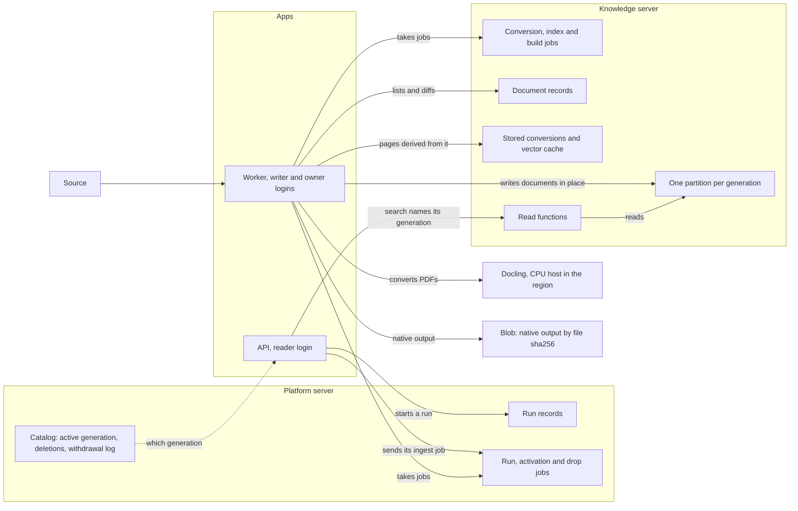
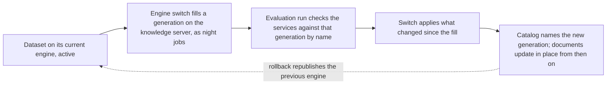

# 0042 The knowledge database

Status: proposed, 2026-10-27 (the connection to the knowledge server built: settings, roles, logins, pools, `connection: knowledge` and the binding, 2026-10-30; generations as partitions, their filter indexes and the catalog naming the active generation, 2026-10-30; stale ingestion runs found by heartbeat, 2026-10-29; the read functions, the read pool and the generation check, 2026-11-02; the knowledge job queues, run states, admission on the run, the reconciler and sending back, 2026-11-02; document records, in-place updates, the change sequence and data version, deletes by source kind and the citation read, 2026-11-03; a knowledge server per environment in the infra template, with its own network, identities, principals job and connect fence, not yet deployed, 2026-11-03; heavy work in the night window, its bypass, the VACUUM workaround's lock, VACUUM after runs, and the freeze and recall checks, 2026-11-03; engine switches into the knowledge database through ingestion runs, a run's own generation, prepared by its first ingest job and built and attached when the run ends, and `knowledge.drop` for one generation, 2026-11-04; Kudos ids by UUID with earlier ids on the record, complete Kudos listings by distinct count, 2026-11-04; folder document ids by owner and a hash of the path, 2026-11-04; records copied by an engine switch, owned by `_copy` and taken over by a pipeline, 2026-11-05; index and fill jobs side by side, `KNOWLEDGE_INDEX_CONCURRENCY`, 2026-11-06; the dataset delete route, which writes the deletion version, holds the id and leaves records and partitions on the knowledge server until `knowledge.drop` is sent, 2026-11-10; throttled embedding calls wait instead of failing a document, 2026-11-06; amended, not built: PDFs converted with Docling on a CPU host instead of Marker, accepted and kept converters per pipeline, converters' native output in Blob storage keyed by file sha256 first, and the derivation and its version in a stored conversion's key, 2026-11-12)

Left: which datasets move into the knowledge database, and when. Moving the whole Kudos corpus, removing the shared Typesense (issue 150), where Kudos may be processed (issue 131), and the server size and standby that Kudos would need are separate decisions, each taken with its cost (issue 175). This record says what any dataset gets when it moves in, and sizes Kudos only to show what moving it would need.

## Context

Search data for pgvector datasets lives in shared tables on the platform database (`kn_docs`, `kn_chunks`, `kn_phrases` in `packages/providers-pgvector/src/schema.ts`). Every dataset and every generation shares them: the full-text GIN indexes span all datasets, vectors are stored as `vector` with a partial HNSW index per dataset, and nothing above 2,000 dimensions is indexed. The API reads them as the owner role, and isolation between organisations rests on the router and on every statement naming its dataset. The pgvector endpoint accepts no database other than the platform's (`pgvectorEndpointOptions` in `engine.ts`). Each ingestion run builds a complete new generation and promotes it (`packages/ingest/src/index-writer.ts`), and nothing between the source and the index is kept, so a new chunker or embedding model means fetching and converting every document again. Pipelines are config entries on the platform server, and their runs are records in its `ingestion_executions` table, which are `running`, `succeeded`, `failed` or `cancelled` (`apps/api/src/ingestion.ts`, `packages/providers-postgres/src/executions.ts`). A run runs in the API process that started it.

That fits small datasets. It does not fit a dataset like Kudos, which the platform today only reads from a shared Typesense cluster: 45,961 documents in the KUDOS API listing on 2026-10-27, about 3.1 million pages by the page counts in that listing (2.96 million in primary files and 181,000 in attachments; the pilot's 300 documents averaged 55 pages, 16,611 in all), about 3.1 million vectors at the pilot's 20,248 for those documents (`benchmarks/kudos-pilot/results/timings.md` and `index-report.md` at tag [`evidence/kudos-pilot`](https://github.com/digdir/genki/tree/evidence/kudos-pilot/benchmarks/kudos-pilot/results)). One million 1,536-dimension `halfvec` vectors need a 3.8 GB HNSW index. Azure caps `maintenance_work_mem` at 2,097,151 kB, about 2 GiB ([Azure: memory parameters](https://learn.microsoft.com/en-us/azure/postgresql/parameters/parameters-resource-usage-memory?pivots=postgresql-17)), which holds the graph of about 570,000 such vectors; a larger build spills to disk and slows down sharply. The knowledge database is meant to hold many datasets owned by different organisations.

## Decision

The platform keeps one knowledge database for all pgvector datasets, keeps what it has fetched, converted and embedded, updates documents in place, builds a new generation only when the way documents are processed changes, and lets the API read it only through functions that check the dataset. Its work runs as jobs on pg-boss (ADR 0041).

How the parts meet, for one dataset:

### The knowledge server

- **Its own Azure Database for PostgreSQL flexible server.** The API and the worker reach it with an Entra ID token for their own identity (below): `KNOWLEDGE_PGHOST`, `KNOWLEDGE_PGDATABASE`, `KNOWLEDGE_PGUSER` and `KNOWLEDGE_AZURE_CLIENT_ID`, through `knowledgeIdentityTokenSource`, a managed identity credential for that client id only, which never falls back to the Azure CLI or another developer login as the token source for `PGHOST` does. `KNOWLEDGE_DATABASE_URL` is for local development only. The pgvector endpoint option `connection` accepts `knowledge` beside `platform`; an endpoint set to `knowledge` with no knowledge server configured stops the API from starting outside development mode, so data never falls back to the platform database unnoticed.
- **One per environment.** Each environment's template creates its own knowledge server (`knowledgePostgres` in `infra/main.bicep`), set up as its platform server is: the same module (`infra/modules/postgres.bicep`), private access in a delegated subnet, its own private DNS zone and Entra ID auth only. It sits in a network of its own (`genai-<env>-knowledge-vnet` in `infra/modules/knowledge-network.bicep`: test `10.43.0.0/24`, prod `10.42.0.0/24`), peered both ways with the environment's network, and its DNS zone is linked to both. A server cannot move to another network once it is made, so a network peered with the knowledge network later reaches the knowledge server and nothing else of the environment. Each server holds one database, `genai_knowledge`, bound to its own environment's platform server, and a change to a server (a parameter, a restart, a resize) is tried on test's before prod's.
- **Only the database's own logins connect.** Roles are global to a server ("Database roles are global across a database cluster installation", [PostgreSQL: database roles](https://www.postgresql.org/docs/17/database-roles.html)), and every role may connect to every database by default, so a login made for another database on the same server, such as another environment's, could otherwise log in to this one as a knowledge role it holds. The setup (`setUpKnowledgeServer` in `packages/providers-pgvector/src/knowledge-setup.ts`) revokes `CONNECT` from `PUBLIC`, grants it only to its two logins and, on Azure, to `azure_pg_admin`, takes back every other grant it can, and fails, naming each grant left and its grantor, when one remains. A role that inherits one of the two logins connects through it, and one that may set it acts as it wherever it connects, so the setup also fails, naming it, while any role but its own admin and the server's admins holds a login either way; the admin option alone, which PostgreSQL gives the role that created a login, is allowed. Tests: "a login of one environment cannot connect to the other environment's database", "setup takes back a connect grant to any login but its own two", "setup fails, naming the grant, while a connect grant it cannot take back is left" and "setup fails, naming the member, while another role can act as one of its logins".
- **In its environment's region.** Each server, its backups and the converters' native output in Blob storage (below) stay in the region its environment runs in (`location` in `infra/env/*.bicepparam`), inside the EU/EEA (ADR 0045). Its backups are kept 7 days and are not geo-redundant, unlike the platform server's (30 days, geo-redundant). Azure sets geo-redundant backup only when a server is created ("You can configure geo-redundant storage for backup only during server creation", [Azure: backup and restore](https://learn.microsoft.com/en-us/azure/postgresql/backup-restore/concepts-backup-restore)), so turning it on later means a restore into a new server. What neither the sources nor Blob storage can give back is small, and the nightly export copies it there too: earlier ids and tombstones (below). Losing the server then costs deriving the pages again from the native output in Blob, converting again only the files that had the text layer, the counts of listings a document has been missing from, so a delete waits for two more listings, and the data versions older results recorded. Geo-redundant backups would go to the paired region, also inside the EU/EEA, so residency is not the reason against them. Blob storage is a locally redundant storage account, like the platform's file share today (`Standard_LRS` in `infra/modules/storage.bicep`).
- **Bound to one platform server.** The platform server gets a random id once, when its migrations first run (`platform_identity`), and the knowledge server setup (`scripts/knowledge-server-setup.ts`) stores that id once (`knowledge_binding`). The worker compares the two when it starts, every minute until they match, and before every drop (in the `knowledge.drop` handler, issue 250). While they differ it runs no knowledge job, logs the mismatch as an error and answers 503 on `/readyz`, so a worker pointed at another environment's platform server changes nothing. A worker with no knowledge server configured is ready and runs no knowledge job. A restore keeps a server's id, so it needs no rebinding. Binding a knowledge server to another platform server, such as a copy given to another environment, is done only by the setup script with `--rebind` and a reason, run by an admin of both servers, and recorded in the platform server's audit log as `platform.knowledge.rebind` with the old id, the new id and the reason. It is not an API task as ADR 0010 describes, because the API has no right to change the knowledge server.
- **Three roles.** `genai_knowledge_owner` runs migrations and partition DDL, in the worker's build and drop jobs and when an ingest job prepares a generation that does not exist yet. `genai_knowledge_writer` is the worker's role for every other job: DML on the knowledge and `pgboss` tables, no DDL. `genai_knowledge_reader` is the API's role: `EXECUTE` on the read functions below and on the console's job-state function, and nothing else, so no `SELECT` on any knowledge table and no rights on `pgboss`. The `knowledge.ingest` and `knowledge.index` handlers run as the writer. Preparing a generation grants the writer `SELECT`, `INSERT`, `UPDATE` and `DELETE` on its standalone tables, so index jobs fill a generation that is not attached yet without DDL, and write through the parents once it is attached.
- **Each app logs in with its own identity.** The API reaches the knowledge server with a managed identity of its own that maps only to `genai_knowledge_reader`; the worker's maps to the writer and owner roles. The identity the apps share for the platform server has no rights on the knowledge server, so no code in the API can log in as anything stronger than the reader.
- **A principals job per environment sets the server up.** The environment's knowledge admin identity (`genai-<env>-knowledge-admin-id`) is an Entra admin of its knowledge server beside the admin group, and only the principals job holds it: `genai-<env>-knowledge-setup`, a Container Apps job started by hand, running `scripts/knowledge-server-setup.ts --principals` from the worker image. The job makes the API's and the worker's logins by object id (`pgaadauth_create_principal_with_oid`, in the `postgres` database), runs the setup and the binding, and prints the server's settings, extensions, logins, the two logins' memberships and who may connect, since the server can only be reached from inside the environment's network. It reads the platform id as `appIdentity`, the only identity that can read `platform_identity`.
- **The API reads only through `SECURITY DEFINER` functions,** as ADR 0022 does for API keys and cross-organisation reads: `kn_search`, `kn_fetch`, `kn_range`, `kn_facets`, `kn_documents` and `kn_resolve_citation`, one for each read of the knowledge port, and `kn_generation`, which gives the recipe of the generation a search reads, so the query is embedded with the model that built it rather than the one the catalog names now. The router checks the caller as today (`dataset.tenants` and residency in `packages/port-knowledge/src/router.ts`) and only then hands the connection the datasets it allowed (`DatasetConfig.allowed`); the connection sets `app.datasets` to them once for the transaction, beside `statement_timeout`, and refuses a dataset the router did not hand it. Each function first refuses a dataset that is not in `app.datasets`, then runs its query in PL/pgSQL as dynamic SQL with the dataset and generation written in as literals (`format('%L', …)`), so the planner reads one partition. Filters, profiles and weights are typed arguments, filters as clause rows in `jsonb` that become containment on `fields` so the partition's filter index serves them; a function whose arguments change gets a new name (`kn_search_v2`), so old and new API replicas both work during a deploy. Each function's statement comes from an owner-only helper (`kn_search_sql` and the like), so the plan tests run on the SQL the functions execute (`packages/providers-pgvector/src/read-functions.ts`).
- **Search reads through its own pool,** set by `KNOWLEDGE_READ_PGHOST`, which is the knowledge server itself until a read replica is added (heavy work, below). Nothing on the search path writes. A search names the generation it reads, the active one from the catalog or a candidate from the request, and embeds its query for that generation. A server that does not have that generation attached answers that it is not ready (SQLSTATE `KN503`), and the search goes to the primary, whose answer is final; a replica that does not answer (no connection, SQLSTATE class 08, or 57P01 to 57P03) sends the search to the primary too. A statement timeout or a refusal is the answer and is not repeated. On the primary, a generation the catalog names but no partition holds yet reads as empty. When `KNOWLEDGE_READ_PGHOST` is unset or names the primary, the API has one pool and nothing is read twice. Each read also returns the data version of the server that answered. Everything else uses the primary.
- **A candidate is searched only by a person with the right to manage datasets in the organisation that owns the dataset** (ADR 0027), never on the strength of a right in an organisation it is shared with. Services read a candidate only in an evaluation run or live comparison that such a person started. The same holds for a generation that an engine switch is filling (ADR 0025): it can be checked through a service's full retrieval path before the switch is activated.
- **The two content caches are shared across organisations.** Stored conversions and cached vectors are keyed by content, so the same file or text is converted and embedded once, whoever holds it. Cache hits per run are shown to operators, not to organisations, since a hit tells whether anyone else holds an exact file or a short text.
- **The worker fetches as the API does today:** through the ingestion fetch guard, which connects only to the addresses it validated and validates every redirect again (`guardedFetchStream` in `packages/ingest/src/website.ts`), and with a tenant secret only for the hosts it is set for (ADR 0015).

### What is stored

Each layer can be rebuilt from the one before it, so a later step never needs the source again:

| Layer              | Table                        | Key                                                                   | Holds                                                                                                                                                                     |
| ------------------ | ---------------------------- | --------------------------------------------------------------------- | ------------------------------------------------------------------------------------------------------------------------------------------------------------------------- |
| Document records   | `src_documents`, `src_files` | Dataset and document id; dataset, document and file                   | A number of its own, the pipelines that own it, the source record as received, a metadata hash, each file's sha256, state, when last seen, earlier ids, its change number |
| Native output      | Blob container `conversions` | `<sha256>/<converter>/<version>/<settings hash>.json.gz`              | The converter's own output, gzipped, with `<settings hash>.meta.json` beside it, no images                                                                                |
| Stored conversions | `src_conversions`            | File sha256, converter, version, settings, derivation and its version | Per-page markdown derived from the native output, and that output's Blob path                                                                                             |
| Vector cache       | `kn_embeddings`              | Hash of the text, the model's deployment and version, dimensions      | The vector, as `halfvec`                                                                                                                                                  |
| Index              | `kn_docs`, `kn_chunks`       | Generation partition, id                                              | Chunks, vectors and full-text data that searches read                                                                                                                     |

- **The platform keeps no source files it can fetch again.** A converter upgrade downloads them again; a new derivation does not, since it reads the native output (conversion, below). Uploaded files are the exception: they exist only in the platform's blob store (`apps/api/src/dataset-uploads.ts`), where they stay.
- **Unused cache entries are removed.** A nightly `knowledge.cleanup` job deletes stored conversions and cached vectors that a file record or a kept generation used and none uses any more, after a grace period of 7 days, and each native output in Blob once no stored conversion holds its Blob path. That also removes what an older converter version or derivation left behind. A seeded conversion that no record has used yet is not unused, so a seed is not removed before the fill that uses it.
- **A converter's native output goes to Blob storage when it is made,** gzipped, keyed by the file's sha256 first: `<sha256>/<converter>/<version>/<settings hash>.json.gz`, where the settings hash is the sha256 of the settings as canonical JSON, with `<settings hash>.meta.json` beside it (converter, version, settings, pages, when), so two settings of one version keep apart. Listing `<sha256>/` finds every native output of a file without the database, and deleting that prefix erases them. The container has versioning, and earlier versions are deleted after 30 days. `src_conversions` keeps the pages and the output's Blob path, not the output itself: for Kudos the Docling output is about 51 GB raw, about 20 KB a page. The text layer has no native output.
- **The nightly `knowledge.export` copies each dataset's earlier ids and tombstones** to Blob storage, and no conversions, since their native output is already there. A new server, region or host is filled from Blob: the pages are derived again from the native output with no converter call, and only the files that had the text layer are downloaded and converted again.
- **Deleting a dataset** writes a catalog version that deletes it, with who, when and the reason, and sends a `knowledge.drop` job in the same transaction (jobs, below). Its id cannot be used for a new dataset until that job has finished.
- **A deleted document leaves a tombstone** in its dataset, whether its source deleted it (deletes, below) or it was withdrawn on request: the keyed hash of its id (below) and the date, nothing else. The API passes `kn_resolve_citation` the keyed hash of the id it resolves, so an old citation says the document was withdrawn instead of linking nowhere, and it answers the same for both kinds, so it does not tell whether anyone asked for erasure. Until issue 178, tombstones hold a plain sha256 of the id (`tombstoneHash` in `packages/port-knowledge/src/tombstone.ts`), not the keyed hash.
- **Withdrawing a document on request,** for example on an erasure request, is an admin action with a reason, audited (ADR 0010): the API writes the withdrawal's log entry (below) and sends a `knowledge.withdraw` job with it, and the job deletes the document from every generation of its dataset, kept generations and candidates included, in one transaction; deletes its stored conversions and cached vectors at once when no other record uses them; and, when no other record uses the file, deletes the file's `<sha256>/` prefix in Blob storage, earlier versions included, in the same job. It leaves a tombstone like any deleted document, so the knowledge server keeps neither the id, which can be a path that names a person, nor the title. The id cannot be read from the hash, and without the key a guessed id cannot be confirmed either.
- **Withdrawals are logged where a restore cannot undo them.** Each withdrawal is recorded on the platform server (`knowledge_withdrawals`: a number, the dataset, the keyed hashes of the document's id and of each of its files, and the date) and kept as long as its dataset, since it also keeps the document out of later runs. The knowledge server records the last withdrawal it has applied, and each search passes the platform's latest number. A server that is behind, after a restore from a backup or a fill from the Blob copy, answers that it is not ready until the worker has applied the log; on the primary that fails the search, which is the price of never serving withdrawn content.
- **A withdrawn document stays out.** A run skips a listed document whose id's keyed hash is in the withdrawal log, and a file whose keyed hash is, and its report counts the skips, so a source that still lists the document does not bring it back.
- **Tombstones and the withdrawal log hash with a key per dataset.** A keyed hash is HMAC-SHA256 under the dataset's key, of the document's id or, for a file, of its sha256. The dataset's key is HMAC-SHA256 of the dataset id under one secret, `KNOWLEDGE_ID_KEY` (32 random bytes in Key Vault), which the API and the worker read and neither database holds. A table, a backup or the Blob copy alone then confirms no guessed or listed id, and the same document gives different hashes in two datasets. The key is never rotated, since the ids are gone and old entries cannot be hashed again, and it is kept as long as any dataset, under Key Vault's soft delete and purge protection (`infra/modules/keyvault.bicep`). The platform server keeps a check value, the key's HMAC of a fixed string, stored the first time the worker starts with a key. While the key an app reads does not give it, the worker runs no knowledge job and fails its readiness check, and the API refuses withdrawals, so a lost or replaced key cannot quietly let withdrawn documents back in.
- **How long withdrawn content lasts:** it leaves the knowledge server, the caches and Blob storage at once, a read replica when the replica has caught up, and the server's backups within their 7 days. Stored answers and traces that cited it keep their excerpts and chunk ids for their own retention (ADR 0011). The Docling host keeps no files or results; what it keeps of temporary files and logs is recorded when it is built (open, below).

### Identity and chunks

- **A document's id names its source instance and its id there:** `kudos:<uuid>`, `folder:<owner>/<hash of path>`, `cms:<endpoint>:<id>`. A folder document's owner is the dataset's scope (`platform` or the organisation number), and the hash is of the file's path from the folder root (`INGEST_FOLDER_ROOT`). So within a dataset the id is the same on every machine, two pipelines that list the same file name the same document, as co-ownership below needs, and no file path, which can name a person, reaches a stored answer through the id (`folderDocumentId` in `packages/ingest/src/sources.ts`; tests "a folder document keeps its id when the folder root moves", "two folder pipelines over one file give it the same id" and "a folder document's id names no path"). The path stays in the record's metadata, where withdrawal reaches it. Records are kept per dataset, so the same document in two datasets has two records; its conversion and vectors are still shared.
- **A source id stays in records and chunks, where withdrawal reaches it.** An id can name a person (a file path, a title in a URL), so job data, stored job errors and logs name a document by its record's own number instead.
- **When a source renumbers,** the earlier ids stay on the record. A citation is resolved through them only inside a dataset the caller may read (`kn_resolve_citation`).
- **A chunk's id is a hash of its document id, file, page and position,** so two documents never share a chunk id, even with the same text, and a chunk id that a stored answer keeps carries no path. Today's chunk ids start with the document's key (`${document.key}#n` in `apps/api/src/ingestion.ts`).
- **Every chunk carries** its document id, file, page or page range, and heading path when the converter gives one. How a document is cut into chunks is part of the recipe, not of this contract.

### Ingestion runs

- **A document record is owned by the pipelines that list it.** A dataset can be filled by several pipelines, and a run compares, deletes and brakes only on its own pipeline's records. When a pipeline lists a document another pipeline owns, it takes the document over only when the file sha256 or metadata hash differs; otherwise it becomes a co-owner. A document is deleted only when no owner lists it any more.
- **A copy owns what it copies until a pipeline takes it over.** An engine switch that copies a dataset in from another engine (ADR 0025) writes its records owned by `_copy`, which no pipeline id can be. A pipeline's run counts them among its own: a copied record it lists is processed as changed, so it is converted and indexed again, and it becomes the pipeline's; a copied record it does not list stays as copied, since only its owner deletes it (tests "a pipeline that takes over a copied dataset processes each listed document as changed" and "a pipeline that takes over a copied dataset leaves the copied documents it does not list").
- **Disabling a pipeline pauses it and keeps its documents.** Deleting a pipeline starts a removal run of its own: it gives up its ownership and deletes the documents no other pipeline owns, through the change brake.
- **A run lists its pipeline's source and compares the listing with the records its pipeline owns.** A new id, a changed file sha256 or a changed metadata hash marks a document to process. The run sends a `knowledge.convert` job for each file without a stored conversion and a `knowledge.index` job for each document ready to index. A file that is already being converted gets no second job: its record waits, and the run that marks it waiting and the conversion that finishes take the same lock on the file, so the finished conversion sends an index job for every waiting record. Unchanged work is free: stored conversions and cached vectors are reused.
- **Documents are replaced in place,** each in one transaction inside the active generation, so search never sees half a document. Every change to a dataset's document records takes the next number in the dataset's change sequence. A generation's data version is the highest number below which it has every change; it moves forward as index jobs apply changes. A document stored or skipped (no text, an unsupported type) has its change applied; one whose index job fails is marked `failed` with a reason code and is not applied, so its generation keeps what it held and the data version stays below its change until a later run, a send-back or a catch-up writes it. A catch-up then never skips it, and two reads with the same data version both hold every change up to it. An index job whose record changed while it ran writes nothing and fails, so its retry reads the record again and writes the newer change.
- **A run has six states.** `ingestion_executions` gains `queued`, for a run that waits for its pipeline's open run, and `waiting`, for a run stopped at the change brake until it is approved, beside `running`, `succeeded`, `failed` and `cancelled`. A run started while its pipeline has an open run is created `queued`, and at most one run per pipeline is `queued` (a unique index); a start or an approval while one is queued is refused with that reason. A run started with no open run is created `running` with its ingest job, and the transaction that ends a run makes its pipeline's queued run `running` and sends that run's ingest job. A run that runs as jobs is marked so on its record, and the API's check for stale runs (`failStaleRuns`, a heartbeat two minutes old) leaves it alone: it ends with its jobs (jobs, below).
- **One ingestion run per pipeline is open at a time,** from its start until its last job has ended. A run started while one is open waits, and at most one waits per pipeline. A record waiting on another run's conversion counts as open work of its own run. When a run's last job ends, the run ends with `VACUUM (ANALYZE)` (heavy work, below) and is marked finished.
- **Pushes and explicit deletes do not wait.** A source that pushes or deletes documents by id (uploads, a CMS) changes only those documents, each in its own transaction, beside any open run of its pipeline. Each push is a one-document run in `ingestion_executions`, admitted by the API like any run but not its pipeline's open run, and sends a `knowledge.push` job on the platform server in the same transaction; the worker writes the record and sends its convert or index job.
- **Deletes follow the kind of source:**
  - explicit sources (uploads, a CMS that pushes and deletes by id) delete at once;
  - listed sources (Kudos, folders, databases, Parquet) delete a document after two complete listings in a row without it. A listing is complete when every page came back without error and, for a source that reports a total (Kudos's `meta.total`), the count of distinct documents matches. A source can repeat some documents and skip others between pages, as KUDOS does for documents that share a publish date, so a raw count can match while documents are missing; a search that comes back short is listed again in the other order, up to three passes, and stays incomplete if the union is still short;
  - crawled sources delete a page after a 404 or 410 seen twice, or after three complete crawls without it.
- **A change brake stops large runs.** A run that would change, take over or delete more than 5 % and more than 50 of the documents its pipeline owns in the dataset stops before writing. A pipeline's first run in a dataset is exempt for new documents, not for takeovers. A stopped run is `waiting` and releases its pipeline; when a person with the right to manage datasets in the dataset's organisation approves it (`platform.pipeline.approve`, audited), the run lists again and goes on.
- **A bad run is undone by fixing the cause and running again.** The records say what to redo, and stored conversions and cached vectors make the rerun cheap. Bad data from the source needs the source fixed or the document excluded.
- **Schedules stay per pipeline** (`none`, `daily`, `weekly` at 03:00). A firing creates the run and sends its `knowledge.ingest` job instead of starting the run in the API.
- **An engine switch into or out of the knowledge database counts as an open run of every pipeline of the dataset** while it copies or re-ingests (ADR 0025). Runs into other engines, such as Typesense, stay in the API as today.

### Conversion

- **The converter port returns pages, not one string.** `DocumentConverter` returns a `Conversion`: the pages, the converter's native output when it has one, and the converter's name, version and settings.
- **PDFs are converted with Docling on a CPU host.** The PDF text layer runs inside the platform. Docling runs as an HTTP server in the environment's region, with no public ingress, reachable only from the worker, and scales to zero when no conversion waits (issue 476). It is called from `knowledge.convert` jobs: one request per job, with header and body timeouts, and the queue's retries in place of a retry ladder (ADR 0041). The server pins an exact Docling version and reads scans with Tesseract (`nor`), with TableFormer accurate; its version and settings are part of each conversion's key. Every dataset's PDFs may go there, since the host runs inside the environment as the worker does. The text layer is the fallback when no Docling host is configured.
- **The Docling host keeps nothing.** The client asks it to keep nothing, and the host has no cache of files or results and logs no request bodies. What it does keep (temporary files, logs) is recorded when it is built (open, below).
- **Marker stays a possible converter.** `markerConverter` remains for the API's in-process runs into other engines, and nothing calls it from jobs until a Marker host exists.
- **A pipeline names the converters it accepts, in order, and which of them are kept.** A file is converted when it has no stored conversion from an accepted converter. For Kudos: Docling, any version and settings, is kept; the text layer is accepted and replaced. A file whose only conversion is one to be replaced is converted again later, by a replacement run, so a fill never waits for it. A run that ends with such files sends one replacement run for them, a run of its own in `ingestion_executions` that, like a push, is not its pipeline's open run, so the pipeline's next run does not wait for it; it carries the admission of the run that sent it, since the worker cannot admit a run. Its convert jobs are sent with `startAfter` at the next night window, and one taken outside the window is sent again for the next, at a concurrency the host can take. A convert job sent for the same key while a replacement job waits moves that job to now, at the sender's priority, since the queue keeps one job per key. In lockdown (ADR 0033), a replacement run would outlive the 24 hours of its sender's admission, since a backlog can take weeks of nights (about 567,000 Kudos pages at about 27,000 a night), so it starts `waiting` until a person with the right to manage datasets in the dataset's organisation admits it, with a reason, audited as approving a braked run is (`platform.pipeline.approve`); that admission lasts until the run's files are converted, not 24 hours. Each new conversion sends index jobs for every document that holds the file, and those documents are replaced in place. A kept conversion is never converted again on its own: a newer Docling version or other settings on the server do not queue the files it already holds. Converting kept files again, such as Tesseract on image-only pages, is an explicit upgrade with its own scope.
- **Which conversion a document reads.** The first converter in the pipeline's list that the file has a stored conversion from, and of that converter the newest stored conversion with the generation's derivation. A new one, from the background replacement or an upgrade, is applied in place, as any changed document is.
- **The text the chunker reads is derived, and records how.** A stored conversion's key is the file sha256, converter, version and settings, and the derivation and its version: `docling-pages` 1 for Docling, `text-layer` 1 for the text layer, conversion parts later. A new derivation is made from the native output in Blob by sha256, with no file download and no converter call, and is stored beside the old one until a generation built from it is active.
- **`docling-pages` reads a `DoclingDocument` in reading order,** groups it by page, leaves out page headers and footers, empty items and bare page numbers, and writes headings as `#` lines and tables as Markdown tables. Text inside a picture is left out, except on a page with no other text, which takes the text inside its pictures. In five samples of 300 random files of the KUDOS export, 1.7 to 2.8 % of pages (2,155 of 91,466) had text only inside pictures, 1.6 % with 200 characters or more, and would otherwise be empty ([`picture-text/results.md`](../../benchmarks/ingestion/blocks/picture-text/results.md)). It needs no file, so no text-layer guard: the text layer is not compared page by page as it was planned for Marker.
- **Conversions made outside the platform can be seeded.** A Docling export of KUDOS PDFs, made outside the platform from the public files, is seeded as kept conversions (issue 474): 40,505 files, about 2.55 million pages, Docling 2.123.1 with EasyOCR (`no,en`) and TableFormer accurate. The parser benchmark measured Docling with Tesseract, not EasyOCR, so the seeded conversions' quality on scanned pages is not measured (open, below); the seed checks 20 sampled documents against Docling's page tests.

### Generations, recipes and experiments

- **A generation is one partition.** The knowledge tables are partitioned by list on the generation id, and every generation belongs to one dataset. GIN and btree indexes are declared on the parent; each partition has its own HNSW index.
- **Vectors of different sizes share the parent.** The parent's `vec` column is `halfvec` without dimensions; each partition's HNSW index is on `(vec::halfvec(N))` for its recipe's dimensions, and every query writes the same cast, since a query without it falls back to a sequential scan without an error.
- **Each partition indexes its own dataset's declared filters** (`dataset.filters` in the catalog: `select`, `multiselect`, `text`, `range`, `boolean`). `select`, `multiselect` and `boolean` filters share one GIN index on `fields` (`jsonb_path_ops`, for `@>`), and each `range` filter gets a btree index on its value cast to its type, such as a year, through `kn_int` or `kn_text` (compared bytewise, `collate "C"`, as the read functions compare text bounds), which give no value for a list or a value of another type, so a bad value is stored and matched by no range query instead of failing the write. A partition belongs to one dataset, so no index serves another dataset, and changing a dataset's filters adds or drops indexes on its own partitions only, as a `knowledge.build` job when the partition is above the heavy threshold. The worker makes that change when it sees the dataset's filters change in the catalog. Containment can use the GIN index because reads go through the read functions, not row-level security. Source-specific fields, such as Kudos's `type`, `concerned_years` and `orgs_short`, stay in `fields` rather than in columns or tables of their own.
- **A new generation is built standalone and attached.** It is created with `LIKE … INCLUDING ALL`, so it has the parent's generated columns, loaded, given the parent's indexes and a `CHECK` constraint matching its partition bound, and then attached with `ATTACH PARTITION`, which then needs no scan. `ATTACH` locks the parent only in `SHARE UPDATE EXCLUSIVE` mode, so searches never wait for it; `lock_timeout` keeps it from queueing behind other DDL or a VACUUM of the parent. An old generation is detached with `DETACH PARTITION ... CONCURRENTLY` and dropped. A detach that was cancelled leaves the partition pending, and the next partition DDL on that table finishes it first (`DETACH PARTITION ... FINALIZE`).
- **A generation records its recipe:** the accepted converters in order, which of them are kept, and their derivations; the chunking and search-phrase settings of each pipeline; embedding model and dimensions; and full-text configuration. These settings move from the pipeline (`chunking`, `phrases` in `apps/api/src/ingestion.ts`) into the recipe, so a change to them takes effect through a candidate, never in the active generation, and unchanged chunks reuse cached vectors. A search embeds and parses its query with the recipe of the generation it reads. The engine is not part of the recipe: moving to another engine stays an engine switch (ADR 0025).
- **A new generation is built only when the recipe changes, and activating it is a catalog change,** as an engine switch is (ADR 0025): a new version of the dataset's catalog entry names the active generation and its embedding, published with a reason through the audited admin path. The previous generation is kept for `knowledge.switchRetentionDays` and then dropped by a `knowledge.drop` job. `kn_active` goes.
- **The catalog names a dataset's generation.** A dataset entry on a `knowledge` endpoint carries `generation`. A publish without one keeps the generation the previous version named; a new dataset gets a new one, named by the date and a short random part (`g-20261030-7f3c2a`), empty until the worker fills it. A plain publish that moves a dataset from another endpoint onto the knowledge server is refused, since it would go live empty: an engine switch fills a generation first and publishes the entry naming it. Attaching a generation never makes it active.
- **Activating a candidate catches it up first.** A `knowledge.activate` job pauses the dataset's pipelines and applies the record changes after the candidate's data version (new, changed and deleted documents) with the candidate's recipe; the catch-up publishes the catalog change when it is done and lets the pipelines go on.
- **Rollback switches at once and catches up afterwards.** It publishes the previous catalog version, then applies the changes the previous generation missed. If that generation's embedding model is no longer served, rollback is refused with that reason; a catch-up reads each file's conversion by the generation's accepted converters and derivations, as any index job does.
- **Provenance names the data, not only the generation.** A task records each dataset it read with the generation and the data version of the server that answered, so two results are only compared when they read the same data (ADR 0003, ADR 0004).
- **Recipes are tried on a frozen sample first,** a small dataset with fixed documents and test cases, where a candidate builds in seconds. The winning recipe is then built as a full candidate beside the active generation and compared there. Recipes are chosen on the train and validation cases of a test set; the holdout (ADR 0003) is used only for the check before a candidate is activated, so the recipe is never tuned on it.

How a dataset moves in from another engine, such as Kudos from Typesense:

### Vectors and full text

- **Vectors are `halfvec`** (today `vector`), indexed with HNSW (`m` 16, `ef_construction` 64) and searched with iterative scans on, as today. `halfvec` indexes up to 4,000 dimensions. Binary quantisation with re-ranking is a recipe option for very large generations, not yet measured (open, below).
- **An embedding input is at most 8,191 UTF-8 bytes.** A longer text, such as a long table an engine switch copies in (ADR 0025), is embedded by its start and stored whole, so full-text search and reading still see all of it. text-embedding-3 takes 8,192 tokens and none of its tokens is shorter than a byte, so no input is refused (`embedIndexDocument` in `packages/ingest/src/index-writer.ts`; test "a chunk over 8,191 UTF-8 bytes is embedded by its start and stored whole").
- **The full-text configuration is one per generation,** chosen in the recipe and `norwegian` by default, as today's `textSearchConfig`. Azure's extension list has no `pg_textsearch` (BM25) ([Azure: extension versions](https://learn.microsoft.com/en-us/azure/postgresql/extensions/concepts-extensions-versions)), and as far as its documentation shows, Azure gives no way to install the files Hunspell dictionaries need, so compound words are not split.

### Heavy work

- **Heavy work runs only in a night window,** `knowledge.nightWindow`, 01:00 to 06:00 Europe/Oslo by default. Work is heavy above `knowledge.heavyThreshold` (100,000 chunks by default): an index build of a generation that size, writing more chunks than that into one generation (a candidate fill, a catch-up or an ingestion run), and VACUUM of a partition above that size. Builds, catch-ups and VACUUM are `knowledge.build` jobs, and the documents of a heavy fill or run are `knowledge.fill` jobs. Both start at the next window, `knowledge.build` jobs are taken one at a time per knowledge server, and nothing starts one earlier unless an operator sets `knowledge.nightWindow` to `always` through the audited settings path: heavy work then runs at any hour, as to fill datasets before a service goes live, until the window is set back. The worker moves the start of waiting `knowledge.build` and `knowledge.fill` jobs whenever the window changes. Work below the threshold, including a frozen sample and a small catch-up, runs at any time. An ingestion run counts its chunks as it writes; once it has written `knowledge.heavyThreshold`, its remaining documents go as `knowledge.fill` jobs: an index job that starts after its run's report counts `knowledge.heavyThreshold` chunks sends itself again as a `knowledge.fill` job.
- **In the window, a build runs at full speed:** `max_parallel_maintenance_workers` is set for the build to the server's vCores minus one (`KNOWLEDGE_VCORES`; without it, PostgreSQL's default), since few searches run at night.
- **A build is estimated in two parts before it is sent.** Vectors up to `maintenance_work_mem` divided by the size of one graph element (about 3.8 KB at 1,536 dimensions) count at the in-memory rate, and the rest at the spilled rate, both measured on the server. A build is refused, with its estimate, when it does not fit in the window, or when its new graph does not fit in the memory the active indexes leave free; it then needs a larger server or a smaller recipe, such as fewer dimensions or binary quantisation. A build still running an hour after the window ends is cancelled and reported with its progress.
- **Outside the window, VACUUM is throttled** (`vacuum_cost_delay` 2 ms). The server keeps memory for its active indexes plus one build, and reads the active indexes back into memory after a heavy job (`pg_prewarm`, which Azure allows with `shared_preload_libraries`). A nightly check reports to operators when the active indexes outgrow the memory kept for them, since in-place growth is not checked as a build is.
- **A read replica can be added later without code changes,** if a night is not enough or search needs more room: setting `KNOWLEDGE_READ_PGHOST` to the replica moves search there. A server with a zone-redundant standby can have read replicas, and a replica has no standby of its own ([Azure: high availability](https://learn.microsoft.com/en-us/azure/postgresql/high-availability/concepts-high-availability), [Azure: read replicas](https://learn.microsoft.com/en-us/azure/postgresql/read-replica/concepts-read-replicas)), which is why the read pool falls back to the primary. Replication is asynchronous, and Azure says lag can reach hours under heavy writes, as during an index build. The generation check covers a generation the replica does not have yet; within a generation, a lagging replica returns older documents, including withdrawn ones, until it catches up, and provenance records the data version it answered with.
- **The VACUUM workaround for pgvector 0.8.2.** Azure ships pgvector 0.8.2 ([Azure: extension versions](https://learn.microsoft.com/en-us/azure/postgresql/extensions/concepts-extensions-versions)). In that version, VACUUM while rows are inserted can corrupt an HNSW index without an error; the bug has been there since HNSW first shipped and is fixed in 0.8.3 ([pgvector #988](https://github.com/pgvector/pgvector/pull/988)), and 0.8.4 fixes a "hnsw graph not repaired" error that 0.8.3's new check raised ([changelog](https://github.com/pgvector/pgvector/blob/master/CHANGELOG.md)). So, until Azure ships 0.8.4 or later:
  - partitions that take in-place updates have autovacuum off;
  - every writer tries a per-generation advisory lock in shared mode (`pg_try_advisory_xact_lock_shared`), and VACUUM takes it exclusively, so VACUUM never runs beside a write. A job that does not get the lock is sent again later instead of waiting, since a waiting exclusive request blocks every later shared one;
  - each ingestion run ends with `VACUUM (ANALYZE)`, as a `knowledge.build` job in the next window when the partition is above the heavy threshold, and a nightly check runs `VACUUM (FREEZE)` in the window before a partition's `age(relfrozenxid)` reaches half of `autovacuum_freeze_max_age`, since PostgreSQL starts an anti-wraparound autovacuum even with autovacuum off;
  - a nightly check compares search on a sample of each active generation's own vectors with exact search, recall@10 at the `hnsw.ef_search` search uses. A generation's first result is its baseline, kept on `kn_generations` until a `REINDEX` resets it; a night more than a margin below it sends a `REINDEX INDEX CONCURRENTLY` of the generation's HNSW indexes as a `knowledge.build` job. The sample size and the margin are set in code from the noise measured on real page vectors (`scripts/knowledge-recall-noise.sql`): 200 queries and 0.01, and fewer queries above 500,000 chunks (at least 50, with the margin widened to match), since each exact search reads the whole partition.
- **Quotas per organisation:** stored size of its datasets' generations, rows and indexes together (`knowledge.quota.storedGb`, 20 GB by default), and candidate generations (two per dataset), checked when a generation is prepared. An organisation with a dataset the size of Kudos gets its quota set explicitly. The shared caches are not charged to anyone.
- **A standby is decided with the first service that depends on the server,** with its cost; for Kudos, that is issue 175. A restore from backup is done and timed before that service switches.

### Jobs

- **A job that follows a platform record lives on the platform server** (ADR 0041) and is sent in the same transaction as that record: `knowledge.ingest` with a run's start, its approval or a schedule's firing; `knowledge.push` with a push; `knowledge.withdraw` with a withdrawal's log entry; `knowledge.activate` with an activation or a rollback; `knowledge.drop` with a dataset's deletion, or from the nightly check for a generation past its retention, which is scheduled on the platform server. The API sends jobs only there, as `genai_runtime` with grants that let it send a job and nothing more, and the worker runs them as `genai_worker` (ADR 0041).
- **A job that follows a document record lives on the knowledge server,** sent by the worker as the writer in the same transaction as the change it follows: `knowledge.convert`, `knowledge.index`, `knowledge.fill` and `knowledge.build`. The nightly `knowledge.cleanup` and `knowledge.export` live there too.
- **Every queue states its contract in code,** and keeps ADR 0041's retention:

  | Queue                | Server    | Policy and key                                                     | Expiry, heartbeat                       | Retries                           | Notes                                                                                                                                                                                      |
  | -------------------- | --------- | ------------------------------------------------------------------ | --------------------------------------- | --------------------------------- | ------------------------------------------------------------------------------------------------------------------------------------------------------------------------------------------ |
  | `knowledge.ingest`   | Platform  | `exclusive`, keyed by pipeline                                     | 2 h, 60 s                               | 2, with backoff, then dead letter | Lists the whole source in one job and sends convert and index jobs; sent when its run becomes `running`                                                                                    |
  | `knowledge.push`     | Platform  | `exclusive`, keyed by dataset and document record                  | 15 min, 60 s                            | 2, with backoff, then dead letter | Writes one pushed or deleted document's record and sends its convert or index job, beside any open run                                                                                     |
  | `knowledge.withdraw` | Platform  | `exclusive`, keyed by dataset and the id's hash                    | 15 min, 60 s                            | 2, with backoff, then dead letter | Removes a withdrawn document from every generation, the caches and Blob storage, leaves its tombstone and records the withdrawal as applied                                                |
  | `knowledge.activate` | Platform  | `singleton` per dataset                                            | 15 min, 60 s                            | 2, with backoff, then dead letter | Pauses the dataset's pipelines and sends the catch-up; a rollback publishes the previous catalog version first                                                                             |
  | `knowledge.drop`     | Platform  | `singleton` per dataset                                            | 1 h, 60 s                               | 2, with backoff, then dead letter | Reads its deletion or retention again, finishes a pending detach, then deletes a deleted dataset's records and partitions, or an old generation                                            |
  | `knowledge.convert`  | Knowledge | `exclusive`, keyed by file sha256, converter, version and settings | 1 h above the converter's timeout, 60 s | 2, with backoff, then dead letter | Priority: uploads before ingestion runs before candidates before replacement runs. Writes the native output to Blob, then the pages; sends index jobs for every record waiting on the file |
  | `knowledge.index`    | Knowledge | `exclusive`, keyed by generation and document record               | 30 min, 60 s                            | 2, with backoff, then dead letter | Chunks, embeds and writes one document in one transaction; sent again later when VACUUM holds its generation                                                                               |
  | `knowledge.fill`     | Knowledge | `exclusive`, keyed by generation and document record               | 30 min, 60 s                            | 2, with backoff, then dead letter | Index jobs of a fill or run above the heavy threshold, taken only in the night window                                                                                                      |
  | `knowledge.build`    | Knowledge | `singleton` per knowledge server                                   | 24 h, 60 s                              | 1                                 | Index builds, catch-ups, VACUUM, `VACUUM (FREEZE)` and `REINDEX`, started at the next night window; a run's VACUUM names the run                                                           |
  | `knowledge.check`    | Knowledge | `singleton`                                                        | 2 h, 60 s                               | 2                                 | Nightly at the window start: the freeze check and the recall check                                                                                                                         |
  | `knowledge.cleanup`  | Knowledge | `singleton`                                                        | 2 h, 60 s                               | 2                                 | Nightly: removes unused cache entries after the grace period                                                                                                                               |
  | `knowledge.export`   | Knowledge | `singleton`                                                        | 2 h, 60 s                               | 2                                 | Nightly: copies earlier ids and tombstones to Blob storage                                                                                                                                 |

- **Deletion follows an explicit record, never absence.** A `knowledge.drop` job is sent only with a catalog version that deletes a dataset, or for a generation the catalog shows past its retention, and its handler reads that record again before it deletes anything. Data on the knowledge server for a dataset the catalog does not know at all is reported to operators every night and never dropped, so a worker that reads the wrong platform server, or a platform server restored from before the dataset existed, deletes nothing.
- **Two steps cross back, and a reconciler repairs them.** The worker, one instance at a time under the leader lease, checks every minute that a run whose jobs have all ended is ended, and that a catch-up that ended without publishing its catalog version publishes it. Every night, an active generation behind its dataset's change sequence with nothing working on it gets a catch-up.
- **A run is open while it has work left.** Its jobs carry its id, and a record waiting on another run's conversion counts as its work too. The reconciler leaves alone a run that is `waiting`, starts a `queued` one as below, and drops a job whose run is gone, finished or cancelled. Cancelling a run marks its record on the platform server; a handler checks it between documents, the worker cancels the run's queued jobs on the knowledge server, and a conversion another run waits on is left running. Sending a dead letter back reopens its run.
- **One open run per pipeline.** Runs, their states and their ingest jobs are all on the platform server, so the records decide: an ingest job is sent only for a run that becomes `running`, in the same transaction, and `knowledge.ingest` is `exclusive`, keyed by pipeline, as a guard. The reconciler starts a `queued` run whose pipeline has no open run, in case the run before it ended without doing so. An engine switch of a dataset in the knowledge database holds every pipeline of the dataset the same way.
- **External services are called from the job (push).** A job that needs a service of its own, such as the Docling converter, calls it and waits (ADR 0041). The Docling host runs in the environment, reachable only from the worker; a service outside Azure, such as the ColBERT reranker (`COLBERT_API_URL`), is called over HTTPS with an API key. Neither needs access to the database or a platform login.
- **The night window is enforced twice.** Heavy jobs are sent with `startAfter` at the next window start, and the worker calls `work()` for `knowledge.build` and `knowledge.fill` only inside the window and stops at its end. A replacement run's convert jobs are sent the same way, and one taken outside the window is sent again for the next. A build still running an hour after the window ends is cancelled.
- **Handlers are idempotent.** A handler writes its result under a key that a second run writes again: a conversion under its file sha256, converter, version, settings and derivation, and its native output under the same Blob path; a document in one transaction that replaces the whole document.
- **Index and fill jobs run side by side.** One worker works up to `KNOWLEDGE_INDEX_CONCURRENCY` `knowledge.index` jobs at once (8 when unset, a whole number from 1 to 32), and as many `knowledge.fill` jobs. Their documents are read and embedded side by side; each write still takes its generation's row lock, so writes to one generation follow one another. A job holds a connection while it waits for that lock, so each of the worker's knowledge pools holds twice the setting plus 6 connections. The jobs that start a generation's run together all keep the chunking the first one set.
- **In lockdown (ADR 0033), a job that fetches, converts or embeds is checked at its start against what admitted it, and admission lasts 24 hours.** Production does not run in lockdown. A job carries only the id of what admitted it: its ingestion run, or a generation build, activation or rollback a person started through the audited admin path. Before a handler lists a source, downloads a file, calls a converter or calls a model (embeddings, search phrases), the worker reads that record, whose admission and the time it was given only the API sets after it has checked the caller and lockdown. The worker refuses the job when the record was not admitted, or was admitted more than 24 hours ago, except a replacement run, whose admission lasts until its files are converted (conversion, above); a run refused that way is marked failed with the reason and keeps what it wrote. Approving a braked run, sending its jobs back and starting it again admit it again from that moment. A conversion runs while any run waiting on it is admitted. A run still `queued` when its admission runs out fails without starting. Nothing in the job's data can admit it. In lockdown, a scheduled run sends no job and is recorded as failed with the reason, as today. Approving a braked run (`platform.pipeline.approve`), activation, rollback and sending knowledge jobs back join the routes lockdown locks for ingestion.
- **Throttling slows a run instead of failing its documents.** An index or fill job opens its embedder without the SDK's own retries and retries itself (`throttledEmbedder` in `packages/ingest/src/throttled-embedder.ts`). A 429 waits as long as the provider asks (`retry-after-ms` or `retry-after`), or 1 s doubling to at most 60 s when it names no wait or a wait of 0, and pauses every job's calls to that model on the same worker until then, so the worker settles at the quota's pace whatever `KNOWLEDGE_INDEX_CONCURRENCY` is. The waits of one try add up to at most 20 minutes, inside the job's 30-minute expiry; after that the 429 fails the try as other errors do, so a document fails only after waiting 20 minutes on each of its 3 tries. An unavailable embedder (5xx, a timeout, 408 or 409) is tried 3 more times, 0.5, 1 and 2 seconds apart, as the SDK did. A cancelled run stops the wait within 30 seconds, and a 429 the job waits out, or a 5xx it retries, is not logged as `model call failed`, so it does not count toward the `model-provider` alert; the job logs `model call failed` once, with its code, when it gives up. Tests: "an embedding call the provider throttles is tried again after the wait it asked for", "one throttled call pauses every job's calls to that model until the wait is over", "a throttled call still refused after 20 minutes fails as other errors do", "a 429 that asks for no wait backs off as if it named none", "a cancelled run stops a throttled call's wait", "a 429 on an embedder that retries itself is logged as throttled, never as a failed call", "an index job whose embedder gives up logs model call failed once, with its code", "a run cancelled while its index job waits out a 429 stops the job at once", "index jobs open their embedder without the SDK's retries, since they wait out a 429 themselves" and "a copy whose embedder answers 429 for its first calls stores every document and fails none".
- **A run ends with its jobs.** The reconciler ends a run when none of its jobs on either server is waiting, retrying or running. The run fails only when its `knowledge.ingest` job ended as a dead letter, since then the source was not listed; document jobs that ended as dead letters leave it `succeeded`, with their count as `failedDocuments` in its report, so a few bad files do not fail a run of thousands. A cancelled run ends `cancelled` once its running jobs have stopped. Sending back reopens a run either way.
- **Sending back works per run.** A person with the right to manage datasets sends back a run's dead letters, and only those, with `POST /tenants/{tenant}/datasets/{dataset}/pipelines/{id}/executions/{execution}/redrive` and a reason, audited as `platform.jobs.redrive`. Nothing else of the run is listed, converted or indexed again. The API reopens the run, admits it from that moment and records the request in `knowledge_job_requests`; the reconciler sends the dead letters back on both servers within a minute. A send-back that finds no dead letter, as for a run refused for its admission, ends the run as it had ended, with its error. A queued run whose pipeline's last ingest job is still ending stays queued, and the reconciler starts it once the job has ended.
- **Failures are visible and recoverable without crossing organisations.** The console's job screen (ADR 0041) shows knowledge queue counts and dead letters per organisation. A shared conversion's job is shown to every organisation with a record waiting on its file, without showing who else waits. Sending knowledge jobs back is allowed to people with the right to manage datasets in an organisation the job serves, which widens ADR 0041, where only operators send jobs back. The API records the request on the platform server and the worker sends the jobs back, since the API cannot change a job on either server (ADR 0041). An operator acts on an organisation's job only through a support session (ADR 0027).
- **Nightly jobs** (cleanup, export and the checks above) use pg-boss `schedule()` with `tz: 'Europe/Oslo'`, which sends one job per occurrence however many instances run.

## Open

- **What the Docling host keeps** (temporary files, logs) is not known until it is built (issue 476). It bounds erasure for anything sent there.
- **The Docling host's size in each region.** The measured rate is on a 32-vCPU host (below); whether test's region offers a 32-vCPU Container Apps profile is not checked (issue 476).
- **The seeded Docling conversions' quality on scans.** They were made with EasyOCR, which the parser benchmark did not grade; it graded Docling with Tesseract. They are kept all the same, and the seed checks 20 sampled documents (issue 474); reading image-only pages again with Tesseract is a later upgrade.
- **Docling on scanned pages.** The two benchmarks disagree. On the opb page tests (1,933 tests on 221 pages), Docling with Tesseract scored 75.2 on scanned pages against Marker 1.10.2's 90.3, a difference of −15.1 points (−46.1 to +8.3; `benchmarks/ingestion/opb/results/parsers.md` in PR 481), while on run 2's era set it led on image-only pages (88.6 against 74.3, from 5 documents, a hint). Both rest on few scanned documents. Which converter reads scans better is not settled; it decides whether image-only pages get their own converter or an upgrade later.
- **Heading levels.** Every heading in the KUDOS export is level 1, so a heading path has one step. Levels from the PDF outline or text size are a later derivation.
- **The ColBERT host's residency.** The GPU host the platform calls for ColBERT reranking is a Hetzner server in Nuremberg (whois of the host in `COLBERT_API_URL`, 2026-10-27), while the reranker is declared `residency: norway` (`apps/api/config/local/rerank.yaml`): that mismatch is a defect of its own (issue 129).
- **A Kudos-sized build on Azure** is not measured: about 3 million vectors at 2 GiB of `maintenance_work_mem` on the server size Kudos would need. Spilled build rates were measured up to one million vectors.
- **How much a build slows search at a realistic search rate** is not measured; the spike measured the worst case.
- **Binary quantisation for large generations** is future work and not measured. pgvector indexes `binary_quantize(vec)::bit(N)` with HNSW (`bit_hamming_ops`), one bit per dimension, so the vector in each index entry takes 192 bytes at 1,536 dimensions instead of 3,072 as `halfvec`; a search takes more candidates from that index and re-ranks them by the full vector ([pgvector: binary quantization](https://github.com/pgvector/pgvector#binary-quantization)). It would let far more vectors fit in the 2 GiB of build memory and in the server's memory, at some cost in recall. On pgvector 0.8.2, `binary_quantize` accepts `halfvec` and the index builds (checked in the spike container). Before it becomes a recipe, it needs recall@10 against exact search on the reviewed Kudos questions with re-ranking, and build time and index size at about 3 million vectors.
- **`pg_diskann` for large generations** is not measured. Azure lists it, and its graph lives on disk with compressed vectors in memory, which goes at the build memory problem; its documentation shows only `vector` operator classes, not `halfvec`, and says nothing about VACUUM ([Azure: pg_diskann](https://learn.microsoft.com/en-us/azure/postgresql/extensions/how-to-use-pgdiskann)).
- **What the missing BM25 ranking costs** in recall is not measured.
- **Files uploaded to a conversation** are out of scope; ADR 0011 already deletes them with the conversation.

## What the spikes showed

Throwaway `pgvector/pgvector:0.8.2-pg17` containers, scripts and results in [`benchmarks/knowledge-spikes/`](https://github.com/digdir/genki/tree/evidence/knowledge-spikes/benchmarks/knowledge-spikes) at tag `evidence/knowledge-spikes`:

- **Row-level security costs the keyword half of search** (`rls/`). With a policy on a table, PostgreSQL uses an operator as an index condition only when it is leakproof. Of the operators search uses, only equality is; full-text match (`@@`) and pgvector's distance are not. HNSW is still used, because ordering is not a condition, but full-text search loses its GIN index: ranked full text over the 180,000 rows of one dataset in a 200,000-row table took 31 ms with a policy against 0.36 ms without, as a sequential scan. On a partition per dataset with a policy that reads no column, it took 40 ms against 0.11 ms, also as a sequential scan (`partition-policy.sql`). Azure gives customers no superuser ([Azure: database users](https://learn.microsoft.com/en-us/azure/postgresql/security/security-manage-database-users)), so the functions cannot be marked leakproof. The same holds for jsonb containment (`@>`), which typed filters would need with a GIN index on `fields`.
- **Reads through `SECURITY DEFINER` functions cost nothing measurable on partitions** (`rls/definer-partitions.sql`, 301 partitions). Ranked full text took 0.09 to 0.12 ms through a PL/pgSQL function that writes the dataset and generation into dynamic SQL, against 0.06 to 0.10 ms read directly by the owner, and 86 to 93 ms through a plain SQL function, which plans every partition. The function refused a dataset outside `app.datasets`, and the reader's direct read was refused.
- **Swapping generations does not hold up searches; building one slows them** (`partitions/`; 4 CPUs, 16 GB, one million 1,536-dimension vectors, 8 clients searching as fast as they could). `ATTACH PARTITION` took 18.5 ms and `DETACH PARTITION ... CONCURRENTLY` 7.3 ms, neither hit its 1-second `lock_timeout`, and no search that overlapped them took more than 52 ms. Building a second generation of the same size beside the active one with one parallel worker raised search p95 from 39 ms to 62 ms while the HNSW graph fit in `maintenance_work_mem` (2 GB, the first 570,906 vectors), and to 195 ms once it spilled, with throughput down from 735 to 113 searches a second. Copying the rows in raised p95 to 778 ms. After the spill the build added about 7 vectors a second and was stopped after 78 minutes at 59 %; the same build with no searches running took 18 minutes. The clients never waited, so this is the worst case for CPU; a realistic search rate was not measured.
- **In-place updates with the VACUUM workaround keep the index healthy** (`churn/`). On 18,000 Kudos page vectors (text-embedding-3-large, 1,536 dimensions) with autovacuum off, 20 rounds each replaced 1 % of the rows and then ran VACUUM with no writer running (4.0 to 7.6 s each). No errors. Recall@10 against exact search for 676 Kudos questions was 0.9951 before, 0.9960 after, and 0.9945 for a fresh build on the same rows. This is the workaround at pilot size, not at millions of rows, and it does not reproduce the bugs themselves.

## Why

- **One server per environment, not per dataset.** The largest dataset sizes the server either way, and a server per dataset multiplies cost and operations. Search needs its indexes in memory, which the platform server (`Standard_D2ds_v5` in production: 2 vCores, 8 GiB, `infra/env/prod.bicepparam`) does not have room for once a large dataset moves in, and index builds and VACUUM must not compete with logins and conversations.
- **Read functions, not checks in every statement or row-level security.** With checks only in the application, every statement, and every future one, is one missing `dataset =` away from returning another organisation's rows, and the guard is a test that parses the statements the tests happen to run. Row-level security keeps isolation in the database but loses the full-text index, on partitions too. `SECURITY DEFINER` functions keep isolation in the database at no measurable cost on partitions, as ADR 0022 already does elsewhere; the cost is that search SQL lives in PL/pgSQL migrations. A database role per organisation with grants per partition would keep the SQL in TypeScript, but its grants would have to follow `dataset.tenants` in the catalog on the other server.
- **Records per dataset, caches shared.** Deletes, tombstones and the change brake are about one dataset's view of a source, so the records are per dataset. Conversion is the expensive step, so it is the part that is shared: stored, it takes about 7 KB a page (`benchmarks/knowledge-spikes/sizes.md` at tag `evidence/knowledge-spikes`).
- **Records owned by pipelines, and co-owned on overlap.** A listing only knows its own source, so a run can only judge its own pipeline's records; without ownership, a Kudos run would delete the documents a folder pipeline added to the same dataset after two listings. If the last writer always took a document over, two pipelines with overlapping sources would take the same documents from each other on every run.
- **A run lock per pipeline.** Records and the brake are already per pipeline. With one lock per dataset, a heavy run that writes only at night, or a run waiting for approval, would hold back uploads, other pipelines, activation and rollback for days.
- **Jobs on the server of the record they follow.** A run, an activation and a dataset's deletion are platform records, so their jobs commit with them there, and the API, which writes those records, needs no right to send jobs to the knowledge server. Document jobs commit with document records on the knowledge server. Only two steps cross back, each repaired by the reconciler. Sending ingest jobs from the API to the knowledge server would give the reader a right to write the queue, and need a repair for every run whose job was lost between the two servers.
- **Deletion from a record, not from absence.** Absence cannot tell a deleted dataset from a worker that reads the wrong server or a catalog restored from before the dataset existed. A deletion version says who deleted what and why, and the drop reads it again.
- **Tombstones keep a hash, not the id.** A tombstone exists so an old citation says withdrawn instead of linking nowhere. A hash of the id is enough for that, an id like a file path can itself be the personal data an erasure request is about, and one kind of tombstone for every delete does not tell who asked. The answer that cited the document already shows its title.
- **Keyed hashes, not plain sha256.** Ids can be listed or guessed: anyone who can read a source's listing can hash every id in it, and a folder path follows a pattern that can hold a person's name. With a plain sha256, whoever holds the withdrawal log, a backup or the Blob copy would learn which of those documents were withdrawn on request, and the same document would match across datasets. The cost is one secret that is never rotated and must outlive every dataset; the check value turns a lost or replaced key into a readiness failure instead. It is a secret of its own, not one derived from `CONTENT_MASTER_KEY`, so the key that wraps content keys can still be rotated. Chunk ids stay plain hashes, since the answers that keep them also keep the title and excerpts.
- **A server per environment, in a network of its own.** Each environment's server starts small (8 GiB, 64 GB) and grows with what that environment holds, so test's costs no more than test needs. Each database stays bound to one platform server, whose catalog, withdrawals and audit log it follows, and test tries every server change before prod. One server shared by test and prod was turned down: it saves a server, but a parameter change, a restart, a resize or an Azure upgrade reaches both untried, a restore brings back both databases, and an admin of the server is an admin of both. Inside the environment's network, the knowledge server could never be reached from another network without that network reaching the platform server too, since a server cannot move network; private endpoints would be a pattern apart from the platform servers'.
- **Backups for 7 days.** The sources, the Blob copy and its nightly copy of earlier ids and tombstones give back everything but listing counts and old data versions, so a longer retention buys little and keeps withdrawn content around longer.
- **In place, not a generation per run.** A generation per run costs as much as the whole dataset every night: the HNSW build alone took 709 s for one million vectors with 2 GB and two workers, against 153 s for half a million, so build time grows faster than the row count once the graph outgrows memory (`index-report.md`), and 1,069 s with one worker in the partition spike. In place, a night with a few dozen changed documents writes a few thousand rows. The cost that grows with the dataset is VACUUM, which runs in the night window.
- **A partition per generation.** VACUUM, index builds and memory then follow one generation instead of the whole database, autovacuum can be off for one partition, a candidate sits beside the active generation without touching its index (building it still competes with search for the server, as measured above), attaching and detaching one takes milliseconds, and dropping a generation takes seconds instead of deleting millions of rows. A partition per dataset would still put candidates into the active index; shared tables put every cost on the whole database.
- **One set of tables, not tables per source or per dataset.** Each generation is already a table of its own, with its own indexes, so a source's fields and filters fit in `fields` with indexes on that dataset's partitions. Tables per source kind would repeat generations, read functions and search SQL for every kind, and a dataset filled from two sources would span tables; tables per dataset would make every migration a loop over datasets. A source whose data is not documents and chunks, such as tabular rows or a graph, would get tables of its own.
- **Night only, at full speed, not throttled by day.** The partition spike shows that one build worker does not protect search: beside the active generation, search p95 rose 1.6 times while the graph fit in memory and 4.9 times once it spilled, and the build itself crawled. At night there are few searches to protect, so a fast build is better than a slow one, and a build that cannot fit in a night is a sizing problem to see before it starts.
- **A read replica later, not now.** A replica takes search off the build's CPU, but costs at least as much as the primary, lags most during the heavy writes it would isolate, and still replays the whole new index. A separate read pool and the generation check cost nothing now and keep the replica a configuration change for when a night is not enough.
- **Catch-up before activating, after rolling back.** Writing every ingestion run into every kept generation would multiply the nightly work by the number of generations, so a generation catches up when it is about to serve. A candidate can wait for that; a rollback is for when the active generation is wrong, so it switches first.
- **Docling on a CPU host, not Marker on a GPU host.** In the parser benchmark on 39 Kudos documents (1,100 pages, 24 with scans), Docling with Tesseract scored 81.0 on the era test set against 78.7 for Marker 1.10.2, the reference, a difference of +2.2 points (−3.3 to +8.3), with 54.5 against 45.0 on tables; with 8 workers on 32 vCPUs it converted 5,413 pages an hour, about $0.287 per 1,000 pages at list price, against $0.675 for Marker on a T4, one document at a time ([`run2.md`](../../benchmarks/ingestion/blocks/results/run2.md), [`throughput.md`](../../benchmarks/ingestion/blocks/results/azure-D32as_v6-swedencentral-run2/throughput.md); how it ran in [`README.md`](../../benchmarks/ingestion/blocks/results/README.md)). Docling is MIT-licensed and needs no GPU, so it runs in the environment's region beside the worker, where every dataset's files may go, instead of on a host whose place and retention would decide which datasets may use it.
- **Accepted and kept converters, not one configured converter.** With the converter, version and settings as the only key, a host with another Docling version or Tesseract would find none of the 40,505 seeded files stored and convert them all again: about 2.55 million pages, roughly 470 hours on the measured host, plus a second embedding run. Naming what a pipeline accepts and keeps makes an upgrade an explicit choice with its own scope, while the text layer, which ranks below Docling, is still replaced.
- **Native output in Blob, keyed by sha256 first.** Keeping the converter's own output makes a new chunking of the same text (a page builder now, conversion parts later) a derivation, with no download and no conversion. Blob holds it at a fraction of database storage, and a file's sha256 as the first part of the key lets erasure and a refill find every output of a file with one listing.
- **Push over pull.** Workers on the converter host could pull jobs through platform endpoints instead. That survives a deploy completely, but needs claim, heartbeat and upload endpoints, a machine login for the host and a worker program to maintain. The host is reachable from the worker, and a pushed job that loses its worker in a deploy is retried after its heartbeat lapses. The cost is that the retry converts the file again, since the host keeps nothing.
- **Lockdown on the record that admitted the job, for a day.** Trusting a mark in the job's data would let anything that can write the queue admit work. A run's admission is set only by the API, after it checked the caller, and starting a run is audited, which is the trust ADR 0033 already relies on. Only test runs in lockdown. There, a run can stay open for nights, and the person who started it may lose the right in the meantime; a day covers a normal run and one night window, and starting again is cheap because the records say what is left.
- **`pg_diskann` not yet.** It aims at the build memory problem, but its documentation shows no `halfvec`, it is not measured, and the platform's tests run on the plain pgvector image.
- **Recipes and named candidates** make a new chunker, embedding model or text configuration a measurement instead of a migration, which the platform's evaluation already supports (ADR 0003).
- **Ids from the source instance.** A source id is readable and stable as long as the source keeps it; naming the instance keeps two folders or two CMS sites from clashing. A platform-minted id would survive renumbering, but every lookup would go through a map.

## Consequences

- Existing knowledge tables cannot be converted into partitioned ones. The new tables are created beside them and datasets are re-ingested; the shared tables are dropped when no dataset uses them. `kn_phrases` is kept only for recipes that use search phrases.
- Today's shared tables run autovacuum while ingestion writes (`packages/providers-pgvector/src/schema.ts` sets nothing), so on pgvector 0.8.2 their HNSW indexes can already be corrupted without an error. Until they are replaced, they need the same workaround: autovacuum off and a VACUUM after each run with no writer running.
- Infra (issue 136, in the template, not yet deployed): each environment's template creates its knowledge server through `infra/modules/postgres.bicep`, in its own network with its own private DNS zone (`infra/modules/knowledge-network.bicep`), peered with the environment's network (`infra/modules/peering.bicep`), with 7-day backups that are not geo-redundant, `VECTOR,PG_PREWARM` in `azure.extensions` and `pg_stat_statements,pg_prewarm` in `shared_preload_libraries`, which takes a restart. Each environment gets an API, a worker and a knowledge admin identity and the principals job. `KNOWLEDGE_SERVER_STAGE` (`none`, `server`, `apps`) per GitHub environment rolls it out, so a merge changes nothing in Azure (`infra/README.md`); test's server comes first, prod's when genki prod runs. The apps keep sharing one identity for the platform server (`appIdentity` in `infra/main.bicep`), which is a Postgres admin there and has no role on the knowledge server. The server starts at the platform server's size (`Standard_D2ds_v5`: 2 vCores, 8 GiB, 64 GB) with no standby and grows with the datasets that move in; `max_connections` stays at Azure's default (859 on that size), since the pools take at most 102 in prod and 82 in test. For Kudos at 3.1 million vectors, the active generation's indexes would take about 19 GB (12.7 GB HNSW at 4.1 KB a vector from `index-report.md`, and about 6.8 GB GIN, an earlier lab estimate) and about 46 GB with its rows at 8.5 KB a row, and memory for the active indexes plus one build would come to about 39 GB, so the server would need 64 GiB, for example `Standard_E8ds_v5`, and about 100 GB of storage before candidates, sized for IOPS too, since Azure gives IOPS by provisioned size; that size is decided with the move (Left). `KNOWLEDGE_READ_PGHOST` is set to the same server until there is a replica. Blob storage does not exist yet (`infra/modules/storage.bicep` has an SMB file share, and the blob port has only file system and memory stores), so native output needs the container `conversions` with versioning, a lifecycle rule and a data role for the worker's identity, and a blob provider (issue 473). The Docling host is issue 476. The id key needs a Key Vault secret, `knowledge-id-key` in `keyVaultSecretNames` and `infra/README.md`, which `npm run setup` generates for `.env.local` like `CONTENT_MASTER_KEY`.
- `providers-pgvector` accepts the knowledge connection, and its search SQL (`sql.ts`) moves into the read functions in its migrations; its module description (`docs/architecture/modules/providers-pgvector.yaml`) changes with it. The `KNOWLEDGE_*` variables are in `docs/development.md`. `sql.ts` stays for `connection: platform`. Its writes run only in the worker, which holds the owner and writer roles.
- `knowledgeContract`, `knowledgeAdapterContract` and `indexWriterContract` run on pgvector with `connection: knowledge`, through the read functions, on `pgvector/pgvector:0.8.2-pg17` (`packages/providers-pgvector/src/read-functions.test.ts`). The writer contract lets a target make a generation active by naming it in its catalog, as the knowledge database does; such a target skips "promote returns the previous generation", and declares that its vectors keep about three decimals (`halfvec`).
- Today's Marker client (`markerConverter` in `packages/ingest/src/converter.ts`), which jobs do not call (conversion, above), has two defects of its own. It asks the host to keep every file (`cache=true`). And it calls the global `fetch` with only an abort signal, so a conversion that takes more than five minutes fails with `UND_ERR_HEADERS_TIMEOUT`; the error is a `TypeError`, not a `MarkerFailed`, so it is not retried either. The spike hit this before anything else, and the pilot never did because its PDFs were converted by a script first. The client needs `cache=false`, an `undici` agent with `headersTimeout` and `bodyTimeout` from `MARKER_TIMEOUT_MS`, and tests that a slow response is awaited and that the host is asked to keep nothing.
- When this is built, ADR 0004's provenance gains the data version, and three rows of ADR 0017 change: a run over its failure budget has already replaced some documents in place, PDFs in jobs go to Docling with the queue's retries instead of the Marker retry ladder, and a second run of a pipeline waits instead of being refused. ADR 0033 is amended for admission checked on the record that admitted a job, at the start of every job that fetches, converts or embeds, and lasting 24 hours in lockdown, except a replacement run's, which lasts until its files are converted. ADR 0011 gains withdrawals from the knowledge database. Those records, ADR 0022 and ADR 0025 point here; for datasets in the knowledge database, records owned by pipelines replace copying the other pipelines' documents into each new generation (issue 107).
- Built (issue 135): the queue table in code (`packages/jobs/src/knowledge-queues.ts`) without `knowledge.withdraw`, which comes with withdrawals; `knowledge.nightWindow` (`01:00-06:00`, platform only) with `nextNightWindowStart` and `inNightWindow` (`packages/jobs/src/night-window.ts`); the worker installs `pgboss` on both servers, the platform side with send grants for `genai_runtime` and the knowledge side worked by `genai_knowledge_writer`, with `genai_knowledge_reader` allowed only the two job read functions there (`apps/worker/src/knowledge-jobs.ts`), and works none of the knowledge queues until their handlers exist; `ingestion_executions` with `queued` and `waiting`, `runs_as_jobs`, `admitted_at`, a cancel mark, one queued and one open run per pipeline as unique indexes, and a trigger that refuses a change of `admitted_at` by `genai_worker`, in a migration of its own; runs as jobs in `IngestionService` for the datasets its `jobs` option names, (since issue 139, those on `connection: knowledge`); the handler wrapper that checks admission on the run (`admittedWork`); the reconciler (`apps/worker/src/reconciler.ts`), every minute under a leader lease; and sending back per run. The worker also holds the platform server's owner pool, which the trigger does not cover. The console screen (issue 181) is not built; it is to read the knowledge server's queues through those read functions. Tests: "each queue runs with the contract ADR 0042 gives it", "job payloads hold no document text", "the night window gives its next start across a daylight-saving change", "a file is never converted twice at once", "the API sends knowledge jobs only to the platform server and has no rights on the knowledge server's job tables", "the console reads the knowledge server's jobs only with platform access", "a run's ingest job commits with its record", "one run per pipeline is open at a time and at most one waits, as queued", "a start or an approval while a run is queued is refused" (a start; approval comes with issue 139), "a scheduled run in lockdown sends no job and is recorded as failed", "the check for stopped runs leaves a run that runs as jobs alone", "the worker installs the knowledge queues on both servers and works none of them", "the worker cannot admit a run", "the end of a run starts its pipeline's queued run", "the reconciler starts a queued run whose pipeline has no open run, and leaves a run waiting for approval alone", "a run whose last handler died is ended by the reconciler", "a run fails only when its ingest job is a dead letter, and counts its failed documents", "the reconciler drops the jobs of a finished run", "cancelling a run cancels its queued jobs" (leaving a conversion another run waits on comes with issue 350), "a queued run stays queued while its pipeline's last ingest job still runs", "a send-back with no dead letters leaves the run as it ended", "a start while the pipeline's last ingest job still holds its key is refused", "sending back refuses a run of another pipeline", "counts a run's jobs on the platform server before the knowledge server", "the API sends a run's ingest job to the platform queues the worker installed", "a cancel or a send-back from the API reaches the knowledge server's queue through the worker", "sending a dead letter back reopens its run", "in lockdown, a job that was not admitted, or was admitted more than 24 hours ago, fetches, converts and embeds nothing", "approving or sending back admits a run again from that moment, and a queued run whose admission ran out fails without starting" (sending back; approving comes with issue 139), "a job's data never admits it in lockdown" and "sending back is audited and needs the dataset right".
- Built (issue 139), for datasets on `connection: knowledge`: the record tables in the knowledge server's migrations (`recordMigrations` in `packages/providers-pgvector/src/partitions.ts`): `src_documents` with owners, the source record, metadata hash, state and reason, `last_seen`, `missing`, a 404/410 count, earlier ids and change; `src_files`; `src_tombstones` with only the dataset, the id's hash and the date; `src_changes`, the per-dataset change sequence; `kn_applied`, the change each generation applied per document; and `kn_generations.data_version`, with DML for `genai_knowledge_writer`. The record store (`packages/providers-pgvector/src/knowledge-records.ts`) writes a run's record changes in one transaction, each content change with the next change number and its `knowledge.index` job sent in the same transaction; replaces or deletes one document in one transaction, leaves a tombstone on delete and moves the data version; and records a pipeline's chunking in its generation's recipe at the pipeline's first run and keeps it after. `planRun`, `ingestListing` and `indexRecord` (`packages/ingest/src/document-records.ts`) compare a listing with the pipeline's records: a listed source deletes after two complete listings without a document, a crawled one after three complete crawls or a 404 or 410 seen twice, an explicit one at once; an incomplete listing, an empty listing of a listed or crawled source and a Kudos listing that starts after its first page delete nothing; a 404 or 410 counts once per run; an unchanged document only gets `last_seen`, and the earlier ids its listing carries; index jobs embed with the model the generation was built with. Listing and fetching moved to `packages/ingest/src/pipeline-sources.ts` (`pipelineSpec`, `sourceOf`, `knowledgeListingOf`) for `folder`, `upload`, `website` and `kudos`; a website page with a sitemap `lastmod` is not fetched to compare it, one without is fetched and hashed, and a page not checked for 7 days is downloaded again so a removed page that its sitemap still lists is found by its 404; a re-checked page that still answers is not embedded or written again. The worker works `knowledge.ingest` on the platform server and `knowledge.index` on the knowledge server behind admission on the run and the knowledge binding (`apps/worker/src/knowledge-handlers.ts`), converts with the text layer and embeds without a cache; the reconciler cancels a run whose document dead letters reach its pipeline's `maxDocumentFailures` (`cancelled_by` `failure-budget`), and the run keeps what it replaced. The API runs these datasets' runs as jobs (`CatalogRegistry.datasetOnKnowledgeServer`) and refuses a second pipeline, `phrases`, a changed `chunking` and `database`, `episerver` and `parquet` sources (`docs/api/datasets.md`). `kn_resolve_citation` resolves a cited id as found, through earlier ids, as withdrawn by its tombstone, or unknown; every read function returns the data version; the knowledge port has `resolveCitations`; and provenance records the data version of the server that answered (`IndexProvenance.dataVersion`). Tests: "each record change takes the next number in the change sequence", "sends the index job of every record to process in the transaction that writes it", "a document is replaced in one transaction", "the data version is the highest change below which every change is applied", "a deleted document leaves only the hash of its id and the date", "counts a 404 or 410 and marks the record deleted at the second", "a changed chunking setting leaves the active generation unchanged", "lists the records a pipeline owns with the change its generation holds", "a listed source deletes only after two complete listings", "an incomplete listing deletes nothing", "an explicit delete removes at once", "a crawled page is deleted after three complete crawls without it", "a run writes every document its generation does not hold", "counts new, changed and unchanged documents", "an unchanged document is neither fetched nor written", "a website page whose lastmod has not moved is not fetched", "a crawled page not written for 7 days is downloaded again, so a removed page is found", "a re-checked page that still answers is neither embedded nor rewritten", "a held record is checked without being written again", "a page that answers 404 when its index job loads it is gone", "the worker's fetches go through the fetch guard, and a source that needs a tenant secret is refused", "an empty listing deletes nothing", "deleting the last upload removes it at the next run", "an index job whose record changed while it ran fails, so its retry writes the newer change", "a Kudos listing that starts after its first page is incomplete", "a blob listing that cannot read its folder fails instead of listing nothing", "a 404 delivered twice in one run counts once", "a stale index job changes nothing", "a document listed again is no longer withdrawn", "a redelivered ingest job keeps the run's first counts", "index jobs embed with the generation's embedding model, not the catalog's", "an index job refuses a record of another dataset", "a knowledge job does nothing while the knowledge server is bound to another platform server", "the knowledge port refuses more citations than its cap", "changing chunking after deleting and saving the pipeline again is refused", "a folder listing hashes each file and loads one document from its record", "an upload listing gives the blob store hash without reading the file", "a folder pipeline run twice with one file changed writes one document, reports 1 changed, and its generation's data version equals the dataset's last change", "a run's report counts new, changed, deleted, unchanged, stored, skipped and failed documents", "a handler run twice leaves the same result (knowledge.ingest and knowledge.index)", "an index job names its document by the record's number, never its source id", "a crawled page is deleted after a 404 or 410 seen twice", "a run over its failure budget stops and keeps the documents it replaced", "a failed index job keeps what its generation held and leaves the data version below its change", "the next run writes a failed document again without a source change, and the data version reaches the dataset's last change", "runs of a dataset on connection knowledge run as jobs", "a second pipeline into a dataset on the knowledge database is refused", "a pipeline with phrases into a dataset on the knowledge database is refused", "changing chunking on a pipeline into a dataset on the knowledge database is refused", "a database, Episerver or Parquet source into a dataset on the knowledge database is refused", "a disabled pipeline keeps its documents", "a cited id resolves to its document in the generation, and an unknown id to unknown", "a withdrawn document's citation resolves to its tombstone", "an earlier id resolves to its document" and "provenance records the data version of the server that answered". Not built yet: the change brake and approval, removal runs when a pipeline is deleted, and the engine-switch hold (issue 249); pushes and `knowledge.drop` (issue 250); keyed hashes (issue 178); co-owners, so one pipeline fills such a dataset; and stored conversions and Docling (issues 350, 474 and 477). The vector cache, cleanup and the nightly export are issue 141. The fourth convert priority and the converter's timeout are not built either: the queue has three priorities (`packages/jobs/src/knowledge-queues.ts`) and its expiry reads `MARKER_TIMEOUT_MS` (`apps/worker/src/main.ts`). Built since (issue 144): a Kudos listing is complete only when each search's distinct documents reach its `meta.total`, a short search is listed again in the other order, and Kudos records keep the numeric ids of the earlier index as earlier ids (tests "a Kudos listing is complete only when every page came back and its distinct UUIDs reach meta.total", "a Kudos search that comes back short is walked again in the other order, up to three passes", "an earlier id resolves to its document, for 377252", "a seen record takes the earlier ids its listing carries, without a new change").
- Built (issue 140): `knowledge.heavyThreshold` (100,000 chunks, platform only) and `always` for `knowledge.nightWindow`, labelled in the console and the portal; `heavyWorkStart`, `nightWindowEnd` and `nightlyCron` (`packages/jobs/src/night-window.ts`); `sendAgain` and `retime` on the job queue (`packages/jobs/src/job-queue.ts`, `packages/providers-pgboss`); the generation's advisory lock, taken shared by `replace`, `remove` and the partition writer and exclusively by VACUUM, and VACUUM, builds, `REINDEX`, `pg_prewarm`, the freeze ages and the recall sample (`packages/providers-pgvector/src/heavy-work.ts`); index jobs that probe the lock before they embed and give way for two minutes without using a retry, count their run's chunks and become `knowledge.fill` jobs at the threshold (`apps/worker/src/knowledge-handlers.ts`); the worker's window (`heavyWindow`), `knowledge.build`, `knowledge.check` and the reconciler's VACUUM at a run's end (`apps/worker/src/heavy-work.ts`, `apps/worker/src/reconciler.ts`). A run's VACUUM covers its dataset's active generation as the catalog names it when the run ends. A `knowledge.build` of kind `index` has no sender until the engine switch, and `catch-up` is refused until candidates exist. A cancelled build is reported in the worker's log and the job's error, not on a screen. Tests: "a heavy job does not start outside the night window", "work above the heavy threshold waits for the window and work below it does not", "a build still running an hour after the window is cancelled", "a partition past half the freeze age gets `VACUUM (FREEZE)` in the next window", "a writer that cannot get its generation's lock is sent again later", "a drop in sampled recall sends a `REINDEX`", "a run ends with `VACUUM (ANALYZE)` before it is marked finished", "VACUUM never runs while a writer holds its generation's lock", "a run's index jobs become fill jobs once it has written the heavy threshold", "a build runs with the server's vCores minus one maintenance workers", "VACUUM outside the window is throttled", "the active indexes are prewarmed after a heavy job", "with the night window set to always, heavy jobs start at once", "a change of the night window moves waiting heavy jobs to its next start", "a heavy run's `VACUUM (ANALYZE)` is a build job that keeps the run open until it ends", "a writer sent again later uses none of its retries", "a generation's first recall check sets its baseline, and a `REINDEX` resets it", "recall inside the measured margin sends nothing", "a catch-up build is refused until candidates exist", "the nightly checks are scheduled at the window start in Europe/Oslo", "the worker stops taking heavy jobs at the window's end" and "`knowledge.heavyThreshold` and `knowledge.nightWindow` are labelled in the console and the portal in bokmål and English".
- For datasets in the knowledge database, the per-pipeline run replaces the in-memory writer lock. A switch into the knowledge database follows its ingestion runs instead of a heartbeat (ADR 0025); other switches keep the heartbeat ADR 0025 describes.
- `GLOSSARY.md` defines the words this record uses, from dataset and pipeline to generation, candidate and data version.
- For Kudos, the old numeric ids are resolved through the records, and the `kudos-legacy` title-search link rule (`packages/contracts/src/source-links.ts`) is no longer needed.
- Not built. Tests to add with the build, each named for its rule:
  - access: a candidate is searched only with the dataset right in the owning organisation; services read a candidate only in an evaluation run or live comparison a dataset manager started; cache hits are not shown to organisations;
  - storage and erasure: two documents with the same text get different chunk ids; every chunk carries its document, file and page; a kept conversion is never converted again; a conversion is stored per page under its converter, version, settings and derivation; a file with a stored conversion from an accepted converter is not converted again; a file with only a text-layer conversion is converted again after the fill, not during it; a seeded Docling conversion is not converted again when the server runs another Docling version or other settings; a converter's native output is kept in Blob storage, not in the knowledge database; every native output of a file is found in Blob storage by its sha256 alone; a new derivation is made from the Blob copy without downloading the file or calling the converter; a page whose only text is inside pictures takes that text; `docling-pages` leaves out page headers and footers; a document reads the first accepted converter's newest stored conversion with its generation's derivation; a convert job sent while a replacement job for the same file waits moves it to now; in lockdown, a replacement run waits until a dataset manager admits it, and that admission lasts until its files are converted; an old derivation is kept until a generation built from the new one is active; a replacement run is not its pipeline's open run; a replacement run's convert jobs run only in the night window; without a Docling host, PDFs use the text layer; the Docling client asks the host to keep nothing; the vector cache is keyed by deployment and model version; cleanup removes an unused conversion after the grace period and keeps a used one; cleanup deletes a native output no stored conversion points to, and keeps a seeded conversion no record has used yet; deleting a dataset writes a deletion version and its drop job together, and its id is refused until the drop has finished; every tombstone holds only the id's keyed hash and the date, and a citation gets the same answer for both kinds; the same id gets different keyed hashes in two datasets; while the id key does not give the stored check value, the worker runs no knowledge job and fails readiness and the API refuses withdrawals; a withdrawal removes the document from every generation, removes its unshared conversions, vectors and Blob versions at once; a later listing that still has a withdrawn document skips it; a withdrawal's job commits with its log entry; a server behind the withdrawal log answers that it is not ready; a chunk id carries no path; export copies earlier ids and tombstones; job data and stored job errors hold no source id;
  - ingestion: an approval while a run is queued is refused; a push changes its documents while a run of its pipeline is open, as a one-document run whose job commits with it; a record waiting on another run's conversion keeps its run open, and a finished conversion sends index jobs for every waiting record; a run that would change more than 5 % and more than 50 of its pipeline's documents stops as `waiting` and releases its pipeline; a pipeline's first run is braked for takeovers; only a dataset manager in the dataset's organisation can approve, and the approval is audited; a run never deletes a document another pipeline owns; the same document from a second pipeline makes it a co-owner unless its content differs; deleting a pipeline deletes the documents only it owns, through the change brake; an engine switch holds every pipeline of its dataset;
  - jobs: a drop refuses a dataset whose latest catalog version is not a deletion; data for a dataset the catalog does not know is reported and kept; a catch-up that ended without publishing is published; cancelling a run leaves a conversion another run waits on; the Docling client makes one request per job and waits longer than 300 seconds for a response; approving admits a run again from that moment; a shared conversion's dead letter is shown to every organisation waiting on it; an operator sends an organisation's job back only in a support session;
  - generations: activation catches up before the catalog changes; rollback changes the catalog first and then catches up; rollback is refused when the generation's model is gone; a generation past its retention is dropped; a recipe comparison refuses holdout cases; a quota refuses a generation over it;
  - heavy work and the server: a build whose estimate overruns the window, or whose graph does not fit in free memory, is refused; the nightly check reports active indexes that outgrow the memory kept for them; an evaluation run reads a generation a switch is filling only when a dataset manager started it.
