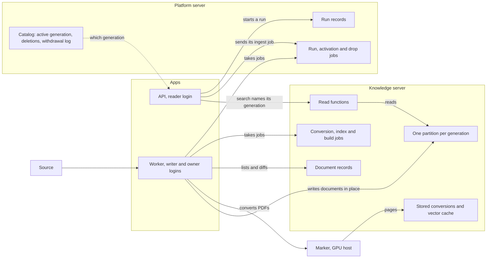
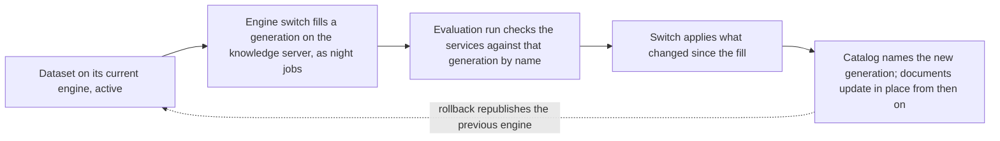

# 0042 The knowledge database

Status: proposed, 2026-10-27

Left: which datasets move into the knowledge database, and when. Moving the whole Kudos corpus, removing the shared Typesense (issue 150), where Kudos may be processed (issue 131), and the server size and standby that Kudos would need are separate decisions, each taken with its cost (issue 175). This record says what any dataset gets when it moves in, and sizes Kudos only to show what moving it would need.

## Context

Search data for pgvector datasets lives in shared tables on the platform database (`kn_docs`, `kn_chunks`, `kn_phrases` in `packages/providers-pgvector/src/schema.ts`). Every dataset and every generation shares them: the full-text GIN indexes span all datasets, vectors are stored as `vector` with a partial HNSW index per dataset, and nothing above 2,000 dimensions is indexed. The API reads them as the owner role, and isolation between organisations rests on the router and on every statement naming its dataset. The pgvector endpoint accepts no database other than the platform's (`pgvectorEndpointOptions` in `engine.ts`). Each ingestion run builds a complete new generation and promotes it (`packages/ingest/src/index-writer.ts`), and nothing between the source and the index is kept, so a new chunker or embedding model means fetching and converting every document again. Pipelines are config entries on the platform server, and their runs are records in its `ingestion_executions` table, which are `running`, `succeeded`, `failed` or `cancelled` (`apps/api/src/ingestion.ts`, `packages/providers-postgres/src/executions.ts`). A run runs in the API process that started it.

That fits small datasets. It does not fit a dataset like Kudos, which the platform today only reads from a shared Typesense cluster: 45,961 documents in the KUDOS API listing on 2026-10-27, about 3.1 million pages by the page counts in that listing (2.96 million in primary files and 181,000 in attachments; the pilot's 300 documents averaged 55 pages, 16,611 in all), about 3.1 million vectors at the pilot's 20,248 for those documents (`benchmarks/kudos-pilot/results/timings.md` and `index-report.md` at tag [`evidence/kudos-pilot`](https://github.com/digdir/genki/tree/evidence/kudos-pilot/benchmarks/kudos-pilot/results)). One million 1,536-dimension `halfvec` vectors need a 3.8 GB HNSW index. Azure caps `maintenance_work_mem` at 2,097,151 kB, about 2 GiB ([Azure: memory parameters](https://learn.microsoft.com/en-us/azure/postgresql/parameters/parameters-resource-usage-memory?pivots=postgresql-17)), which holds the graph of about 570,000 such vectors; a larger build spills to disk and slows down sharply. The knowledge database is meant to hold many datasets owned by different organisations.

## Decision

The platform keeps one knowledge database for all pgvector datasets, keeps what it has fetched, converted and embedded, updates documents in place, builds a new generation only when the way documents are processed changes, and lets the API read it only through functions that check the dataset. Its work runs as jobs on pg-boss (ADR 0041).

How the parts meet, for one dataset:

### The knowledge server

- **Its own Azure Database for PostgreSQL flexible server.** The API and the worker reach it with an Entra ID token for their own identity (below): `KNOWLEDGE_PGHOST`, `KNOWLEDGE_PGDATABASE`, `KNOWLEDGE_PGUSER` and `KNOWLEDGE_AZURE_CLIENT_ID`, through the same token source as `PGHOST`. `KNOWLEDGE_DATABASE_URL` is for local development only. The pgvector endpoint option `connection` accepts `knowledge` beside `platform`; an endpoint set to `knowledge` with no knowledge server configured stops the API from starting outside development mode, so data never falls back to the platform database unnoticed.
- **In the platform's region.** The server, its backups and the Blob copy of stored conversions (below) stay in the region where the platform runs (`infra/env/prod.bicepparam`), inside the EU/EEA (ADR 0045). Its backups are kept 7 days and are not geo-redundant, unlike the platform server's (30 days, geo-redundant). What neither the sources nor the Blob copy can give back is small, and the nightly export copies it too: earlier ids and tombstones (below). Losing the server then costs converting again, at a Marker speed not yet measured (open), the counts of listings a document has been missing from, so a delete waits for two more listings, and the data versions older results recorded. Geo-redundant backups would go to the paired region, also inside the EU/EEA, so residency is not the reason against them. The Blob copy goes to a locally redundant storage account, like the platform's file share today (`Standard_LRS` in `infra/modules/storage.bicep`).
- **Bound to one platform server.** The platform server gets a random id once, when its migrations first run, and the knowledge server stores that id once in the same way. The worker compares the two when it starts and before every drop. While they differ it runs no knowledge job, reports it to operators and fails its readiness check, so a worker pointed at another environment's platform server changes nothing. Binding a knowledge server to another platform server is an audited operator action (ADR 0010).
- **Three roles.** `genai_knowledge_owner` runs migrations and partition DDL, in the worker's build and drop jobs only. `genai_knowledge_writer` is the worker's role for every other job: DML on the knowledge and `pgboss` tables, no DDL. `genai_knowledge_reader` is the API's role: `EXECUTE` on the read functions below and on the console's job-state function, and nothing else, so no `SELECT` on any knowledge table and no rights on `pgboss`.
- **Each app logs in with its own identity.** The API reaches the knowledge server with a managed identity of its own that maps only to `genai_knowledge_reader`; the worker's maps to the writer and owner roles. The identity the apps share for the platform server has no rights on the knowledge server, so no code in the API can log in as anything stronger than the reader.
- **The API reads only through `SECURITY DEFINER` functions,** as ADR 0022 does for API keys and cross-organisation reads: `kn_search`, `kn_fetch`, `kn_range`, `kn_facets`, `kn_documents` and `kn_resolve_citation`, one for each read of the knowledge port. The router checks the caller as today (`dataset.tenants` and residency in `packages/port-knowledge/src/router.ts`) and sets `app.datasets` once for the transaction to the datasets it allowed. Each function first refuses a dataset that is not in `app.datasets`, then runs its query in PL/pgSQL as dynamic SQL with the dataset and generation written in as literals (`format('%L', …)`), so the planner reads one partition. Filters, profiles and weights are arguments; a function whose arguments change gets a new name (`kn_search_v2`), so old and new API replicas both work during a deploy.
- **Search reads through its own pool,** set by `KNOWLEDGE_READ_PGHOST`, which is the knowledge server itself until a read replica is added (heavy work, below). Nothing on the search path writes. A search names the generation it reads, the active one from the catalog or a candidate from the request, and embeds its query for that generation. A server that does not have that generation answers that it is not ready, and the search goes to the primary, whose answer is final; a replica that does not answer sends the search to the primary too. Each read also returns the data version of the server that answered. Everything else uses the primary.
- **A candidate is searched only by a person with the right to manage datasets in the organisation that owns the dataset** (ADR 0027), never on the strength of a right in an organisation it is shared with. Services read a candidate only in an evaluation run or live comparison that such a person started. The same holds for a generation that an engine switch is filling (ADR 0025): it can be checked through a service's full retrieval path before the switch is activated.
- **The two content caches are shared across organisations.** Stored conversions and cached vectors are keyed by content, so the same file or text is converted and embedded once, whoever holds it. Cache hits per run are shown to operators, not to organisations, since a hit tells whether anyone else holds an exact file or a short text.
- **The worker fetches as the API does today:** through the ingestion fetch guard, which connects only to the addresses it validated and validates every redirect again (`guardedFetchStream` in `packages/ingest/src/website.ts`), and with a tenant secret only for the hosts it is set for (ADR 0015).

### What is stored

Each layer can be rebuilt from the one before it, so a later step never needs the source again:

| Layer              | Table                        | Key                                                              | Holds                                                                                                                                                                     |
| ------------------ | ---------------------------- | ---------------------------------------------------------------- | ------------------------------------------------------------------------------------------------------------------------------------------------------------------------- |
| Document records   | `src_documents`, `src_files` | Dataset and document id; dataset, document and file              | A number of its own, the pipelines that own it, the source record as received, a metadata hash, each file's sha256, state, when last seen, earlier ids, its change number |
| Stored conversions | `src_conversions`            | File sha256, converter, converter version, settings              | Per-page markdown and the converter's structured output, no images                                                                                                        |
| Vector cache       | `kn_embeddings`              | Hash of the text, the model's deployment and version, dimensions | The vector, as `halfvec`                                                                                                                                                  |
| Index              | `kn_docs`, `kn_chunks`       | Generation partition, id                                         | Chunks, vectors and full-text data that searches read                                                                                                                     |

- **The platform keeps no source files it can fetch again.** A converter upgrade downloads them again. Uploaded files are the exception: they exist only in the platform's blob store (`apps/api/src/dataset-uploads.ts`), where they stay.
- **Unused cache entries are removed.** A nightly `knowledge.cleanup` job deletes stored conversions and cached vectors that no file record in any dataset and no kept generation uses, after a grace period of 7 days. That also removes what an older converter version left behind.
- **Stored conversions are copied to Blob storage every night** (`knowledge.export`), with versioning, and earlier versions are deleted after 30 days. The same job deletes the copy of a conversion that cleanup removed, so its last version is gone 30 days later, and copies each dataset's earlier ids and tombstones. A new server, region or host can be filled from the copy without converting again.
- **Deleting a dataset** writes a catalog version that deletes it, with who, when and the reason, and sends a `knowledge.drop` job in the same transaction (jobs, below). Its id cannot be used for a new dataset until that job has finished.
- **A deleted document leaves a tombstone** in its dataset, whether its source deleted it (deletes, below) or it was withdrawn on request: the keyed hash of its id (below) and the date, nothing else. The API passes `kn_resolve_citation` the keyed hash of the id it resolves, so an old citation says the document was withdrawn instead of linking nowhere, and it answers the same for both kinds, so it does not tell whether anyone asked for erasure.
- **Withdrawing a document on request,** for example on an erasure request, is an admin action with a reason, audited (ADR 0010): the API writes the withdrawal's log entry (below) and sends a `knowledge.withdraw` job with it, and the job deletes the document from every generation of its dataset, kept generations and candidates included, in one transaction; deletes its stored conversions and cached vectors at once when no other record uses them; and deletes their Blob copies, earlier versions included, in that night's export. It leaves a tombstone like any deleted document, so the knowledge server keeps neither the id, which can be a path that names a person, nor the title. The id cannot be read from the hash, and without the key a guessed id cannot be confirmed either.
- **Withdrawals are logged where a restore cannot undo them.** Each withdrawal is recorded on the platform server (`knowledge_withdrawals`: a number, the dataset, the keyed hashes of the document's id and of each of its files, and the date) and kept as long as its dataset, since it also keeps the document out of later runs. The knowledge server records the last withdrawal it has applied, and each search passes the platform's latest number. A server that is behind, after a restore from a backup or a fill from the Blob copy, answers that it is not ready until the worker has applied the log; on the primary that fails the search, which is the price of never serving withdrawn content.
- **A withdrawn document stays out.** A run skips a listed document whose id's keyed hash is in the withdrawal log, and a file whose keyed hash is, and its report counts the skips, so a source that still lists the document does not bring it back.
- **Tombstones and the withdrawal log hash with a key per dataset.** A keyed hash is HMAC-SHA256 under the dataset's key, of the document's id or, for a file, of its sha256. The dataset's key is HMAC-SHA256 of the dataset id under one secret, `KNOWLEDGE_ID_KEY` (32 random bytes in Key Vault), which the API and the worker read and neither database holds. A table, a backup or the Blob copy alone then confirms no guessed or listed id, and the same document gives different hashes in two datasets. The key is never rotated, since the ids are gone and old entries cannot be hashed again, and it is kept as long as any dataset, under Key Vault's soft delete and purge protection (`infra/modules/keyvault.bicep`). The platform server keeps a check value, the key's HMAC of a fixed string, stored the first time the worker starts with a key. While the key an app reads does not give it, the worker runs no knowledge job and fails its readiness check, and the API refuses withdrawals, so a lost or replaced key cannot quietly let withdrawn documents back in.
- **How long withdrawn content lasts:** it leaves the knowledge server and the caches at once, the Blob copy by the next night, a read replica when the replica has caught up, and the server's backups within their 7 days. Stored answers and traces that cited it keep their excerpts and chunk ids for their own retention (ADR 0011). What a Marker host keeps is open (below).

### Identity and chunks

- **A document's id names its source instance and its id there:** `kudos:<uuid>`, `folder:<tenant>/<root>/<path>`, `cms:<endpoint>:<id>`. Records are kept per dataset, so the same document in two datasets has two records; its conversion and vectors are still shared.
- **A source id stays in records and chunks, where withdrawal reaches it.** An id can name a person (a file path, a title in a URL), so job data, stored job errors and logs name a document by its record's own number instead.
- **When a source renumbers,** the earlier ids stay on the record. A citation is resolved through them only inside a dataset the caller may read (`kn_resolve_citation`).
- **A chunk's id is a hash of its document id, file, page and position,** so two documents never share a chunk id, even with the same text, and a chunk id that a stored answer keeps carries no path. Today's chunk ids start with the document's key (`${document.key}#n` in `apps/api/src/ingestion.ts`).
- **Every chunk carries** its document id, file, page or page range, and heading path when the converter gives one. How a document is cut into chunks is part of the recipe, not of this contract.

### Ingestion runs

- **A document record is owned by the pipelines that list it.** A dataset can be filled by several pipelines, and a run compares, deletes and brakes only on its own pipeline's records. When a pipeline lists a document another pipeline owns, it takes the document over only when the file sha256 or metadata hash differs; otherwise it becomes a co-owner. A document is deleted only when no owner lists it any more.
- **Disabling a pipeline pauses it and keeps its documents.** Deleting a pipeline starts a removal run of its own: it gives up its ownership and deletes the documents no other pipeline owns, through the change brake.
- **A run lists its pipeline's source and compares the listing with the records its pipeline owns.** A new id, a changed file sha256 or a changed metadata hash marks a document to process. The run sends a `knowledge.convert` job for each file without a stored conversion and a `knowledge.index` job for each document ready to index. A file that is already being converted gets no second job: its record waits, and the run that marks it waiting and the conversion that finishes take the same lock on the file, so the finished conversion sends an index job for every waiting record. Unchanged work is free: stored conversions and cached vectors are reused.
- **Documents are replaced in place,** each in one transaction inside the active generation, so search never sees half a document. Every change to a dataset's document records takes the next number in the dataset's change sequence. A generation's data version is the highest number below which it has every change; it moves forward as index jobs apply changes.
- **A run has six states.** `ingestion_executions` gains `queued`, for a run that waits for its pipeline's open run, and `waiting`, for a run stopped at the change brake until it is approved, beside `running`, `succeeded`, `failed` and `cancelled`. A run started while its pipeline has an open run is created `queued`, and at most one run per pipeline is `queued` (a unique index); a start or an approval while one is queued is refused with that reason. A run started with no open run is created `running` with its ingest job, and the transaction that ends a run makes its pipeline's queued run `running` and sends that run's ingest job. A run that runs as jobs is marked so on its record, and the API's startup check for stale runs (`failStaleRuns`, 6 hours) leaves it alone: it ends with its jobs (jobs, below).
- **One ingestion run per pipeline is open at a time,** from its start until its last job has ended. A run started while one is open waits, and at most one waits per pipeline. A record waiting on another run's conversion counts as open work of its own run. When a run's last job ends, the run ends with `VACUUM (ANALYZE)` (heavy work, below) and is marked finished.
- **Pushes and explicit deletes do not wait.** A source that pushes or deletes documents by id (uploads, a CMS) changes only those documents, each in its own transaction, beside any open run of its pipeline. Each push is a one-document run in `ingestion_executions`, admitted by the API like any run but not its pipeline's open run, and sends a `knowledge.push` job on the platform server in the same transaction; the worker writes the record and sends its convert or index job.
- **Deletes follow the kind of source:**
  - explicit sources (uploads, a CMS that pushes and deletes by id) delete at once;
  - listed sources (Kudos, folders, databases, Parquet) delete a document after two complete listings in a row without it. A listing is complete when every page came back without error and, for a source that reports a total (Kudos's `meta.total`), the count matches;
  - crawled sources delete a page after a 404 or 410 seen twice, or after three complete crawls without it.
- **A change brake stops large runs.** A run that would change, take over or delete more than 5 % and more than 50 of the documents its pipeline owns in the dataset stops before writing. A pipeline's first run in a dataset is exempt for new documents, not for takeovers. A stopped run is `waiting` and releases its pipeline; when a person with the right to manage datasets in the dataset's organisation approves it (`platform.pipeline.approve`, audited), the run lists again and goes on.
- **A bad run is undone by fixing the cause and running again.** The records say what to redo, and stored conversions and cached vectors make the rerun cheap. Bad data from the source needs the source fixed or the document excluded.
- **Schedules stay per pipeline** (`none`, `daily`, `weekly` at 03:00). A firing creates the run and sends its `knowledge.ingest` job instead of starting the run in the API.
- **An engine switch into or out of the knowledge database counts as an open run of every pipeline of the dataset** while it copies or re-ingests (ADR 0025). Runs into other engines, such as Typesense, stay in the API as today.

### Conversion

- **The converter port returns pages, not one string.** `DocumentConverter` returns a `Conversion`: the pages, the converter's structured output when it has one, and the converter's name, version and settings. Stored conversions are keyed by those fields.
- **Two engines.** The PDF text layer runs inside the platform. Marker is an external HTTP service on a GPU host, called from `knowledge.convert` jobs. In a job the Marker client makes one attempt, with header and body timeouts taken from `MARKER_TIMEOUT_MS` (ADR 0041); the queue's retries replace its retry ladder.
- **The Marker client asks the host to keep nothing** (`cache=false`), since the platform keeps conversions itself. Today's client asks the opposite (`cache=true` in `packages/ingest/src/converter.ts`), and the Marker service in [PR 91](https://github.com/digdir/genki/pull/91) then keeps every PDF it is sent, with its pages, until it is deleted by hash.
- **A text-layer guard per page.** When a page has at least 200 characters in the PDF's text layer and Marker's text for it is under a tenth of that, the page keeps the text layer. Marker keeps no text from a page it reads as one picture: of the 6,674 non-blank pages of 150 Kudos documents, 49 with at least 200 characters of text layer lost most of their text in Marker, 43 of them read as one picture (`benchmarks/ingestion/opb/results/report.md` at tag [`evidence/ingestion-benchmark`](https://github.com/digdir/genki/tree/evidence/ingestion-benchmark/benchmarks/ingestion/opb/results)).
- **The text layer is the fallback** when no Marker host is configured, and for files that may not be sent to the host (open, below).

### Generations, recipes and experiments

- **A generation is one partition.** The knowledge tables are partitioned by list on the generation id, and every generation belongs to one dataset. GIN and btree indexes are declared on the parent; each partition has its own HNSW index.
- **Vectors of different sizes share the parent.** The parent's `vec` column is `halfvec` without dimensions; each partition's HNSW index is on `(vec::halfvec(N))` for its recipe's dimensions, and every query writes the same cast, since a query without it falls back to a sequential scan without an error.
- **Each partition indexes its own dataset's declared filters** (`dataset.filters` in the catalog: `select`, `multiselect`, `text`, `range`, `boolean`). `select`, `multiselect` and `boolean` filters share one GIN index on `fields` (`jsonb_path_ops`, for `@>`), and each `range` filter gets a btree index on its value cast to its type, such as a year. A partition belongs to one dataset, so no index serves another dataset, and changing a dataset's filters adds or drops indexes on its own partitions only, as a `knowledge.build` job when the partition is above the heavy threshold. Containment can use the GIN index because reads go through the read functions, not row-level security. Source-specific fields, such as Kudos's `type`, `concerned_years` and `orgs_short`, stay in `fields` rather than in columns or tables of their own.
- **A new generation is built standalone and attached.** It is created with `LIKE … INCLUDING ALL`, so it has the parent's generated columns, loaded, given the parent's indexes and a `CHECK` constraint matching its partition bound, and then attached with `ATTACH PARTITION`, which then needs no scan. `ATTACH` locks the parent only in `SHARE UPDATE EXCLUSIVE` mode, so searches never wait for it; `lock_timeout` keeps it from queueing behind other DDL or a VACUUM of the parent. An old generation is detached with `DETACH PARTITION ... CONCURRENTLY` and dropped. A detach that was cancelled leaves the partition pending, and the next partition DDL on that table finishes it first (`DETACH PARTITION ... FINALIZE`).
- **A generation records its recipe:** converter, version and settings; the chunking and search-phrase settings of each pipeline; embedding model and dimensions; and full-text configuration. These settings move from the pipeline (`chunking`, `phrases` in `apps/api/src/ingestion.ts`) into the recipe, so a change to them takes effect through a candidate, never in the active generation, and unchanged chunks reuse cached vectors. A search embeds and parses its query with the recipe of the generation it reads. The engine is not part of the recipe: moving to another engine stays an engine switch (ADR 0025).
- **A new generation is built only when the recipe changes, and activating it is a catalog change,** as an engine switch is (ADR 0025): a new version of the dataset's catalog entry names the active generation and its embedding, published with a reason through the audited admin path. The previous generation is kept for `knowledge.switchRetentionDays` and then dropped by a `knowledge.drop` job. `kn_active` goes.
- **Activating a candidate catches it up first.** A `knowledge.activate` job pauses the dataset's pipelines and applies the record changes after the candidate's data version (new, changed and deleted documents) with the candidate's recipe; the catch-up publishes the catalog change when it is done and lets the pipelines go on.
- **Rollback switches at once and catches up afterwards.** It publishes the previous catalog version, then applies the changes the previous generation missed. If that generation's embedding model is no longer served, rollback is refused with that reason; if only its converter version is gone, the catch-up uses the current converter's stored output and records that it did.
- **Provenance names the data, not only the generation.** A task records each dataset it read with the generation and the data version of the server that answered, so two results are only compared when they read the same data (ADR 0003, ADR 0004).
- **Recipes are tried on a frozen sample first,** a small dataset with fixed documents and test cases, where a candidate builds in seconds. The winning recipe is then built as a full candidate beside the active generation and compared there. Recipes are chosen on the train and validation cases of a test set; the holdout (ADR 0003) is used only for the check before a candidate is activated, so the recipe is never tuned on it.

How a dataset moves in from another engine, such as Kudos from Typesense:

### Vectors and full text

- **Vectors are `halfvec`** (today `vector`), indexed with HNSW (`m` 16, `ef_construction` 64) and searched with iterative scans on, as today. `halfvec` indexes up to 4,000 dimensions. Binary quantisation with re-ranking is a recipe option for very large generations, not yet measured (open, below).
- **The full-text configuration is one per generation,** chosen in the recipe and `norwegian` by default, as today's `textSearchConfig`. Azure's extension list has no `pg_textsearch` (BM25) ([Azure: extension versions](https://learn.microsoft.com/en-us/azure/postgresql/extensions/concepts-extensions-versions)), and as far as its documentation shows, Azure gives no way to install the files Hunspell dictionaries need, so compound words are not split.

### Heavy work

- **Heavy work runs only in a night window,** `knowledge.nightWindow`, 01:00 to 06:00 Europe/Oslo by default. Work is heavy above `knowledge.heavyThreshold` (100,000 chunks by default): an index build of a generation that size, writing more chunks than that into one generation (a candidate fill, a catch-up or an ingestion run), and VACUUM of a partition above that size. Builds, catch-ups and VACUUM are `knowledge.build` jobs, and the documents of a heavy fill or run are `knowledge.fill` jobs. Both start at the next window, `knowledge.build` jobs are taken one at a time per knowledge server, and nothing starts one earlier. Work below the threshold, including a frozen sample and a small catch-up, runs at any time. An ingestion run counts its chunks as it writes; once it has written `knowledge.heavyThreshold`, its remaining documents go as `knowledge.fill` jobs.
- **In the window, a build runs at full speed:** `max_parallel_maintenance_workers` is set for the build to the server's vCores minus one, since few searches run at night.
- **A build is estimated in two parts before it is sent.** Vectors up to `maintenance_work_mem` divided by the size of one graph element (about 3.8 KB at 1,536 dimensions) count at the in-memory rate, and the rest at the spilled rate, both measured on the server. A build is refused, with its estimate, when it does not fit in the window, or when its new graph does not fit in the memory the active indexes leave free; it then needs a larger server or a smaller recipe, such as fewer dimensions or binary quantisation. A build still running an hour after the window ends is cancelled and reported with its progress.
- **Outside the window, VACUUM is throttled** (`vacuum_cost_delay` 2 ms). The server keeps memory for its active indexes plus one build, and reads the active indexes back into memory after a heavy job (`pg_prewarm`, which Azure allows with `shared_preload_libraries`). A nightly check reports to operators when the active indexes outgrow the memory kept for them, since in-place growth is not checked as a build is.
- **A read replica can be added later without code changes,** if a night is not enough or search needs more room: setting `KNOWLEDGE_READ_PGHOST` to the replica moves search there. A server with a zone-redundant standby can have read replicas, and a replica has no standby of its own ([Azure: high availability](https://learn.microsoft.com/en-us/azure/postgresql/high-availability/concepts-high-availability), [Azure: read replicas](https://learn.microsoft.com/en-us/azure/postgresql/read-replica/concepts-read-replicas)), which is why the read pool falls back to the primary. Replication is asynchronous, and Azure says lag can reach hours under heavy writes, as during an index build. The generation check covers a generation the replica does not have yet; within a generation, a lagging replica returns older documents, including withdrawn ones, until it catches up, and provenance records the data version it answered with.
- **The VACUUM workaround for pgvector 0.8.2.** Azure ships pgvector 0.8.2 ([Azure: extension versions](https://learn.microsoft.com/en-us/azure/postgresql/extensions/concepts-extensions-versions)). In that version, VACUUM while rows are inserted can corrupt an HNSW index without an error; the bug has been there since HNSW first shipped and is fixed in 0.8.3 ([pgvector #988](https://github.com/pgvector/pgvector/pull/988)), and 0.8.4 fixes a "hnsw graph not repaired" error that 0.8.3's new check raised ([changelog](https://github.com/pgvector/pgvector/blob/master/CHANGELOG.md)). So, until Azure ships 0.8.4 or later:
  - partitions that take in-place updates have autovacuum off;
  - every writer tries a per-generation advisory lock in shared mode (`pg_try_advisory_xact_lock_shared`), and VACUUM takes it exclusively, so VACUUM never runs beside a write. A job that does not get the lock is sent again later instead of waiting, since a waiting exclusive request blocks every later shared one;
  - each ingestion run ends with `VACUUM (ANALYZE)`, as a `knowledge.build` job in the next window when the partition is above the heavy threshold, and a nightly check runs `VACUUM (FREEZE)` in the window before a partition's `age(relfrozenxid)` reaches half of `autovacuum_freeze_max_age`, since PostgreSQL starts an anti-wraparound autovacuum even with autovacuum off;
  - a nightly check compares search on a sample of each active generation with exact search, and a drop in recall sends a `REINDEX` of that partition as a `knowledge.build` job.
- **Quotas per organisation:** stored size of its datasets' generations, rows and indexes together (`knowledge.quota.storedGb`, 20 GB by default), and candidate generations (two per dataset), checked when a generation is prepared. An organisation with a dataset the size of Kudos gets its quota set explicitly. The shared caches are not charged to anyone.
- **A standby is decided with the first service that depends on the server,** with its cost; for Kudos, that is issue 175. A restore from backup is done and timed before that service switches.

### Jobs

- **A job that follows a platform record lives on the platform server** (ADR 0041) and is sent in the same transaction as that record: `knowledge.ingest` with a run's start, its approval or a schedule's firing; `knowledge.push` with a push; `knowledge.withdraw` with a withdrawal's log entry; `knowledge.activate` with an activation or a rollback; `knowledge.drop` with a dataset's deletion, or from the nightly check for a generation past its retention, which is scheduled on the platform server. The API sends jobs only there, as `genai_runtime` with grants that let it send a job and nothing more, and the worker runs them as `genai_worker` (ADR 0041).
- **A job that follows a document record lives on the knowledge server,** sent by the worker as the writer in the same transaction as the change it follows: `knowledge.convert`, `knowledge.index`, `knowledge.fill` and `knowledge.build`. The nightly `knowledge.cleanup` and `knowledge.export` live there too.
- **Every queue states its contract in code,** and keeps ADR 0041's retention:

  | Queue                | Server    | Policy and key                                                     | Expiry, heartbeat                   | Retries                           | Notes                                                                                                                                           |
  | -------------------- | --------- | ------------------------------------------------------------------ | ----------------------------------- | --------------------------------- | ----------------------------------------------------------------------------------------------------------------------------------------------- |
  | `knowledge.ingest`   | Platform  | `exclusive`, keyed by pipeline                                     | 15 min, 60 s                        | 2, with backoff                   | Lists the source and sends convert and index jobs; sent when its run becomes `running`                                                          |
  | `knowledge.push`     | Platform  | `exclusive`, keyed by dataset and document record                  | 15 min, 60 s                        | 2, with backoff, then dead letter | Writes one pushed or deleted document's record and sends its convert or index job, beside any open run                                          |
  | `knowledge.withdraw` | Platform  | `exclusive`, keyed by dataset and the id's hash                    | 15 min, 60 s                        | 2, with backoff, then dead letter | Removes a withdrawn document from every generation and the caches, leaves its tombstone and records the withdrawal as applied                   |
  | `knowledge.activate` | Platform  | `singleton` per dataset                                            | 15 min, 60 s                        | 2, with backoff, then dead letter | Pauses the dataset's pipelines and sends the catch-up; a rollback publishes the previous catalog version first                                  |
  | `knowledge.drop`     | Platform  | `singleton` per dataset                                            | 1 h, 60 s                           | 2, with backoff, then dead letter | Reads its deletion or retention again, finishes a pending detach, then deletes a deleted dataset's records and partitions, or an old generation |
  | `knowledge.convert`  | Knowledge | `exclusive`, keyed by file sha256, converter, version and settings | 1 h above `MARKER_TIMEOUT_MS`, 60 s | 2, with backoff, then dead letter | Priority: uploads before ingestion runs before candidates. Sends index jobs for every record waiting on the file                                |
  | `knowledge.index`    | Knowledge | `exclusive`, keyed by generation and document record               | 30 min, 60 s                        | 2, with backoff, then dead letter | Chunks, embeds and writes one document in one transaction; sent again later when VACUUM holds its generation                                    |
  | `knowledge.fill`     | Knowledge | `exclusive`, keyed by generation and document record               | 30 min, 60 s                        | 2, with backoff, then dead letter | Index jobs of a fill or run above the heavy threshold, taken only in the night window                                                           |
  | `knowledge.build`    | Knowledge | `singleton` per knowledge server                                   | 24 h, 60 s                          | 1                                 | Index builds, catch-ups, VACUUM and `REINDEX` above the heavy threshold, started at the next night window                                       |
  | `knowledge.cleanup`  | Knowledge | `singleton`                                                        | 2 h, 60 s                           | 2                                 | Nightly: removes unused cache entries after the grace period                                                                                    |
  | `knowledge.export`   | Knowledge | `singleton`                                                        | 2 h, 60 s                           | 2                                 | Nightly: copies new conversions, earlier ids and tombstones to Blob storage, and deletes removed and withdrawn copies                           |

- **Deletion follows an explicit record, never absence.** A `knowledge.drop` job is sent only with a catalog version that deletes a dataset, or for a generation the catalog shows past its retention, and its handler reads that record again before it deletes anything. Data on the knowledge server for a dataset the catalog does not know at all is reported to operators every night and never dropped, so a worker that reads the wrong platform server, or a platform server restored from before the dataset existed, deletes nothing.
- **Two steps cross back, and a reconciler repairs them.** The worker, one instance at a time under the leader lease, checks every minute that a run whose jobs have all ended is ended, and that a catch-up that ended without publishing its catalog version publishes it. Every night, an active generation behind its dataset's change sequence with nothing working on it gets a catch-up.
- **A run is open while it has work left.** Its jobs carry its id, and a record waiting on another run's conversion counts as its work too. The reconciler leaves alone a run that is `waiting`, starts a `queued` one as below, and drops a job whose run is gone, finished or cancelled. Cancelling a run marks its record on the platform server; a handler checks it between documents, the worker cancels the run's queued jobs on the knowledge server, and a conversion another run waits on is left running. Sending a dead letter back reopens its run.
- **One open run per pipeline.** Runs, their states and their ingest jobs are all on the platform server, so the records decide: an ingest job is sent only for a run that becomes `running`, in the same transaction, and `knowledge.ingest` is `exclusive`, keyed by pipeline, as a guard. The reconciler starts a `queued` run whose pipeline has no open run, in case the run before it ended without doing so. An engine switch of a dataset in the knowledge database holds every pipeline of the dataset the same way.
- **External services are called from the job (push).** A job that needs a service outside Azure, such as the Marker converter, calls it over HTTPS with an API key and waits (ADR 0041), as the platform already calls the ColBERT reranker (`COLBERT_API_URL`). The host needs no access to the database and no platform login.
- **The night window is enforced twice.** Heavy jobs are sent with `startAfter` at the next window start, and the worker calls `work()` for `knowledge.build` and `knowledge.fill` only inside the window and stops at its end. A build still running an hour after the window ends is cancelled.
- **Handlers are idempotent.** A handler writes its result under a key that a second run writes again: a conversion under its file sha256, converter, version and settings; a document in one transaction that replaces the whole document.
- **In lockdown (ADR 0033), a job that fetches, converts or embeds is checked at its start against what admitted it, and admission lasts 24 hours.** Production does not run in lockdown. A job carries only the id of what admitted it: its ingestion run, or a generation build, activation or rollback a person started through the audited admin path. Before a handler lists a source, downloads a file, calls a converter or calls a model (embeddings, search phrases), the worker reads that record, whose admission and the time it was given only the API sets after it has checked the caller and lockdown. The worker refuses the job when the record was not admitted, or was admitted more than 24 hours ago; a run refused that way is marked failed with the reason and keeps what it wrote. Approving a braked run, sending its jobs back and starting it again admit it again from that moment. A conversion runs while any run waiting on it is admitted. A run still `queued` when its admission runs out fails without starting. Nothing in the job's data can admit it. In lockdown, a scheduled run sends no job and is recorded as failed with the reason, as today. Approving a braked run (`platform.pipeline.approve`), activation, rollback and sending knowledge jobs back join the routes lockdown locks for ingestion.
- **Failures are visible and recoverable without crossing organisations.** The console's job screen (ADR 0041) shows knowledge queue counts and dead letters per organisation. A shared conversion's job is shown to every organisation with a record waiting on its file, without showing who else waits. Sending knowledge jobs back is allowed to people with the right to manage datasets in an organisation the job serves, which widens ADR 0041, where only operators send jobs back. The API records the request on the platform server and the worker sends the jobs back, since the API cannot change a job on either server (ADR 0041). An operator acts on an organisation's job only through a support session (ADR 0027).
- **Nightly jobs** (cleanup, export and the checks above) use pg-boss `schedule()` with `tz: 'Europe/Oslo'`, which sends one job per occurrence however many instances run.

## Open

- **What the Marker host keeps** beyond the cache the client turns off (its logs, temporary files and backups) is not known until a host is chosen. It bounds erasure for anything sent there, and decides whether a conversion retried after a deploy runs again.
- **Which files may be sent to a Marker host, and where it runs.** The options are a residency rule (a host declares where it runs, and a dataset's files go only to hosts inside its residency), datasets shared with every organisation only, or every dataset. Kudos is declared `residency: norway` today, and whether it may be processed elsewhere is a separate decision (issue 131). The GPU host the platform calls today for ColBERT reranking is a Hetzner server in Nuremberg (whois of the host in `COLBERT_API_URL`, 2026-10-27), while the reranker is declared `residency: norway` (`apps/api/config/local/rerank.yaml`): that mismatch is a defect of its own. Today's code sends every PDF to Marker when `DOCUMENT_CONVERTER=marker` (`apps/api/src/document-converter.ts`). Marker conversion in jobs is built after this is decided; until then the text layer is used.
- **Marker's speed on a GPU host** is not measured.
- **A Kudos-sized build on Azure** is not measured: about 3 million vectors at 2 GiB of `maintenance_work_mem` on the server size Kudos would need. Spilled build rates were measured up to one million vectors.
- **How much a build slows search at a realistic search rate** is not measured; the spike measured the worst case.
- **Binary quantisation for large generations** is future work and not measured. pgvector indexes `binary_quantize(vec)::bit(N)` with HNSW (`bit_hamming_ops`), one bit per dimension, so the vector in each index entry takes 192 bytes at 1,536 dimensions instead of 3,072 as `halfvec`; a search takes more candidates from that index and re-ranks them by the full vector ([pgvector: binary quantization](https://github.com/pgvector/pgvector#binary-quantization)). It would let far more vectors fit in the 2 GiB of build memory and in the server's memory, at some cost in recall. On pgvector 0.8.2, `binary_quantize` accepts `halfvec` and the index builds (checked in the spike container). Before it becomes a recipe, it needs recall@10 against exact search on the reviewed Kudos questions with re-ranking, and build time and index size at about 3 million vectors.
- **`pg_diskann` for large generations** is not measured. Azure lists it, and its graph lives on disk with compressed vectors in memory, which goes at the build memory problem; its documentation shows only `vector` operator classes, not `halfvec`, and says nothing about VACUUM ([Azure: pg_diskann](https://learn.microsoft.com/en-us/azure/postgresql/extensions/how-to-use-pgdiskann)).
- **What the missing BM25 ranking costs** in recall is not measured.
- **Whether geo-redundant backup can be turned on after the server is created** is not checked. If it cannot, it is decided before the server is made (issue 136).
- **Files uploaded to a conversation** are out of scope; ADR 0011 already deletes them with the conversation.

## What the spikes showed

Throwaway `pgvector/pgvector:0.8.2-pg17` containers, scripts and results in [`benchmarks/knowledge-spikes/`](https://github.com/digdir/genki/tree/evidence/knowledge-spikes/benchmarks/knowledge-spikes) at tag `evidence/knowledge-spikes`:

- **Row-level security costs the keyword half of search** (`rls/`). With a policy on a table, PostgreSQL uses an operator as an index condition only when it is leakproof. Of the operators search uses, only equality is; full-text match (`@@`) and pgvector's distance are not. HNSW is still used, because ordering is not a condition, but full-text search loses its GIN index: ranked full text over the 180,000 rows of one dataset in a 200,000-row table took 31 ms with a policy against 0.36 ms without, as a sequential scan. On a partition per dataset with a policy that reads no column, it took 40 ms against 0.11 ms, also as a sequential scan (`partition-policy.sql`). Azure gives customers no superuser ([Azure: database users](https://learn.microsoft.com/en-us/azure/postgresql/security/security-manage-database-users)), so the functions cannot be marked leakproof. The same holds for jsonb containment (`@>`), which typed filters would need with a GIN index on `fields`.
- **Reads through `SECURITY DEFINER` functions cost nothing measurable on partitions** (`rls/definer-partitions.sql`, 301 partitions). Ranked full text took 0.09 to 0.12 ms through a PL/pgSQL function that writes the dataset and generation into dynamic SQL, against 0.06 to 0.10 ms read directly by the owner, and 86 to 93 ms through a plain SQL function, which plans every partition. The function refused a dataset outside `app.datasets`, and the reader's direct read was refused.
- **Swapping generations does not hold up searches; building one slows them** (`partitions/`; 4 CPUs, 16 GB, one million 1,536-dimension vectors, 8 clients searching as fast as they could). `ATTACH PARTITION` took 18.5 ms and `DETACH PARTITION ... CONCURRENTLY` 7.3 ms, neither hit its 1-second `lock_timeout`, and no search that overlapped them took more than 52 ms. Building a second generation of the same size beside the active one with one parallel worker raised search p95 from 39 ms to 62 ms while the HNSW graph fit in `maintenance_work_mem` (2 GB, the first 570,906 vectors), and to 195 ms once it spilled, with throughput down from 735 to 113 searches a second. Copying the rows in raised p95 to 778 ms. After the spill the build added about 7 vectors a second and was stopped after 78 minutes at 59 %; the same build with no searches running took 18 minutes. The clients never waited, so this is the worst case for CPU; a realistic search rate was not measured.
- **In-place updates with the VACUUM workaround keep the index healthy** (`churn/`). On 18,000 Kudos page vectors (text-embedding-3-large, 1,536 dimensions) with autovacuum off, 20 rounds each replaced 1 % of the rows and then ran VACUUM with no writer running (4.0 to 7.6 s each). No errors. Recall@10 against exact search for 676 Kudos questions was 0.9951 before, 0.9960 after, and 0.9945 for a fresh build on the same rows. This is the workaround at pilot size, not at millions of rows, and it does not reproduce the bugs themselves.

## Why

- **One server for all knowledge data.** The largest dataset sizes the server either way, and a server per dataset multiplies cost and operations. Search needs its indexes in memory, which the platform server (`Standard_D2ds_v5` in production: 2 vCores, 8 GiB, `infra/env/prod.bicepparam`) does not have room for once a large dataset moves in, and index builds and VACUUM must not compete with logins and conversations.
- **Read functions, not checks in every statement or row-level security.** With checks only in the application, every statement, and every future one, is one missing `dataset =` away from returning another organisation's rows, and the guard is a test that parses the statements the tests happen to run. Row-level security keeps isolation in the database but loses the full-text index, on partitions too. `SECURITY DEFINER` functions keep isolation in the database at no measurable cost on partitions, as ADR 0022 already does elsewhere; the cost is that search SQL lives in PL/pgSQL migrations. A database role per organisation with grants per partition would keep the SQL in TypeScript, but its grants would have to follow `dataset.tenants` in the catalog on the other server.
- **Records per dataset, caches shared.** Deletes, tombstones and the change brake are about one dataset's view of a source, so the records are per dataset. Conversion is the expensive step, so it is the part that is shared: stored, it takes about 7 KB a page (`benchmarks/knowledge-spikes/sizes.md` at tag `evidence/knowledge-spikes`).
- **Records owned by pipelines, and co-owned on overlap.** A listing only knows its own source, so a run can only judge its own pipeline's records; without ownership, a Kudos run would delete the documents a folder pipeline added to the same dataset after two listings. If the last writer always took a document over, two pipelines with overlapping sources would take the same documents from each other on every run.
- **A run lock per pipeline.** Records and the brake are already per pipeline. With one lock per dataset, a heavy run that writes only at night, or a run waiting for approval, would hold back uploads, other pipelines, activation and rollback for days.
- **Jobs on the server of the record they follow.** A run, an activation and a dataset's deletion are platform records, so their jobs commit with them there, and the API, which writes those records, needs no right to send jobs to the knowledge server. Document jobs commit with document records on the knowledge server. Only two steps cross back, each repaired by the reconciler. Sending ingest jobs from the API to the knowledge server would give the reader a right to write the queue, and need a repair for every run whose job was lost between the two servers.
- **Deletion from a record, not from absence.** Absence cannot tell a deleted dataset from a worker that reads the wrong server or a catalog restored from before the dataset existed. A deletion version says who deleted what and why, and the drop reads it again.
- **Tombstones keep a hash, not the id.** A tombstone exists so an old citation says withdrawn instead of linking nowhere. A hash of the id is enough for that, an id like a file path can itself be the personal data an erasure request is about, and one kind of tombstone for every delete does not tell who asked. The answer that cited the document already shows its title.
- **Keyed hashes, not plain sha256.** Ids can be listed or guessed: anyone who can read a source's listing can hash every id in it, and a folder path follows a pattern that can hold a person's name. With a plain sha256, whoever holds the withdrawal log, a backup or the Blob copy would learn which of those documents were withdrawn on request, and the same document would match across datasets. The cost is one secret that is never rotated and must outlive every dataset; the check value turns a lost or replaced key into a readiness failure instead. It is a secret of its own, not one derived from `CONTENT_MASTER_KEY`, so the key that wraps content keys can still be rotated. Chunk ids stay plain hashes, since the answers that keep them also keep the title and excerpts.
- **Backups for 7 days.** The sources, the Blob copy and its nightly copy of earlier ids and tombstones give back everything but listing counts and old data versions, so a longer retention buys little and keeps withdrawn content around longer.
- **In place, not a generation per run.** A generation per run costs as much as the whole dataset every night: the HNSW build alone took 709 s for one million vectors with 2 GB and two workers, against 153 s for half a million, so build time grows faster than the row count once the graph outgrows memory (`index-report.md`), and 1,069 s with one worker in the partition spike. In place, a night with a few dozen changed documents writes a few thousand rows. The cost that grows with the dataset is VACUUM, which runs in the night window.
- **A partition per generation.** VACUUM, index builds and memory then follow one generation instead of the whole database, autovacuum can be off for one partition, a candidate sits beside the active generation without touching its index (building it still competes with search for the server, as measured above), attaching and detaching one takes milliseconds, and dropping a generation takes seconds instead of deleting millions of rows. A partition per dataset would still put candidates into the active index; shared tables put every cost on the whole database.
- **One set of tables, not tables per source or per dataset.** Each generation is already a table of its own, with its own indexes, so a source's fields and filters fit in `fields` with indexes on that dataset's partitions. Tables per source kind would repeat generations, read functions and search SQL for every kind, and a dataset filled from two sources would span tables; tables per dataset would make every migration a loop over datasets. A source whose data is not documents and chunks, such as tabular rows or a graph, would get tables of its own.
- **Night only, at full speed, not throttled by day.** The partition spike shows that one build worker does not protect search: beside the active generation, search p95 rose 1.6 times while the graph fit in memory and 4.9 times once it spilled, and the build itself crawled. At night there are few searches to protect, so a fast build is better than a slow one, and a build that cannot fit in a night is a sizing problem to see before it starts.
- **A read replica later, not now.** A replica takes search off the build's CPU, but costs at least as much as the primary, lags most during the heavy writes it would isolate, and still replays the whole new index. A separate read pool and the generation check cost nothing now and keep the replica a configuration change for when a night is not enough.
- **Catch-up before activating, after rolling back.** Writing every ingestion run into every kept generation would multiply the nightly work by the number of generations, so a generation catches up when it is about to serve. A candidate can wait for that; a rollback is for when the active generation is wrong, so it switches first.
- **Push over pull.** Workers on the GPU host could pull jobs through platform endpoints instead. That survives a deploy completely, but needs claim, heartbeat and upload endpoints, a machine login for the host and a worker program to maintain. The host is reachable over HTTPS like the ColBERT host, and a pushed job that loses its worker in a deploy is retried after its heartbeat lapses. The cost is that the retry converts the file again, since nothing is known yet about what the host keeps (open).
- **Lockdown on the record that admitted the job, for a day.** Trusting a mark in the job's data would let anything that can write the queue admit work. A run's admission is set only by the API, after it checked the caller, and starting a run is audited, which is the trust ADR 0033 already relies on. Only test runs in lockdown. There, a run can stay open for nights, and the person who started it may lose the right in the meantime; a day covers a normal run and one night window, and starting again is cheap because the records say what is left.
- **`pg_diskann` not yet.** It aims at the build memory problem, but its documentation shows no `halfvec`, it is not measured, and the platform's tests run on the plain pgvector image.
- **Recipes and named candidates** make a new chunker, embedding model or text configuration a measurement instead of a migration, which the platform's evaluation already supports (ADR 0003).
- **Ids from the source instance.** A source id is readable and stable as long as the source keeps it; naming the instance keeps two folders or two CMS sites from clashing. A platform-minted id would survive renumbering, but every lookup would go through a map.

## Consequences

- Existing knowledge tables cannot be converted into partitioned ones. The new tables are created beside them and datasets are re-ingested; the shared tables are dropped when no dataset uses them. `kn_phrases` is kept only for recipes that use search phrases.
- Today's shared tables run autovacuum while ingestion writes (`packages/providers-pgvector/src/schema.ts` sets nothing), so on pgvector 0.8.2 their HNSW indexes can already be corrupted without an error. Until they are replaced, they need the same workaround: autovacuum off and a VACUUM after each run with no writer running.
- Infra: a second flexible server through `infra/modules/postgres.bicep` with its own private DNS zone in `infra/modules/network.bicep`, with 7-day backups that are not geo-redundant, and two more managed identities, one for the API and one for the worker, with their Postgres principals and grants; today the apps share one identity (`appIdentity` in `infra/main.bicep`), which is a Postgres admin on the platform server. The server starts at the platform server's size (`Standard_D2ds_v5`: 2 vCores, 8 GiB) with no standby and grows with the datasets that move in. For Kudos at 3.1 million vectors, the active generation's indexes would take about 19 GB (12.7 GB HNSW at 4.1 KB a vector from `index-report.md`, and about 6.8 GB GIN, an earlier lab estimate) and about 46 GB with its rows at 8.5 KB a row, and memory for the active indexes plus one build would come to about 39 GB, so the server would need 64 GiB, for example `Standard_E8ds_v5`, and about 100 GB of storage before candidates, sized for IOPS too, since Azure gives IOPS by provisioned size; that size is decided with the move (Left). `KNOWLEDGE_READ_PGHOST` is set to the same server until there is a replica; `PG_PREWARM` is added to `azure.extensions` and `shared_preload_libraries`; the server parameters above. Blob storage does not exist yet (`infra/modules/storage.bicep` has an SMB file share, and the blob port has only file system and memory stores), so the nightly copy needs a storage account with versioning and a lifecycle rule, and a blob provider. The id key needs a Key Vault secret, `knowledge-id-key` in `keyVaultSecretNames` and `infra/README.md`, which `npm run setup` generates for `.env.local` like `CONTENT_MASTER_KEY`.
- `providers-pgvector` accepts the knowledge connection, and its search SQL (`sql.ts`) moves into the read functions in its migrations; its module description (`docs/architecture/modules/providers-pgvector.yaml`) changes with it. The `KNOWLEDGE_*` variables go into `docs/development.md` when built.
- `knowledgeContract` runs on pgvector as well as the Typesense fake, on `pgvector/pgvector:0.8.2-pg17` instead of today's floating image (`packages/providers-pgvector/src/pgvector.test.ts`), through the read functions.
- Today's Marker client (`markerConverter` in `packages/ingest/src/converter.ts`) has two defects of its own. It asks the host to keep every file (`cache=true`). And it calls the global `fetch` with only an abort signal, so a conversion that takes more than five minutes fails with `UND_ERR_HEADERS_TIMEOUT`; the error is a `TypeError`, not a `MarkerFailed`, so it is not retried either. The spike hit this before anything else, and the pilot never did because its PDFs were converted by a script first. The client needs `cache=false`, an `undici` agent with `headersTimeout` and `bodyTimeout` from `MARKER_TIMEOUT_MS`, and tests that a slow response is awaited and that the host is asked to keep nothing.
- When this is built, ADR 0004's provenance gains the data version, and three rows of ADR 0017 change: a run over its failure budget has already replaced some documents in place, the Marker retry ladder becomes the queue's retries, and a second run of a pipeline waits instead of being refused. ADR 0033 needs an amendment for admission checked on the record that admitted a job, at the start of every job that fetches, converts or embeds, and lasting 24 hours, since today it refuses every model call the worker makes, embeddings and search phrases included. ADR 0011 gains withdrawals from the knowledge database. Those records, ADR 0022 and ADR 0025 point here; for datasets in the knowledge database, records owned by pipelines replace copying the other pipelines' documents into each new generation (issue 107).
- `ingestion_executions` gets `queued` and `waiting` in its status check, a mark for runs that run as jobs, and a unique index on queued runs per pipeline. Today's migration rewrites the status check only when `cancelled` is missing (`packages/providers-postgres/src/schema.ts`), so this needs a migration of its own.
- For datasets in the knowledge database, the per-pipeline run replaces the in-memory writer lock. A switch into the knowledge database follows its ingestion runs instead of a heartbeat (ADR 0025); other switches keep the heartbeat ADR 0025 describes.
- `GLOSSARY.md` defines the words this record uses, from dataset and pipeline to generation, candidate and data version.
- For Kudos, the old numeric ids are resolved through the records, and the `kudos-legacy` title-search link rule (`packages/contracts/src/source-links.ts`) is no longer needed.
- Not built. Tests to add with the build, each named for its rule:
  - access: the reader role cannot select from any knowledge table and has no rights on `pgboss`; `genai_runtime` sends the knowledge jobs on the platform server but cannot read, change or delete one; each read function refuses a dataset outside `app.datasets`; a citation resolves only inside a dataset the caller may read; a candidate is searched only with the dataset right in the owning organisation; services read a candidate only in an evaluation run or live comparison a dataset manager started; cache hits are not shown to organisations; an endpoint set to `knowledge` without a knowledge server stops the API outside development mode; the worker runs no knowledge job, fails readiness and reports it when the knowledge server is bound to another platform server; the worker's fetches go through the fetch guard and use a tenant secret only for its hosts;
  - storage and erasure: two documents with the same text get different chunk ids; every chunk carries its document, file and page; a stored conversion is never converted again; a conversion is stored per page under its converter, version and settings; without a Marker host, PDFs use the text layer; the text-layer guard keeps the text layer for a picture page; the Marker client asks the host to keep nothing; the vector cache is keyed by deployment and model version; cleanup removes an unused conversion after the grace period and keeps a used one; export deletes the copy of a removed conversion; deleting a dataset writes a deletion version and its drop job together, and its id is refused until the drop has finished; every tombstone holds only the id's keyed hash and the date, and a citation gets the same answer for both kinds; the same id gets different keyed hashes in two datasets; while the id key does not give the stored check value, the worker runs no knowledge job and fails readiness and the API refuses withdrawals; a withdrawal removes the document from every generation, removes its unshared conversions and vectors at once and their Blob versions that night; a later listing that still has a withdrawn document skips it; a withdrawal's job commits with its log entry; a server behind the withdrawal log answers that it is not ready; a chunk id carries no path; export copies earlier ids and tombstones; job data and stored job errors hold no source id;
  - ingestion: a document is replaced in one transaction; each record change takes the next number in the change sequence; the data version is the highest change below which every change is applied; one run per pipeline is open at a time and at most one waits, as `queued`; a start or an approval while a run is queued is refused; the end of a run starts its pipeline's queued run; a push changes its documents while a run of its pipeline is open, as a one-document run whose job commits with it; a record waiting on another run's conversion keeps its run open, and a finished conversion sends index jobs for every waiting record; a run that would change more than 5 % and more than 50 of its pipeline's documents stops as `waiting` and releases its pipeline; a pipeline's first run is braked for takeovers; only a dataset manager in the dataset's organisation can approve, and the approval is audited; a run never deletes a document another pipeline owns; the same document from a second pipeline makes it a co-owner unless its content differs; a disabled pipeline keeps its documents; deleting a pipeline deletes the documents only it owns, through the change brake; a listed source deletes only after two complete listings; an explicit delete removes at once; a crawled page is deleted after a 404 or 410 seen twice; an earlier id resolves to its document; an engine switch holds every pipeline of its dataset; the startup check for stale runs leaves a run that runs as jobs alone;
  - jobs: a run's ingest job commits with its record; a drop refuses a dataset whose latest catalog version is not a deletion; data for a dataset the catalog does not know is reported and kept; the reconciler ends a run whose jobs have all ended, starts a `queued` run whose pipeline has no open run, and leaves a `waiting` run alone; a cancel or a send-back from the API reaches the knowledge server's queue through the worker; a catch-up that ended without publishing is published; the reconciler drops the jobs of a finished run; cancelling a run cancels its queued jobs and leaves a conversion another run waits on; sending a dead letter back reopens its run; a file is never converted twice at once; the Marker client makes one request per job and waits longer than 300 seconds for a response; a heavy job does not start outside the night window; in lockdown, a job that was not admitted, or was admitted more than 24 hours ago, fetches, converts and embeds nothing; approving or sending back admits a run again from that moment; a queued run whose admission ran out fails without starting; a job's data never admits it in lockdown; a scheduled run in lockdown sends no job and is recorded as failed; a shared conversion's dead letter is shown to every organisation waiting on it; an operator sends an organisation's job back only in a support session; sending back is audited and needs the dataset right; a nightly schedule sends one job per occurrence with two instances;
  - generations: vector search uses the partition's HNSW index for two dimension sizes, keyword search its GIN index, and a filter on a declared field its partition's filter index (checked with `EXPLAIN`); changing a dataset's filters changes indexes on its own partitions only; attaching a generation does not scan it; a pending detach is finished before the next partition DDL; partition DDL gives up after `lock_timeout`; a changed chunking setting leaves the active generation unchanged; a query is embedded with the model and parsed with the text configuration of the generation it reads; activation catches up before the catalog changes; rollback changes the catalog first and then catches up; rollback is refused when the generation's model is gone; a generation past its retention is dropped; provenance records the data version of the server that answered; a recipe comparison refuses holdout cases; a quota refuses a generation over it;
  - heavy work and the server: work above the heavy threshold waits for the window and work below it does not; a build whose estimate overruns the window, or whose graph does not fit in free memory, is refused; a build still running an hour after the window is cancelled; a partition that takes in-place updates has autovacuum off; a partition past half the freeze age gets `VACUUM (FREEZE)` in the next window; a writer that cannot get its generation's lock is sent again later; a drop in sampled recall sends a `REINDEX`; the nightly check reports active indexes that outgrow the memory kept for them; search reads through the read pool and writes nothing; the API's identity can log in to the knowledge server only as the reader; an evaluation run reads a generation a switch is filling only when a dataset manager started it; a search on a server that lacks its generation, or a replica that does not answer, goes to the primary.
