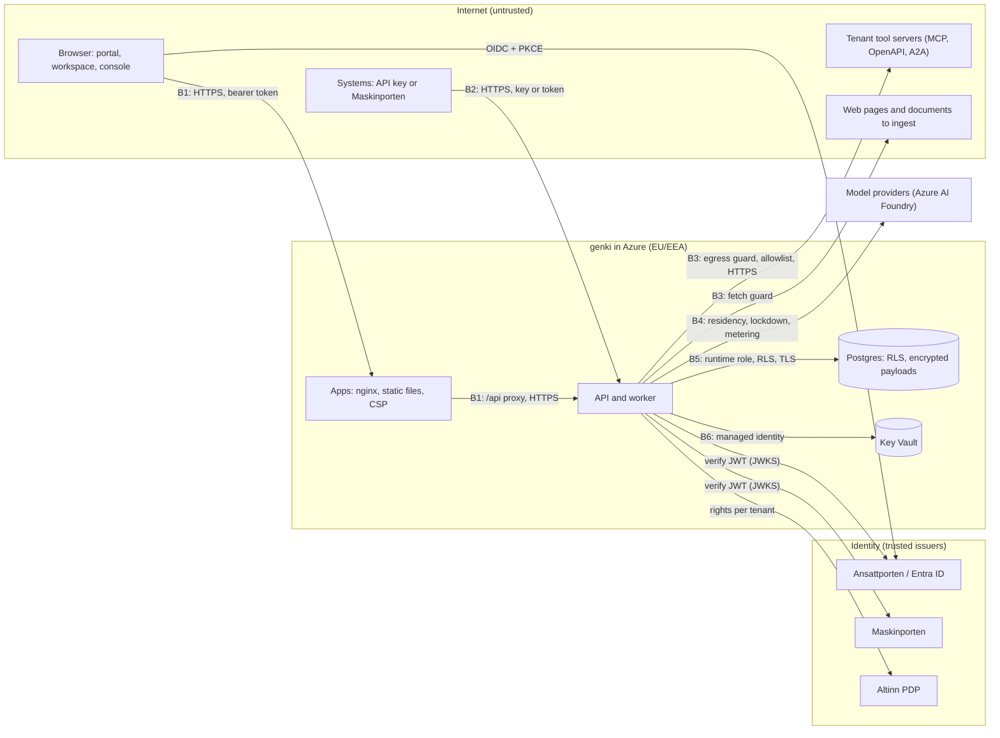

# Assurance case

This document argues why genki meets its security requirements. It covers the threat model, the trust boundaries, how secure design principles are applied, and how common weaknesses are countered. Claims link to the ADR that decides them and, where it helps, the code that enforces them.

The security requirements themselves, what users and operators can and cannot expect, are in [the security documentation](README.md). genki is under development and not in production; where something is decided but not built, this document says so.

## Claim

genki aims to keep each organisation's services, data and secrets apart from every other organisation's, to let only the people and systems an organisation has granted act for it, to send nothing to an address the organisation has not allowed, and to leave an audit trail of every change. The sections below show what enforces each part when genki runs outside development mode with the settings in [the security documentation](README.md#what-operators-must-configure). [Known gaps](#known-gaps) lists where it does not hold yet.

## Threat model

### Assets

| Asset                              | Why it matters                                                                                                              |
| ---------------------------------- | --------------------------------------------------------------------------------------------------------------------------- |
| Prompts, answers and conversations | Personal data, and possibly case documents under offentleglova ([ADR 0011](../adr/0011-retention-erasure-and-archiving.md)) |
| Uploaded documents and datasets    | An organisation's own content, sometimes not public                                                                         |
| Tenant secrets                     | Credentials for an organisation's own tools, models and databases ([ADR 0015](../adr/0015-tenant-tools-and-secrets.md))     |
| Platform secrets                   | Model keys, the Altinn and Maskinporten keys, and the content master key, all in Key Vault                                  |
| API keys and access tokens         | They act for an organisation or a person                                                                                    |
| Service definitions                | They decide which model, data and tools a service uses, and who may reach it                                                |
| The audit log                      | It shows who changed what and why ([ADR 0010](../adr/0010-admin-operations-and-audit.md))                                   |
| Model budget                       | Every model call costs money                                                                                                |

### Actors

| Actor                                          | What they might try                                                                                               |
| ---------------------------------------------- | ----------------------------------------------------------------------------------------------------------------- |
| Anonymous internet user                        | Reach the API without a credential, or spend model tokens                                                         |
| A person in one organisation                   | Read or change another organisation's data, or do more in their own than Altinn grants                            |
| A system with an API key or Maskinporten token | Reach services or tenants outside its key's grants                                                                |
| A malicious document, web page or tool result  | Inject instructions into a model, exfiltrate data through tool arguments, or make genki fetch an internal address |
| A malicious tool server an agency registered   | Read another tenant's data, reach genki's network, or capture a secret meant for another host                     |
| A Digdir operator                              | Reach a tenant's content without a reason                                                                         |
| A compromised dependency or CI step            | Ship malicious code in the image                                                                                  |

Out of scope, as in [SECURITY.md](../../SECURITY.md): development mode, which is insecure by design; denial of service by volume; and the services genki calls, such as Azure AI Foundry, Altinn and Ansattporten.

## Trust boundaries

| Boundary | Where trust changes                                                    | What enforces it                                                                                                                                                                                                                                                                                                                                                                                                                                                                                                                                                                                                                                                                                                                                                                                                                                                                                                                                                                                                                                                                                                                                                                                                                                                                                                                                                                     |
| -------- | ---------------------------------------------------------------------- | ------------------------------------------------------------------------------------------------------------------------------------------------------------------------------------------------------------------------------------------------------------------------------------------------------------------------------------------------------------------------------------------------------------------------------------------------------------------------------------------------------------------------------------------------------------------------------------------------------------------------------------------------------------------------------------------------------------------------------------------------------------------------------------------------------------------------------------------------------------------------------------------------------------------------------------------------------------------------------------------------------------------------------------------------------------------------------------------------------------------------------------------------------------------------------------------------------------------------------------------------------------------------------------------------------------------------------------------------------------------------------------ |
| **B1**   | A browser calls the apps and, through the apps' `/api/` proxy, the API | TLS at Azure Container Apps ingress with HTTP refused. Tokens verified on every request. CSP and other headers in [`docker/apps/headers.conf`](../../docker/apps/headers.conf) and [`apps/api/src/hardening.ts`](../../apps/api/src/hardening.ts). The proxy verifies the API's certificate.                                                                                                                                                                                                                                                                                                                                                                                                                                                                                                                                                                                                                                                                                                                                                                                                                                                                                                                                                                                                                                                                                         |
| **B2**   | A system calls the API with an API key or a Maskinporten token         | Key looked up by SHA-256 digest; grants are a ceiling, bound to one tenant ([ADR 0008](../adr/0008-principal-model-and-api-key-bridge.md), [`packages/identity/src/api-keys.ts`](../../packages/identity/src/api-keys.ts)). Maskinporten tokens verified against the issuer's keys ([`packages/identity/src/verify.ts`](../../packages/identity/src/verify.ts)).                                                                                                                                                                                                                                                                                                                                                                                                                                                                                                                                                                                                                                                                                                                                                                                                                                                                                                                                                                                                                     |
| **B3**   | genki calls a tenant's tool, a remote engine or a web page             | For tools and remote engines, the egress guard: HTTPS only, hosts on the connection's allowlist, no private or reserved addresses, no redirects to another origin, size and time limits ([ADR 0015](../adr/0015-tenant-tools-and-secrets.md), [`packages/providers-mcp-client/src/egress.ts`](../../packages/providers-mcp-client/src/egress.ts)). Web pages to ingest go through ingestion's own fetch guard, which refuses private and reserved addresses but allows plain HTTP ([`packages/ingest/src/website.ts`](../../packages/ingest/src/website.ts)). A tenant secret goes only to the hosts it is bound to ([`packages/providers-mcp-client/src/secrets.ts`](../../packages/providers-mcp-client/src/secrets.ts)).                                                                                                                                                                                                                                                                                                                                                                                                                                                                                                                                                                                                                                                          |
| **B4**   | genki sends a prompt to a model provider                               | Every chat, decision, embedding and rerank call goes through one gate in the kernel ([`packages/kernel/src/gate.ts`](../../packages/kernel/src/gate.ts), [ADR 0047](../adr/0047-one-governed-path-for-model-operations.md)), which checks admission in a locked environment (chat and rerank; embedding is open so search keeps working, [ADR 0033](../adr/0033-locked-test-environment.md)), whether the model is turned on, tenant sharing and every residency ceiling (router, request and service), refuses image, audio and file content, runs the service's payload guard, meters usage and writes a `kernel.gate.call` audit event without payload text. A decision request outside its closed shape, such as one with a URL or a provider object id, is refused before it leaves, and undocumented response fields are dropped and counted. The chat router also checks capability ([ADR 0021](../adr/0021-model-access-through-protocol-adapters.md)). PII guardrails mask in the gate, so the same masking reaches chat, embedding and rerank ([`packages/guardrails/src/pii.ts`](../../packages/guardrails/src/pii.ts)). The embedding router takes the same egress-guarded fetch for a plug-in endpoint as chat and rerank do, but operator-registered embedders are not built yet ([ADR 0023](../adr/0023-extension-model.md)), so no embedding endpoint uses it today. |
| **B5**   | The API reads and writes Postgres                                      | A runtime role with no `BYPASSRLS` and forced row-level security on tenant tables; payloads encrypted per tenant and scope ([ADR 0022](../adr/0022-tenant-isolation-in-postgres.md), [`packages/providers-postgres/src/tenancy.ts`](../../packages/providers-postgres/src/tenancy.ts)). TLS with certificate verification ([`packages/providers-postgres/src/entra.ts`](../../packages/providers-postgres/src/entra.ts)).                                                                                                                                                                                                                                                                                                                                                                                                                                                                                                                                                                                                                                                                                                                                                                                                                                                                                                                                                            |
| **B6**   | The apps read secrets                                                  | Key Vault with RBAC only and purge protection; the apps read with their managed identity, never a password ([`infra/README.md`](../../infra/README.md)).                                                                                                                                                                                                                                                                                                                                                                                                                                                                                                                                                                                                                                                                                                                                                                                                                                                                                                                                                                                                                                                                                                                                                                                                                             |

Inside the API there is one more boundary: between a tenant and the platform. Reads that span tenants go through `withPlatformAccess`, which names its purpose ([ADR 0022](../adr/0022-tenant-isolation-in-postgres.md)). An operator reaches a tenant's content through a support session with a reason and a time limit ([ADR 0010](../adr/0010-admin-operations-and-audit.md)). There are two exceptions today: in genki-test an operator also has every right in the platform tenant without a support session ([ADR 0033](../adr/0033-locked-test-environment.md)), and operators see some tenant metadata, such as definitions, tasks and audit, across tenants without one ([ADR 0035](../adr/0035-operator-login.md)).

## Secure design principles

These follow Saltzer and Schroeder's design principles, plus defense in depth.

| Principle                       | How genki applies it                                                                                                                                                                                                                                                                                                                                                                                                                                                                                                                                                                                                                                                                                  |
| ------------------------------- | ----------------------------------------------------------------------------------------------------------------------------------------------------------------------------------------------------------------------------------------------------------------------------------------------------------------------------------------------------------------------------------------------------------------------------------------------------------------------------------------------------------------------------------------------------------------------------------------------------------------------------------------------------------------------------------------------------- |
| **Economy of mechanism**        | One kernel runs every service, whatever the channel. Every admin change is a platform capability that runs as a task ([ADR 0002](../adr/0002-paradigm-neutral-kernel.md), [ADR 0010](../adr/0010-admin-operations-and-audit.md)). ADR 0047 proposes one gate for every model call, because three routers had drifted apart ([ADR 0047](../adr/0047-one-governed-path-for-model-operations.md)).                                                                                                                                                                                                                                                                                                       |
| **Fail-safe defaults**          | The API refuses to start without a database, an identity provider and the Altinn PDP outside development mode, and refuses development mode in production ([`apps/api/src/boot-guard.ts`](../../apps/api/src/boot-guard.ts)). An API key without grants gets nothing. When the Altinn PDP fails, the person gets no rights. A secret without hosts is sent nowhere. In a locked environment, an Entra login whose `groups` claim holds no listed group is refused.                                                                                                                                                                                                                                    |
| **Complete mediation**          | Every route authenticates, checks tenant access (404 otherwise), then the right for the action (403). `admin.perform` checks the right again, so a module calling a handler directly is refused too, and a test fails if an admin action has no mapped right ([ADR 0027](../adr/0027-platform-rights.md), [`apps/api/src/rights.ts`](../../apps/api/src/rights.ts)).                                                                                                                                                                                                                                                                                                                                  |
| **Open design**                 | The code, the ADRs and this document are public. Security does not rest on hiding how genki works.                                                                                                                                                                                                                                                                                                                                                                                                                                                                                                                                                                                                    |
| **Separation of privilege**     | A high-risk service needs two people: the publisher and someone else who confirms the risk class ([ADR 0020](../adr/0020-changes-made-by-ai.md)). For now publishing refuses high-risk services altogether ([`packages/definitions/src/validate.ts`](../../packages/definitions/src/validate.ts)). [ADR 0035](../adr/0035-operator-login.md), proposed, keeps operators out of tenants; in genki-test an operator still has every right in the platform tenant.                                                                                                                                                                                                                                       |
| **Least privilege**             | Five rights per tenant, granted in Altinn ([ADR 0027](../adr/0027-platform-rights.md)). API keys are a ceiling on the service's grants. The database runtime role owns nothing and gets DML only on listed tables ([ADR 0022](../adr/0022-tenant-isolation-in-postgres.md)). The worker's role adds only DML on the job tables ([ADR 0041](../adr/0041-durable-jobs-on-pg-boss.md)). [ADR 0042](../adr/0042-the-knowledge-database.md), proposed, gives the knowledge server its own roles; they are in the infra template but not deployed. Containers run as non-root users. Workflows default to `contents: read`, and jobs add only what they need, such as `id-token: write` to log in to Azure. |
| **Least common mechanism**      | Each tenant's content is encrypted with its own key per scope, and erasure deletes that key ([ADR 0011](../adr/0011-retention-erasure-and-archiving.md)). Tool calls carry only the tenant's connection credential, never the user's token or a platform credential ([ADR 0015](../adr/0015-tenant-tools-and-secrets.md)).                                                                                                                                                                                                                                                                                                                                                                            |
| **Psychological acceptability** | Sign-in uses the national services people already use (Ansattporten, Maskinporten), and rights come from Altinn, where organisations already manage them.                                                                                                                                                                                                                                                                                                                                                                                                                                                                                                                                             |
| **Defense in depth**            | Tenant isolation is enforced by the kernel and again by row-level security on the tables the API reads directly. XSS is countered by React's escaping and again by a strict CSP. The egress guard checks addresses at registration and again on every call, after DNS resolution.                                                                                                                                                                                                                                                                                                                                                                                                                     |

### Tenant isolation

Tables the API reads directly have forced row-level security on `app.tenant`, set per transaction. The API runs as a role without `BYPASSRLS`. The kernel's tables do not use RLS, because the kernel decides access across calling and owning tenants, but their content is encrypted per tenant and scope. Reads that must span tenants go through `withPlatformAccess(pool, purpose, …)`, which the cross-tenant `SECURITY DEFINER` functions require; the few API key functions that run before the tenant is known, such as the lookup by digest, set their own purpose instead ([ADR 0022](../adr/0022-tenant-isolation-in-postgres.md), [`packages/providers-postgres/src/tenancy.ts`](../../packages/providers-postgres/src/tenancy.ts), tests in [`packages/providers-postgres/src/isolation.test.ts`](../../packages/providers-postgres/src/isolation.test.ts)).

### Input validation

Input is checked against what is allowed, and anything else is refused:

- Service definitions, settings, flows and other configuration are parsed with zod schemas before they are stored or published ([`packages/definitions/src/schema.ts`](../../packages/definitions/src/schema.ts)). Publishing also refuses unknown models, models outside the service's residency, and strategy configuration its schema refuses.
- A service's input is checked against the input fields it declares, and the JSON Schema the API publishes for it accepts the same values ([ADR 0030](../adr/0030-frontends-from-schemas.md)).
- Admin actions check their input before they change anything, and a refusal names the field it is about.
- Tokens are verified against the issuer's published keys, with the algorithm, issuer and audience fixed ([`packages/identity/src/verify.ts`](../../packages/identity/src/verify.ts)).
- Job payloads may hold only keys, such as ids and organisation numbers; a value with whitespace or longer than 128 characters is refused ([docs/development.md](../development.md)).
- Uploads have a size limit, and Parquet files a platform ceiling on bytes.

## Common weaknesses and how they are countered

Mapped to the OWASP Top 10 (2021) and, for the model-specific ones, the OWASP Top 10 for LLM applications.

| Weakness                                     | How genki counters it                                                                                                                                                                                                                                                                                                                                                                                                                                                                                                                                                                                                                                                                                                                                                                      |
| -------------------------------------------- | ------------------------------------------------------------------------------------------------------------------------------------------------------------------------------------------------------------------------------------------------------------------------------------------------------------------------------------------------------------------------------------------------------------------------------------------------------------------------------------------------------------------------------------------------------------------------------------------------------------------------------------------------------------------------------------------------------------------------------------------------------------------------------------------ |
| **Broken access control** (A01)              | Rights per tenant from Altinn, checked on the route and again on the admin action ([ADR 0027](../adr/0027-platform-rights.md)). Row-level security in Postgres ([ADR 0022](../adr/0022-tenant-isolation-in-postgres.md)). Operators reach tenant content through support sessions, with the exceptions under [Trust boundaries](#trust-boundaries) ([ADR 0010](../adr/0010-admin-operations-and-audit.md)). A locked environment refuses model and ingestion routes to everyone but admitted Entra logins and the keys that come from configuration or from such a login ([ADR 0033](../adr/0033-locked-test-environment.md), [`apps/api/src/lockdown.ts`](../../apps/api/src/lockdown.ts)).                                                                                               |
| **Cryptographic failures** (A02)             | AES-256-GCM with a random 96-bit IV and authenticated data, keys wrapped by a 256-bit master key ([`packages/providers-postgres/src/crypto.ts`](../../packages/providers-postgres/src/crypto.ts)). API keys genki issues have 192 bits of randomness and are stored only as SHA-256 digests. TLS everywhere outside the developer's machine, with certificates verified. No MD5 or SHA-1 in any security mechanism.                                                                                                                                                                                                                                                                                                                                                                        |
| **Injection** (A03)                          | SQL values are bind parameters. Where SQL text is built, it uses names from code, or, in the database connector, a tenant's table and column names, checked against the source database and quoted as identifiers. The knowledge read functions quote literals with `format('%L')`. Nothing the API receives reaches a shell. The PII email pattern has a test that it runs in linear time on adversarial input ([`packages/guardrails/src/linear-time.test.ts`](../../packages/guardrails/src/linear-time.test.ts)); patterns in custom guardrail rules are not checked this way.                                                                                                                                                                                                         |
| **Cross-site scripting** (A03)               | React escapes what it renders, and links built from service or user data are limited to http(s). The apps' CSP allows scripts from their own origin only, with no inline script and no `eval`, and the pages refuse to be framed, except the System Atlas, which only its own origin may frame ([ADR 0034](../adr/0034-tokens-in-the-browser.md), [`docker/apps/headers.conf`](../../docker/apps/headers.conf)).                                                                                                                                                                                                                                                                                                                                                                           |
| **Insecure design** (A04)                    | Decisions that change a contract, boundary or security property need an ADR, which states what is built ([CONTRIBUTING.md](../../CONTRIBUTING.md#who-maintains-genki)).                                                                                                                                                                                                                                                                                                                                                                                                                                                                                                                                                                                                                    |
| **Security misconfiguration** (A05)          | The API refuses to start with unsafe or missing settings outside development mode, and names them. Infrastructure is code in [`infra/`](../../infra/README.md). Postgres uses Entra ID only, with private networking.                                                                                                                                                                                                                                                                                                                                                                                                                                                                                                                                                                      |
| **Vulnerable components** (A06)              | Renovate, with vulnerability updates at any time, and Dependabot alerts on the repository. GitHub Actions pinned by commit SHA. `npm ci` from the lockfile for every install, with `--ignore-scripts` in the image build.                                                                                                                                                                                                                                                                                                                                                                                                                                                                                                                                                                  |
| **Identification and authentication** (A07)  | People sign in through Ansattporten (OIDC), with PKCE in the browser; systems use Maskinporten tokens. Tokens verified against JWKS with a fixed algorithm. Entra logins in the test environment are accepted only for listed groups and clients ([ADR 0033](../adr/0033-locked-test-environment.md)). A bare subject in `OPERATOR_SUBJECTS` is refused outside development mode ([ADR 0035](../adr/0035-operator-login.md)).                                                                                                                                                                                                                                                                                                                                                              |
| **Integrity failures** (A08)                 | Every change to a definition is versioned and audited, with who and why. AI only proposes changes; a person publishes them ([ADR 0020](../adr/0020-changes-made-by-ai.md)). Tool descriptions are pinned at registration and need approval when they change ([ADR 0015](../adr/0015-tenant-tools-and-secrets.md)).                                                                                                                                                                                                                                                                                                                                                                                                                                                                         |
| **Logging and monitoring failures** (A09)    | The event log is the audit log, and every event has an actor ([ADR 0010](../adr/0010-admin-operations-and-audit.md)). Traces carry metadata only unless a connection opts in ([ADR 0011](../adr/0011-retention-erasure-and-archiving.md)). A service can add the `pii-out-of-log` guardrail to keep personal data out of its logs.                                                                                                                                                                                                                                                                                                                                                                                                                                                         |
| **Server-side request forgery** (A10)        | The egress guard resolves the host, refuses private, loopback and reserved addresses, refuses HTTP, and does not follow redirects to another origin. For a tenant's database connection, an operator can allow a named private network; reserved addresses stay refused ([`packages/providers-mcp-client/src/egress.ts`](../../packages/providers-mcp-client/src/egress.ts)). Ingestion has its own fetch guard that also refuses private and reserved addresses, checks every redirect hop again, and pins each request to the address it checked ([`packages/ingest/src/website.ts`](../../packages/ingest/src/website.ts)). In genki-test only admitted logins and keys may start ingestion, and scheduled ingestion does not run ([ADR 0033](../adr/0033-locked-test-environment.md)). |
| **Prompt injection** (LLM01)                 | In every strategy, retrieved documents, attached documents and tool results marked untrusted are given to the model inside `<untrusted_data>` framing that a document cannot close early ([`packages/port-model/src/untrusted.ts`](../../packages/port-model/src/untrusted.ts)). A model can only call the tools and datasets the service grants, so injected text cannot widen access. The builder assistant cannot touch secrets, register tools or widen access ([ADR 0020](../adr/0020-changes-made-by-ai.md)).                                                                                                                                                                                                                                                                        |
| **Sensitive information disclosure** (LLM02) | PII guardrails can mask Norwegian ids, phone numbers, email and account numbers before the model and restore them after ([`packages/guardrails/src/pii.ts`](../../packages/guardrails/src/pii.ts)). [ADR 0045](../adr/0045-data-stays-in-the-eu-eea.md), proposed, keeps what genki stores in the EU/EEA; the infra parameters place test in West Europe and prod in Norway East. Service residency limits which model endpoints a service may use, and a model classified `global` may process data outside the EU/EEA ([ADR 0021](../adr/0021-model-access-through-protocol-adapters.md)).                                                                                                                                                                                               |
| **Unbounded consumption** (LLM10)            | Usage budgets on each task, quotas, and rate limits per key and tenant. With a database, the rate limits are shared across API instances through Postgres, and fall back to one instance's count if it is unavailable ([`apps/api/src/rate-limit.ts`](../../apps/api/src/rate-limit.ts), [`packages/providers-postgres/src/rate-limits.ts`](../../packages/providers-postgres/src/rate-limits.ts)). Budgets in money are not built yet ([#24](https://github.com/digdir/genki/issues/24)).                                                                                                                                                                                                                                                                                                 |
| **Secrets in code or logs**                  | Platform secrets live in Key Vault and reach the apps as environment variables, referenced as `secret://env/<name>`. Tenant secrets are stored in Postgres, encrypted per tenant, referenced as `secret://tenant/<orgnr>/<name>`, write-only through the API, and bound to hosts. gitleaks scans every pull request and every push to `main` ([`.github/workflows/ci.yml`](../../.github/workflows/ci.yml)).                                                                                                                                                                                                                                                                                                                                                                               |

## Evidence that it holds

- **Tests that state the rules.** Every rule should get a test whose name states it; no check enforces this, the maintainer who merges does ([CONTRIBUTING.md](../../CONTRIBUTING.md)). The isolation, lockdown, rights, egress and crypto rules have tests. CI runs the tests a pull request affects, and every test on each push to `main`.
- **Static analysis.** CodeQL runs with GitHub's default setup and the extended query suite. OpenSSF Scorecard runs weekly and on every push to `main` ([`.github/workflows/scorecard.yml`](../../.github/workflows/scorecard.yml)).
- **Dependency boundaries.** `npm run boundaries` keeps vendor SDKs in `packages/providers-*` and stops the kernel from importing providers ([`.dependency-cruiser.cjs`](../../.dependency-cruiser.cjs)).
- **Source security audits.** The team has audited the source five times with an AI security-audit skill, most recently on 2026-11-03. The reports are kept outside the repository.

## Known gaps

These are proposed or decided but not built, and must be closed before production:

- Tokens are kept in `sessionStorage` in the browser; production needs a backend-for-frontend ([ADR 0034](../adr/0034-tokens-in-the-browser.md)).
- In genki-test, operators are recognised by membership of an Entra group that Digdir IT set up for genki-test (`LOCKDOWN_ENTRA_GROUPS`), logging in through the clients in `OPERATOR_CLIENT_IDS` ([ADR 0033](../adr/0033-locked-test-environment.md)). The same group rule outside the locked environment (`OPERATOR_ENTRA_GROUPS`) and audited break-glass access are not built yet ([ADR 0035](../adr/0035-operator-login.md)), so production needs them first.
- In the API, the kernel shares the runtime database role with the API's own queries, and deployed apps can still switch back to the owner role ([ADR 0022](../adr/0022-tenant-isolation-in-postgres.md)).
- The gate is a wrapper: the routers still keep their own copies of its checks, only the decision payload has a closed shape, and calls outside a run (ingestion, search without a task) have no audit event and meter nowhere ([ADR 0047](../adr/0047-one-governed-path-for-model-operations.md)).
- Budgets in money are not built ([#24](https://github.com/digdir/genki/issues/24)).

## Keeping this current

Update this document in the same pull request as a change to a trust boundary, a security property or one of the ADRs it cites.
